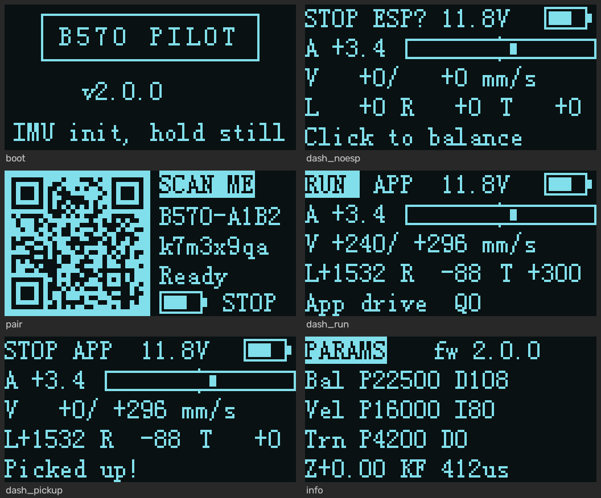
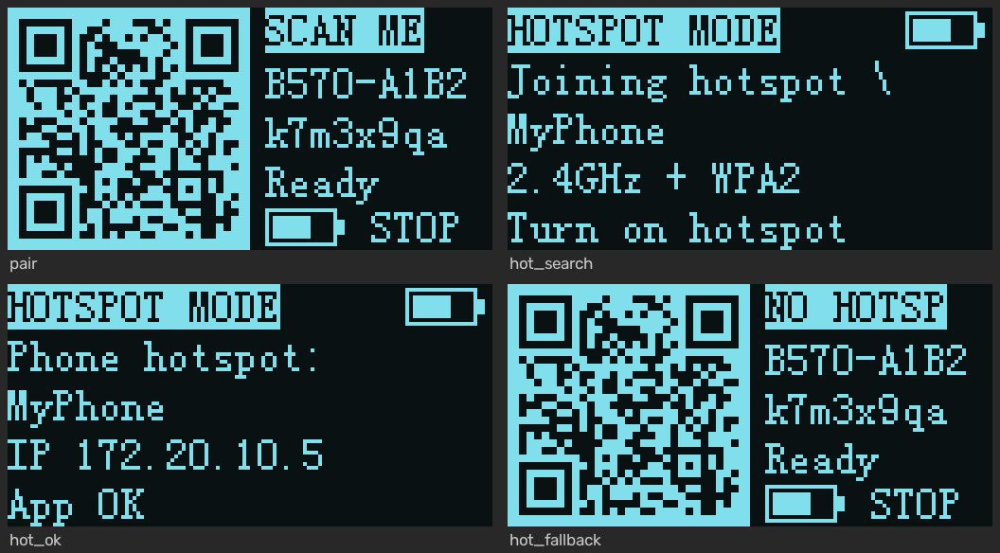

# B570 Pilot — WHEELTEC B570 自平衡車 Wi-Fi 遙控系統

把 WHEELTEC B570 平衡車升級成「手機掃碼即連、低延遲、可觀測、可整定、可編排動作」的遙控平衡車。

```
┌──────────────┐   Wi-Fi UDP（本地網路）   ┌─────────────┐   UART 230400   ┌────────────────────┐
│ Android App  │ ◀──────────────────────▶ │  ESP-01      │ ◀────────────▶ │ STM32F103（平衡車） │
│ B570 Pilot   │   192.168.4.1:8888        │  SoftAP 橋接  │  PA2/PA3 DMA    │ 直立/速度/轉向三環   │
└──────────────┘   行動數據不中斷            └─────────────┘                 └────────────────────┘
```

| 主體 | 位置 | 說明 |
|---|---|---|
| 平衡車韌體 | `Core/` `BSPcode/` `WHEELTEC/`（STM32CubeIDE 專案） | 保留原廠控制演算法，重寫按鍵、OLED、移動邏輯、通訊、安全機制 |
| ESP-01 橋接 | `ESP01/B570_Bridge/`（Arduino） | SoftAP + UDP ⇄ UART 透傳、Session 管理、帳密儲存、OTA |
| Android App | `AndroidApp/`（Kotlin + Jetpack Compose） | 掃碼配對、駕駛、監測、整定、編排、設定、示範模式 |
| 通訊協定 | `docs/PROTOCOL.md` | 三端共用的唯一規格（含測試向量） |
| 工具 | `tools/` | 協定參考實作 / PC 測試工具、韌體與 ESP-01 主機端單元測試、配對 QR 貼紙產生器 |

**文件（教學向）**
- [系統介紹](docs/系統介紹.md)：整個系統長什麼樣子、有哪些功能、怎麼開始用、常見問題。
- [通訊系統及軟硬體設計與選型](docs/通訊系統及軟硬體設計與選型.md)：通訊協定逐位元組解說、延遲怎麼壓低、硬體與軟體為什麼這樣選。
- [通訊協定規格](docs/PROTOCOL.md)、[App 架構](AndroidApp/ARCHITECTURE.md)

---

## 快速開始

1. **接線**：ESP-01 TX → STM32 **PA3**、ESP-01 RX ← STM32 **PA2**、3.3 V（≥300 mA，模組旁加 100~470 µF 電容）、GND 共地、EN/CH_PD 接 3.3 V。
2. **燒錄 STM32**：STM32CubeIDE 開啟本專案 → 專案按右鍵 **Refresh**（讓 IDE 看到新檔案）→ **Project ▸ Clean** → **Build** → ST-Link 燒錄。
3. **燒錄 ESP-01**：Arduino IDE（esp8266 core 3.1.2）開啟 `ESP01/B570_Bridge/B570_Bridge.ino`，設定見下方。
4. **安裝 App**：`AndroidApp/app/build/outputs/apk/release/app-release.apk` 傳到手機安裝（或用 Android Studio 開 `AndroidApp/` 直接執行）。
5. **開機配對**：車子開機 → OLED 自動顯示配對 QR → App 按「掃描 QR 配對」→ 系統彈窗按「連線」→ 按「啟動平衡」→ 推搖桿。

> App 用 Android 的 `WifiNetworkSpecifier` 建立「本地網路」：系統不會把車子的 Wi-Fi 當成上網用的預設網路，**手機行動數據照常可用**，其他 App 不受影響。

---

## 平衡車（STM32）

### 按鍵（PA5）
| 操作 | 功能 |
|---|---|
| 單擊 | 啟動平衡 / 停止（電壓過低或車身傾斜過大時不會啟動，OLED 會提示原因） |
| 雙擊 | 切換 OLED 頁面：儀表板 → 配對 QR → 參數資訊 |
| 長按 2 秒 | 馬達停止時：**機械零點校正並存入 Flash**（扶住車身在平衡點再長按）；運轉中：停止 |

### OLED 頁面（電腦上用真實韌體程式碼渲染的預覽）


- **儀表板**：運轉狀態、連線狀態（APP / WiFi / ---- / ESP?）、電壓與電量圖示、傾角條、目標/實際速度、左右 PWM、轉向量、事件提示。
- **配對**：Wi-Fi QR Code（`WIFI:T:WPA;S:…;P:…;;`，手機內建相機也認得）＋ SSID / 密碼文字（太長會捲動）。
- **資訊**：PID 參數、零點、姿態演算法、控制中斷耗時；`*` 表示有未存檔的修改。
- App 連上會自動切到儀表板，斷線會自動切回配對頁；雙擊可隨時手動切換。

### 移動邏輯（保留原廠三環，只換設定值來源）
- 原廠的直立環 PD、速度環 PI、轉向環 PD 與調好的係數**完全保留**。
- 原本離散的前/後/左/右旗標，改成 App 傳來的**連續速度（mm/s）與轉向（‰）**，經過**加速度 / 轉向變化率限制**後才送進控制環 → 細緻、平順、不暴衝。
- 動作編排在**車上**執行（最多 48 步：定值 / 正弦搖擺 / 正弦點頭 / 線性漸變），時間精準、不受 Wi-Fi 抖動影響；推動搖桿即可手動接管。

### 安全機制
| 情況 | 行為 |
|---|---|
| App 失聯超過 `FAILSAFE_MS`（預設 400 ms） | 目標速度平順歸零，**原地保持平衡**，中止編排，回報 `LINK_LOST` |
| App 緊急停止 / 停止 | 在 UART 中斷內**立即斷電**（不等下一個控制週期），中止編排 |
| 傾倒超過 `FALL_ANGLE`（預設 40°） | 停機；扶正並往前輕推輪子即自動恢復 |
| 被拿起（原廠偵測演算法） | 停機；放下並輕推輪子即自動恢復 |
| 電壓低於 `LOWBAT_V`（預設 10.0 V） | 停機並回報，電壓不足時無法啟動 |
| MPU6050 中斷停止（IMU 斷線/當機） | 主迴圈看門狗 200 ms 內切斷馬達，回報停機原因 8 |
| 存檔、零點校正 | 只允許在馬達停止時進行；姿態演算法切換在**存檔並重新開機**後才生效（避免運轉中角度跳動） |
| Wi-Fi 封包遺失導致指令重送 | 回覆帶請求 SEQ，零點校正 / 存檔 / 播放 / 啟動等指令**只執行一次**；緊急停止後遲到的啟動重送不會讓馬達重新啟動 |
| App 緊急停止 | 不排隊直接送出，並持續重送到遙測確認馬達已停；同時取消所有尚未完成的啟動 / 播放請求 |

### 參數（App 即時整定，存入 Flash 最後 1 KB）
直立環 Kp/Kd、速度環 Kp/Ki、轉向環 Kp/Kd、機械零點、最高車速、最大轉向、加速度、轉向變化率、失聯時間、遙測頻率、姿態演算法（DMP/卡爾曼/互補）、拿起偵測、低電壓門檻、傾倒角度。完整表格見 `docs/PROTOCOL.md §4.2`。

**整定建議順序**：①零點校正 → ②直立環 Kp（加到開始高頻抖再退 30 %）→ ③直立環 Kd（壓住抖動）→ ④速度環 Kp/Ki（Ki = Kp/200 附近）→ ⑤轉向環。App「整定」頁上方的即時曲線會同時畫出傾角與直立環 / 速度環輸出，調整時直接看效果。

### 功能開關（`WHEELTEC/Inc/app_config.h`）
| 巨集 | 預設 | 說明 |
|---|---|---|
| `USE_ULTRASONIC` | 0 | 啟用超音波測距（不需要可保持 0） |
| `APP_LEGACY_BT` | 0 | 保留原廠 MiniBalance 藍牙 APP（USART3） |
| `MOTION_INVERT_SPEED` / `MOTION_INVERT_TURN` | 0 | 實車方向相反時改 1，App 不用改 |

### 對 CubeMX 設定的調整（腳位全部沿用）
- USART2 鮑率 38400 → **230400**；RX DMA 改 **Circular**；新增 **TX DMA（DMA1 Channel 7）**；PA3 加內部上拉（ESP 未接時不會亂收雜訊）。
- `.ioc` 已同步修改，日後用 CubeMX 重新產生程式碼結果一致。
- 連結腳本 Flash 改為 63 KB，最後一頁（`0x0800FC00`）保留給參數。
- 新增 / 修改的檔案都已登記為 UTF-8（`.settings/org.eclipse.core.resources.prefs`），避免 GBK 預設編碼把中文註解變成亂碼（原本 `control.c` 的亂碼註解就是這樣來的，已改寫）。
- 原廠互補濾波模式使用未初始化變數的問題已修正。

---

## 兩種連線方式

| | 直連模式（預設） | 熱點模式 |
|---|---|---|
| 怎麼連 | 手機加入車子的 Wi-Fi `B570-XXXX`（掃 OLED QR） | 車子加入**手機的個人熱點** |
| 手機上網 | 行動數據照常（車子 Wi-Fi 是本地網路） | 行動數據照常（手機就是熱點） |
| 延遲 | 受手機 Wi-Fi 省電、手機同時連其他 Wi-Fi 影響 | 最低（手機當基地台不省電、ESP 關閉休眠） |
| 設定 | 不用設定 | 燒錄前在 `b570_preset_local.h` 填好，或 App「設定 → 連線方式」填熱點名稱/密碼一次 |

**最快：燒錄前內建手機熱點（免直連、免掃 QR、手機 Wi-Fi 一次都不用開）**
把 `ESP01/B570_Bridge/b570_preset_local.example.h` 複製成 `b570_preset_local.h`，填好手機熱點的名稱與密碼再燒錄 ESP-01（這個檔案已列入 `.gitignore`，你的熱點密碼不會被上傳）：車子第一次開機就直接是熱點模式。之後在 App 修改熱點或改回直連都會保留（每個 `PRESET_ID` 只套用一次；換一組內建熱點時把 `PRESET_ID` 加 1）。第一次使用：打開手機熱點 → 打開車子 → App 連線頁出現「熱點上的新車」→ 點一下，之後開 App 就自動連上。

**熱點模式設定步驟（沒有內建熱點時）**
1. 先用直連模式連上車子 → App「設定 → 連線方式」選「熱點模式」→ 輸入手機熱點的名稱與密碼 → 套用（車子會重開 Wi-Fi）。
2. 打開手機熱點：**頻段 2.4 GHz**（iPhone 開「最大化相容性」）、**安全性 WPA2**（不可只開 WPA3）——ESP-01 不支援 5 GHz 與 WPA3。
3. App 會在熱點網路自動找到車子（OLED 顯示 `HOTSPOT MODE`、熱點名稱與車子 IP）。
4. 找不到熱點時車子會自動改回直連（OLED 顯示 `NO HOTSP` 與 QR），之後沒人連線時自動再找熱點：前 3 分鐘每 6 秒一次（第一次等 12 秒；熱點不在時約 2 秒就放棄這次），之後每 30 秒；直連的手機離開後會再快速找 1 分鐘。

**帶到戶外（沒有 Wi-Fi、只用手機熱點）**：先開手機熱點、再開車子電源，車子開機 12 秒內就會加入熱點。車子先開也沒關係：3 分鐘內打開熱點，通常 15 秒內、最久約 20 秒就會連上（OLED 暫時顯示 QR，不用掃；超過 3 分鐘才開熱點，最多約 40 秒）。開車途中走出熱點範圍也一樣，3 分鐘內回到範圍，通常 15 秒內自動連回。手機的 Wi-Fi 開關平常可以一直關著、行動網路照常；只有第一次設定熱點模式（步驟 1），或設定錯誤（熱點是 5 GHz、只有 WPA3、密碼打錯）、在手機上改了熱點名稱/密碼時，才需要開 Wi-Fi 直連車子修改。



**控制延遲**：遙測回報車子最後收到的控制指令序號，App 據此量測「推搖桿 → 車上套用」的真實延遲並顯示在駕駛頁（「控制 xx ms」）；監測頁的「延遲診斷」會分辨是 Wi-Fi 還是車上處理造成，並給出建議。STM32 每 10 ms 主動收取 UART 指令，不再依賴 IDLE 中斷，車上處理延遲最多 10 ms。

---

## ESP-01 橋接（`ESP01/B570_Bridge/`）

| Arduino IDE 設定 | 值 |
|---|---|
| 開發板 | Generic ESP8266 Module |
| Flash Size | 1MB (FS:none OTA:~502KB) |
| CPU Frequency | 160 MHz（較低延遲） |
| Flash Mode | DOUT |
| Upload Speed | 115200 |
| Erase Flash | Only Sketch（保留 Wi-Fi 帳密） |

- 燒錄：3.3 V USB-TTL，GPIO0 接地再上電，**燒錄時先拔開 STM32 的 PA2/PA3**；燒完斷電重開一次。
- 第一次開機自動產生 `B570-XXXX`（晶片 ID）與 8 碼隨機密碼並存入 EEPROM；自動挑選最乾淨的 1/6/11 頻道。
- `b570_preset.h`：內建手機熱點（熱點模式的出廠預設）。帳密放在不上傳的 `b570_preset_local.h`（範本：`b570_preset_local.example.h`）；沒有這個檔案時 `PRESET_ID = 0`，不使用內建熱點。套用紀錄存在 EEPROM 第 248 byte 起，不影響原本的設定紀錄。
- 之後可用 OTA 更新：電腦連上車子 Wi-Fi，IDE 選網路連接埠 `b570-xxxx`，密碼 = Wi-Fi 密碼。
- 同一時間只有一支手機能控制（其他手機會看到「另一支手機正在控制這台車」）。

---

## Android App（`AndroidApp/`）

**橫向遙控器介面**（左右兩種橫向都可以，沉浸式全螢幕）

| 分頁 | 功能 |
|---|---|
| 連線 | 開 App **自動連上最近的車**、記住的車顯示「在附近」與訊號、附近未配對的 `B570-` 車、掃描 OLED QR 配對、手動輸入、示範模式、第一次配對的系統視窗提示 |
| 駕駛 | **360° 類比搖桿**（預設；往任何方向推：前後＝速度、左右＝轉向、斜推＝走弧線），另一手 A/B/X/Y 動作鍵＋升降檔，搖桿可換左右手；左上「啟動平衡」、右上「緊急停止」；也可切換雙搖桿或體感（手機當方向盤）模式 |
| 監測 | 姿態 / 輪速 / PWM 分量 / 角速度 / 電池即時曲線（5~60 秒）、延遲 / 掉包 / 訊號 / 控制迴圈耗時、事件紀錄、匯出 CSV |
| 整定 | 左側即時曲線＋操作，右側分組參數（即時或批次套用）、儲存到車上、恢復預設、零點校正、參數組合（原廠 / 穩定 / 運動 / 自訂） |
| 編排 | 12 種內建動作、時間軸編輯器、路徑預覽、循環播放、進度顯示 |
| 設定 | 車子 Wi-Fi、操控手感、主題色、遙測頻率、**開啟 App 自動連線 / 斷線自動重連**、示範模式、使用說明 |

- **快速連線**：第一次掃 QR 配對後，之後打開 App 就自動連線；車子斷線（關機、走遠）時留在駕駛畫面自動重連（約 45 秒）；長按桌面 App 圖示可直接「連線 <車名>」或「掃描配對」。
- 低延遲：專用執行緒固定 50 Hz 送控制、UDP 綁定車子的網路、持有 `WIFI_MODE_FULL_LOW_LATENCY`（關閉手機 Wi-Fi 省電造成的延遲抖動）。
- 建置：Android Studio 開 `AndroidApp/`，或 `./gradlew assembleRelease`（JDK 17、Android SDK 35）。Release 版已開啟 R8 縮減，目前以 debug 金鑰簽章，正式上架前請換成自己的金鑰。

---

## 更新與重燒（目前版本：STM32 fw 2.1.0、ESP-01 1.1.1）

| 部分 | 要做什麼 | 設定會保留嗎 |
|---|---|---|
| STM32 | CubeIDE：專案右鍵 Refresh → Project ▸ Clean → Build → ST-Link 燒錄 | 整定參數保留；舊版預設的加減速（1200 / 6000）自動升級成新預設（2000 / 12000） |
| ESP-01 | 方法一（免拆線）OTA：電腦連上車子 Wi-Fi，Arduino IDE 連接埠選 `b570-xxxx`，密碼 = Wi-Fi 密碼，上傳。方法二：USB-TTL 序列燒錄（先拔開 PA2/PA3、GPIO0 接地上電） | 車子 Wi-Fi 名稱 / 密碼保留 |
| App | 安裝新的 `app-release.apk`（直接覆蓋安裝） | 記住的車、設定、編排都保留 |

三個都要更新（遙測格式與熱點模式三端一起改的）。更新後駕駛頁上方的「控制 xx ms」應在 40 ms 內（綠色）；若仍偏高，看「監測 › 延遲診斷」的建議。

ESP-01 1.1.1 也加入了內建手機熱點（`b570_preset_local.h`）：燒錄後第一次開機就直接連上該熱點（只套用一次，之後以 App 的設定為準）。

ESP-01 1.1.1（相對 1.1.0）：找不到熱點改回直連後，前 3 分鐘每 6 秒就再找一次熱點（1.1.0 一律 30 秒；第一次等 12 秒，不打擾剛顯示 QR 時的直連配對），熱點不在時約 2 秒就放棄這次（不再每次等滿 8 秒，直連較順），直連的手機離開後也會再快速找 1 分鐘；先開車子、後開熱點也能很快連上。協定與設定完全相同；已是 1.1.0 的車只要重燒 ESP-01（版本見 App「設定 › 關於 › Wi-Fi 模組韌體」）。

---

## 驗證紀錄

| 項目 | 方法 | 結果 |
|---|---|---|
| STM32 編譯 | arm-none-eabi-gcc 11.3（與 CubeIDE 相同 `-Os`） | 0 錯誤 0 警告；Flash 60.5 KB / 63 KB、RAM 6.2 KB / 20 KB |
| 韌體邏輯 | `bash tools/fw_host_test/run.sh`：在 PC 上執行真實的 proto / rc_link / motion / params，模擬 UART DMA 與 Flash | 全部通過（參數夾限 / 存檔 / 毀損復原、加速度限制、遙測頻率、失聯保護、編排分批 / 播放 / 接管、正弦 / 漸變、緊急停止、雜訊復原、SEQ 回覆與重送去重…） |
| 韌體對抗式審查 | 4 個面向獨立審查 + 每項 2 位反駁者驗證 | 15 項確認問題全部修正並加測試 |
| ESP-01 | arduino-cli 編譯 + 主機端測試 3966 項（含與 Python 參考實作的差分比對、熱點狀態機的參考模型比對：快速重試期、第一次 12 秒、提早放棄、密碼錯誤、手機離開後重新開始）+ 內建熱點 44 項 + UBSan 版本 | 0 警告、全部通過；bin 約 332 KB / OTA 上限約 502 KB（IROM 297 KB）、IRAM 92%、RAM 31.3 KB / 80 KB |
| Android | 340 項 JVM 單元測試（協定向量、解析器、QR、參數、示範車、緊急停止、熱點搜尋、控制延遲、防堆積…）+ Robolectric 橫向截圖 | 全部通過；release APK 14.3 MB（R8） |
| Android 對抗式審查 | 4 個面向 + 每項 2 位反駁者驗證 | 22 項確認問題全部修正（含 2 項緊急停止的高嚴重度問題） |
| OLED QR | 與 ISO 18004 參考實作逐模組比對 13 組；模擬相機模糊 / 旋轉 / 雜訊解碼 | 13/13 完全一致；可穩定解碼 |

**需要實車確認**：馬達方向（相反就改 `MOTION_INVERT_*`）、ESP-01 供電穩定度、各廠牌手機的連線彈窗與低延遲模式、OLED QR 實際掃描距離。

---

## 設計決策與給你的建議

1. **連線方式**：ESP-01 沒有藍牙，所以選 **SoftAP + UDP**（點對點、無路由器、免設定）。手機端用 `WifiNetworkSpecifier` 而不是叫使用者去系統設定切 Wi-Fi —— 這是「不打斷行動網路」的關鍵。UDP 不會因為一個掉包卡住後面的控制指令，比 TCP/WebSocket 更適合遙控。
2. **QR 放在 OLED 上動態產生**：改密碼後 QR 自動更新，不用重印貼紙；需要貼紙時用 `tools/make_pair_qr.py`。
3. **動作編排在車上執行**：時間由 STM32 的 10 ms 控制週期保證，不受手機排程與 Wi-Fi 抖動影響。
4. **指令只執行一次**：回覆帶請求 SEQ、重送沿用同一 SEQ，掉包重送不會讓車子重複校正或重播。
5. **硬體建議**：ESP-01 發射瞬間電流約 250 mA，若 OLED 在 App 連線時閃爍或 ESP 反覆重開，請改用獨立 3.3 V 穩壓（AMS1117 + 470 µF）；建議用 ESP-01S（板上已有上拉）。
6. **之後可以升級的方向**：換 ESP32-C3 可加藍牙配對與更大頻寬；把 STM32 的 BOOT0 / NRST 接到 ESP，就能從 App 無線更新 STM32 韌體。

---

## 工具
```bash
python tools/b570_proto.py vectors                  # 協定測試向量
python tools/b570_proto.py monitor                  # 電腦連上車子 Wi-Fi 後即時看遙測
python tools/b570_proto.py set BAL_KP 23000         # 從電腦設定參數
python tools/make_pair_qr.py B570-A1B2 k7m3x9qa     # 產生可列印的配對 QR 貼紙（需 pip install segno）
bash tools/fw_host_test/run.sh                      # 韌體邏輯單元測試（需 gcc）
bash tools/esp_host_test/run_tests.sh               # ESP-01 主機端單元測試（需 g++ C++17、Python）
```
