# B570 Pilot 系統介紹

> 把 WHEELTEC B570 兩輪自平衡車，改造成「手機掃一下就能開、開車時手機照常上網」的遙控平衡車。
>
> 這份文件寫給第一次看到這個專案的你：會一點 C、用過 Android 就夠了，還沒碰過嵌入式網路或控制理論也沒關係。大部分名詞第一次出現時會簡短說明，完整定義都在最後的[名詞小辭典](#13-名詞小辭典)。

| 想知道… | 去看 |
|---|---|
| 怎麼燒錄、怎麼更新、驗證結果 | [README](../README.md) |
| 為什麼這樣設計：通訊架構、軟硬體怎麼挑 | [通訊系統及軟硬體設計與選型](通訊系統及軟硬體設計與選型.md) |
| 每個位元組的意義（通訊協定規格，含測試向量） | [PROTOCOL.md](PROTOCOL.md) |
| Android App 的程式架構與 API | [ARCHITECTURE.md](../AndroidApp/ARCHITECTURE.md) |

## 目錄

1. [這個專案在做什麼](#1-這個專案在做什麼)
2. [系統全貌](#2-系統全貌)
3. [功能總覽](#3-功能總覽)
4. [硬體組成與接線](#4-硬體組成與接線)
5. [兩種連線方式](#5-兩種連線方式)
6. [App 畫面導覽](#6-app-畫面導覽)
7. [車上的 OLED 與按鍵](#7-車上的-oled-與按鍵)
8. [安全機制](#8-安全機制)
9. [快速開始](#9-快速開始)
10. [專案資料夾結構](#10-專案資料夾結構)
11. [測試與驗證](#11-測試與驗證)
12. [常見問題 FAQ](#12-常見問題-faq)
13. [名詞小辭典](#13-名詞小辭典)

---

## 1. 這個專案在做什麼

### 1.1 從原廠平衡車到手機遙控平衡車

WHEELTEC B570 是一台兩輪自平衡車套件，主要零件是：一塊 **STM32F103C8T6** 主控板（車子的大腦）、一顆 **MPU6050** 姿態感測器、兩顆帶編碼器的直流減速馬達、一片 128×64 的 OLED 小螢幕、一顆按鍵和一組鋰電池。

原廠程式已經能讓車子自己站穩，但遙控方式是藍牙 App 的「前、後、左、右」按鈕：只有「開」和「關」，沒辦法「推一點點、慢慢走」。

這個專案（取名 **B570 Pilot**）把它改造成三個部分：

| 部分 | 位置 | 一句話說明 |
|---|---|---|
| 平衡車韌體 | `Core/`、`BSPcode/`、`WHEELTEC/`（STM32CubeIDE 專案） | 保留原廠的平衡控制，重寫遙控、按鍵、OLED、通訊與安全機制 |
| Wi-Fi 橋接 | [`ESP01/B570_Bridge/`](../ESP01/B570_Bridge/)（Arduino） | 車上加一顆 ESP-01 Wi-Fi 模組，把手機送來的 Wi-Fi 封包轉成序列埠訊號 |
| 手機 App | [`AndroidApp/`](../AndroidApp/)（Kotlin + Jetpack Compose） | 橫向遙控器介面：連線、駕駛、監測、整定、編排、設定 |

改造之後你可以：

- 打開車子 → 用 App 掃 OLED 上的 QR Code → 連上。之後打開 App 就會**自動連線**。
- 用 **360° 類比搖桿**開車：推多少就走多快，斜著推就走弧線。
- 一邊開一邊看**即時曲線**、**調 PID 參數**並存進車上的 Flash、**編一段舞**讓車子自己跳。
- **遙控時手機照常上網**（行動數據不中斷）；用分割畫面甚至可以邊看 YouTube 邊開車。
- 帶到戶外：打開手機的個人熱點、打開車子，App 就自動連上，完全不需要任何 Wi-Fi 基地台。

### 1.2 最重要的設計觀念：平衡在車上，手機只出主意

平衡車就像用手掌頂一根掃把：掃把一歪，手就要馬上移過去。B570 的主控板**每 10 ms**（每秒 100 次）就要根據傾角修正一次馬達。

可是 Wi-Fi 沒辦法保證這麼準時：手機的 Wi-Fi 省電機制可能讓封包晚到 100–300 ms（[PROTOCOL.md §1](PROTOCOL.md)）。如果「站穩」這件事要靠手機，車子早就倒了。所以 B570 Pilot 的分工是：

| 誰 | 負責什麼 | 多快 |
|---|---|---|
| 車上的 STM32 | **站穩**：讀姿態、算三個控制環、推馬達、安全檢查 | 每 10 ms 一次，永遠不等手機 |
| 手機 App | **出主意**：「我想用多快的速度、往哪邊轉」（目標值） | 每秒 10–50 次 |
| 斷線時 | 車上自己把目標慢慢歸零，**原地站好** | 預設 400 ms 沒收到指令就啟動 |

> **比喻**：騎腳踏車時保持平衡是小腦的反射，耳機裡的導航只說「前面右轉」。導航斷訊你不會摔車，只是停下來等——這就是 B570 Pilot 的「失聯保護」。

---

## 2. 系統全貌

### 2.1 方塊圖

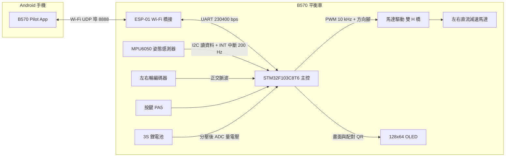

> **圖上的縮寫**：**UDP** 是一種「不建立連線、直接把封包丟出去」的網路傳輸方式；**UART** 是用 TX（送）、RX（收）兩根線傳資料的序列埠，bps 是每秒幾個 bit；**I2C** 是兩條線（時脈 SCL + 資料 SDA）的感測器匯流排；**INT 中斷** 是感測器資料準備好時拉一下的訊號腳，用來叫醒 STM32；**PWM** 是用很快的開關比例控制馬達出力；**ADC** 是把電壓變成數字的類比轉數位器。詳細解釋都在[名詞小辭典](#13-名詞小辭典)。

### 2.2 每一塊負責什麼

| 元件 | 比喻 | 負責什麼 | 主要程式 |
|---|---|---|---|
| 手機 App | 遙控器 + 儀表板 | 把搖桿換算成「速度 mm/s、轉向 ‰」送出；顯示遙測曲線；送啟動、整定、編排等指令 | [`AndroidApp/app/src/main/java/com/b570/pilot/`](../AndroidApp/app/src/main/java/com/b570/pilot/) |
| ESP-01 | 翻譯兼郵差 | Wi-Fi ⇄ UART 原封不動轉送；記住「現在是哪支手機在控制」；保存車子的 Wi-Fi 名稱密碼；熱點模式的連線策略 | [`ESP01/B570_Bridge/B570_Bridge.ino`](../ESP01/B570_Bridge/B570_Bridge.ino) |
| STM32 | 小腦 | 每 5 ms 讀一次姿態與編碼器，每 10 ms 跑一次控制環與安全檢查；遙測依 `TELEM_HZ` 送出（預設 50 Hz，每 20 ms 一筆） | [`WHEELTEC/control.c`](../WHEELTEC/control.c)、[`WHEELTEC/motion.c`](../WHEELTEC/motion.c)、[`WHEELTEC/rc_link.c`](../WHEELTEC/rc_link.c) |
| MPU6050 | 內耳 | 加速度計感覺「哪邊是下面」、陀螺儀感覺「轉得多快」；每 5 ms 用 INT 腳叫醒 STM32 | [`WHEELTEC/MPU6050.c`](../WHEELTEC/MPU6050.c) |
| 編碼器 | 計步器 | 數輪子轉了幾格，換算成輪速 | [`BSPcode/encoder.c`](../BSPcode/encoder.c) |
| 馬達驅動 + 馬達 | 肌肉 | PWM 決定出力大小，方向腳決定正轉或反轉 | `control.c` 的 `Set_Pwm()` |
| OLED | 車上的名牌兼儀表 | 顯示狀態、配對 QR、參數 | [`WHEELTEC/show.c`](../WHEELTEC/show.c)、[`WHEELTEC/qr_mini.c`](../WHEELTEC/qr_mini.c) |
| 按鍵 | 實體開關 | 單擊、雙擊、長按三種操作 | [`BSPcode/key.c`](../BSPcode/key.c) |
| 電池 | 心臟 | 3S 鋰電池（`app_config.h` 以 12.60 V 為滿電），電壓經分壓由 ADC 量測 | [`BSPcode/bsp_adc.c`](../BSPcode/bsp_adc.c) |

**一個關鍵設計**：手機和 STM32 之間的訊息格式（叫做「幀」，frame，台灣的網路教材也常稱「訊框」；本專案沿用 PROTOCOL.md 的「幀」）在 Wi-Fi 上和 UART 上**完全一樣**。ESP-01 不需要看懂內容，收到什麼就轉什麼。這讓三端只要遵守同一份規格 [PROTOCOL.md](PROTOCOL.md)，也讓每一端都能單獨在電腦上測試。

### 2.3 一個搖桿指令的旅程（用真實數字走一遍）

假設你選「中速」檔，把 360° 搖桿推到**正前方、推滿**：


1. **App 換算**：中速檔的速度比例是 0.60（`Gear.NORMAL`），最高車速參數 `MAX_SPEED` 預設 500 mm/s，所以目標速度 = 1.0 × 0.60 × 500 = **300 mm/s**，轉向 = 0 ‰。
2. **組成 CTRL 幀**：一個控制指令只有 12 bytes：`A5 5A 05 01 07 2C 01 06 FF 00 D4 4D`。這裡借用 [PROTOCOL.md](PROTOCOL.md) 的測試向量，所以轉向是 −250 而不是本例的 0（速度一樣是 300）。逐一拆開來看：

   | 位元組 | 欄位 | 這個例子 | 意思 |
   |---|---|---|---|
   | `A5 5A` | 開頭碼 | 固定 | 「一個幀從這裡開始」，接收端靠它在資料流裡找到開頭 |
   | `05` | 長度 | 5 | 後面的內容（payload）有 5 bytes |
   | `01` | 種類 | CTRL | 這是一個控制指令（種類一覽見 [2.4](#24-幾種主要訊息)） |
   | `07` | 序號 SEQ | 7 | 第幾個幀；回覆和重送都靠它對應 |
   | `2C 01` | 速度 | 300 mm/s | 0x012C = 300，低位元組放前面（little-endian） |
   | `06 FF` | 轉向 | −250 ‰ | 0xFF06 = 65286，超過 32767 就減 65536 → −250。這種表示負數的方法叫**二補數** |
   | `00` | 旗標 | 0 | 保留欄位，目前固定 0 |
   | `D4 4D` | CRC | 0x4DD4 | 檢查碼：用「長度」到「旗標」這幾個 byte 算出來，低位元組在前；傳輸中錯一個 bit 就對不上 |

   想看每個位元組怎麼算（包括 CRC），請看[逐位元組解說](通訊系統及軟硬體設計與選型.md#15-封包格式逐位元組教學)。
3. **送出**：App 的 `ControlPacer` 每 20 ms 看一次搖桿，送出「當下最新的值」（推搖桿時 50 Hz、靜止時 10 Hz 當心跳），舊值不排隊（[`link/ControlPacer.kt`](../AndroidApp/app/src/main/java/com/b570/pilot/link/ControlPacer.kt)）。
4. **ESP-01 轉送**：收到 UDP 封包就整幀寫進 UART，不批次、不等計時器。
5. **UART 傳輸**：230400 bps、8N1 格式下每個 byte 佔 10 bit，12 bytes = 120 bit ÷ 230400 ≈ **0.52 ms**。
6. **STM32 收幀**：UART 用 DMA 在背景收，控制中斷每 10 ms 開頭呼叫 `RC_Link_PollRx()` 把已到的資料處理完，所以**最多等 10 ms**。
7. **平順加速**：`Motion_Tick()` 用「斜率限制」把目標慢慢推上去。加速度上限 `ACCEL` 預設 2000 mm/s²，每 10 ms 最多加 20 mm/s，0 → 300 mm/s 需要 15 個週期 = **150 ms**。就像再猛的油門，車速也是一路爬升，不會瞬間跳上去。
8. **三個控制環**：直立環（看傾角和倒下的速度，負責站穩）、速度環（看輪速和目標速度差多少）、轉向環（負責左右輪差速）**各自算出一個 PWM 分量**，三者直接相加：左輪 = 直立 + 速度 + 轉向、右輪 = 直立 + 速度 − 轉向（`control.c` 的 `HAL_GPIO_EXTI_Callback()`）。這種「各算各的、最後相加」的寫法叫**並聯結構**。速度環的輸出效果上等於把直立環的平衡點往前或往後挪一點，車子就會前傾、加速。直覺與公式請看[控制演算法](通訊系統及軟硬體設計與選型.md#32-控制演算法)。
9. **回報**：車子每秒送 50 筆遙測（每筆 49 bytes，在 UART 上約 2.1 ms），裡面附上「最後收到的 CTRL 序號」。App 用它算出「手機送出 → 車上真正套用」的時間，顯示在駕駛頁的「控制 xx ms」。這個數字還包含遙測回傳的時間（約 3–8 ms），所以它是控制延遲的**上限**。

[PROTOCOL.md §5](PROTOCOL.md) 的延遲預算：**手機送出 → 車上套用 < 20 ms**；App 顯示的「控制 xx ms」因為多算了遙測回傳，正常會比這個再多幾 ms。之後車子怎麼加速，是斜率限制和平衡車本身的動態，不是通訊延遲。

### 2.4 幾種主要訊息

上面的 CTRL 只是其中一種。下表是你在本文的圖裡會遇到的訊息種類（完整清單與每個欄位見 [PROTOCOL.md §3](PROTOCOL.md)）：

| 名稱 | 誰送給誰 | 用途 | 頻率 |
|---|---|---|---|
| HELLO / HELLO_ACK | App ⇄ ESP-01 | 「我要控制這台車」/「好，現在由你控制」（取得控制權，也就是 session） | 連線時每 100 ms 送一次 HELLO，直到收到回覆 |
| CTRL | App → STM32 | 目標速度（mm/s）與轉向（‰），同時也是「我還在」的心跳 | 推搖桿時 50 Hz、靜止時 10 Hz |
| MOTOR | App → STM32 | 啟動 / 停止 / 緊急停止 | 按下按鈕時 |
| ACK | STM32 → App | 「收到了」加上結果（OK、BUSY、NOT_READY…） | 回覆每個請求 |
| TELEM | STM32 → App | 遙測：傾角、輪速、PWM、電壓、狀態… | 依 `TELEM_HZ`，預設 50 Hz |
| PING / PONG | App ⇄ STM32 | 量「手機 → 主控板 → 手機」的來回時間 | 每 500 ms |
| ESP_PING / ESP_PONG | App ⇄ ESP-01 | 只到 Wi-Fi 模組就回來，量純 Wi-Fi 的來回時間 | 每 2 秒 |
| LINK | ESP-01 → STM32 | 連線狀態：沒有手機 / 有手機連上 Wi-Fi / 有 App 在控制；同時是 ESP-01 的存活心跳 | 狀態改變時立刻送，平時每 500 ms |
| CRED | ESP-01 → STM32 | 車子的 Wi-Fi 名稱與密碼，讓 OLED 畫出配對 QR | 開機 1 秒後一次；STM32 要求時再送 |
| NET | ESP-01 → STM32 | 熱點狀態：直連 / 搜尋熱點中 / 已連上熱點（附 IP）/ 找不到熱點、已改回直連 | 狀態改變時立刻送，平時每 2 秒 |
| DISCOVER / DISCOVER_ACK | App ⇄ ESP-01 | 在熱點網路上找車：「有沒有 B570？」/「我在這，車名 B570-A1B2」 | 找車時每 300 ms |

PROTOCOL.md 用數字表示狀態，例如 LINK 2 = 有 App 在控制、NET 2 = 已連上熱點、NET 3 = 找不到熱點已改回直連。本文的圖直接寫成文字。

---

## 3. 功能總覽

| 類別 | 功能 | 說明 | 在哪裡 |
|---|---|---|---|
| 駕駛 | 360° 類比搖桿（預設） | 往任何方向推：前後 = 速度、左右 = 轉向、斜推 = 走弧線；前後左右 ±5° 內自動對正；搖桿可換到右手並記住 | App 駕駛頁 |
| 駕駛 | 雙搖桿 | 左手直立油門、右手橫向方向盤，兩根拇指可同時操作 | App 駕駛頁 |
| 駕駛 | 體感 | 手機當方向盤：按住左右任一個「按住駕駛」鈕才會送指令，按下瞬間的姿勢就是零點 | App 駕駛頁 |
| 駕駛 | 三段檔位 | 慢速 / 中速 / 高速 = 速度 30 / 60 / 100 %、轉向 50 / 75 / 100 % | 駕駛頁檔位翹板 |
| 駕駛 | 快捷動作 | A 原地轉圈、B 搖擺、X 點頭、Y 更多（進編排頁） | 駕駛頁 A/B/X/Y 鍵 |
| 安全 | 緊急停止 | 一碰就停：車上在 UART 中斷裡立刻切斷馬達；App 持續補送直到遙測確認已停 | 駕駛頁右上、導覽軌最下面 |
| 安全 | 失聯保護 | 400 ms 沒收到 App 指令 → 目標平順歸零、原地保持平衡 | 車上自動 |
| 監測 | 即時曲線 | 姿態、輪速、PWM 分量、角速度、電池五張圖，時間範圍 5 / 10 / 30 / 60 秒 | App 監測頁 |
| 監測 | 延遲診斷 | 控制延遲、P95、端到端來回、Wi-Fi 來回、上行遺失，並用一句話告訴你慢在哪 | 監測頁左欄 |
| 監測 | 事件紀錄、匯出 CSV | 最近 50 則事件；遙測歷史（60 秒）可匯出成 CSV 用試算表分析 | 監測頁 |
| 整定 | 即時調參數 | 17 個參數分 6 組（直立環、速度環、轉向環、運動限制、安全保護、系統），可即時套用或批次套用 | App 整定頁 |
| 整定 | 存進車上 | 寫入 STM32 Flash 最後 1 KB，關機也不會不見 | 整定頁「儲存到車上」 |
| 整定 | 零點校正、恢復預設、設定檔 | 設定檔有原廠 / 穩定 / 運動 / 自訂 | 整定頁 |
| 編排 | 動作庫 | 12 種內建動作（原地旋轉 360°、左右搖擺、前後點頭、畫圓、8 字繞行、正方形…），點一下就播放 | App 編排頁 |
| 編排 | 時間軸編輯器 | 最多 48 步、4 種步驟模式、路徑預覽、循環播放；**在車上執行**，時間精準不受 Wi-Fi 影響 | 編排頁 |
| 連線 | 掃 QR 配對 | 掃 OLED 上的 Wi-Fi QR Code（`WIFI:T:WPA;S:…;P:…;;` 標準格式） | App 連線頁 |
| 連線 | 兩種連線方式 | 直連（手機連車子的 Wi-Fi）／熱點模式（車子連手機的個人熱點），兩種手機都照常上網 | 見[第 5 節](#5-兩種連線方式) |
| 連線 | 快速連線 | 開 App 自動連最近的車；斷線時留在駕駛畫面自動重連（6 次、約 45 秒）；長按桌面圖示可直接「連線 <車名>」或「掃描配對」 | App |
| 連線 | 附近的車 | 顯示記住的車在不在附近、訊號強弱；還沒配對的 `B570-` 車也會列出來 | 連線頁 |
| 其他 | 展示模式 | 沒有車子也能體驗全部功能，資料由模擬車產生 | 連線頁、設定 › 展示模式 |
| 其他 | 車子 Wi-Fi 管理 | 查看 / 修改車子的 Wi-Fi 名稱、密碼、頻道，或恢復原廠 | 設定 › 車輛 Wi-Fi |
| 其他 | 外觀 | 四種霓虹強調色：電光青、霓虹粉、螢光綠、琥珀橘 | 設定 › 外觀 |
| 車上 | OLED 三個頁面 | 儀表板、配對 QR（熱點模式時改顯示熱點資訊）、參數資訊 | 見[第 7 節](#7-車上的-oled-與按鍵) |
| 車上 | 按鍵 | 單擊啟動 / 停止、雙擊換頁、長按 2 秒零點校正 | 車上 PA5 按鍵 |
| 車上 | ESP-01 無線更新（OTA） | 電腦連上車子 Wi-Fi，就能從 Arduino IDE 無線更新 ESP-01 | 見 [README](../README.md) |
| 工具 | PC 測試工具 | `tools/b570_proto.py`：即時看遙測、讀寫參數、控制馬達；`tools/make_pair_qr.py`：列印配對 QR 貼紙 | [`tools/`](../tools/) |
| 相容 | 原廠藍牙 App、超音波 | `app_config.h` 的 `APP_LEGACY_BT`、`USE_ULTRASONIC` 改成 1 即可啟用（預設 0） | [`WHEELTEC/Inc/app_config.h`](../WHEELTEC/Inc/app_config.h) |

---

## 4. 硬體組成與接線

### 4.1 主要元件

下表只列程式裡查得到的規格；查不到型號的部分（例如馬達驅動晶片、馬達型號）一律以「WHEELTEC 原廠套件」稱呼。

| 元件 | 規格（出處） |
|---|---|
| 主控 | STM32F103C8T6（ARM Cortex-M3，LQFP48 封裝 = 48 支腳的扁平方形晶片，64 KB Flash / 20 KB RAM）；8 MHz 外部石英振盪器，經 PLL（把時脈倍頻的電路）倍頻 ×9 = **72 MHz**（`WHEELTEC.ioc`） |
| 姿態感測器 | MPU6050（3 軸陀螺儀 + 3 軸加速度計），取樣率 **200 Hz**（`DEFAULT_MPU_HZ`），陀螺儀量程 ±2000 °/s，16.4 個原始單位 = 1 °/s（`MPU6050.c`、`control.c`） |
| 姿態演算法 | 三選一：DMP（MPU6050 內建運算）、卡爾曼濾波（**預設**）、互補濾波；參數 `ANGLE_ALGO`，存檔並重新開機後才切換 |
| 馬達與編碼器 | WHEELTEC 原廠直流減速馬達；程式設定減速比 30、編碼器 13 線、4 倍頻 → 輪子轉一圈 = 13 × 4 × 30 = **1560 格**（`control.h`） |
| 輪子 | 直徑 67 mm，周長約 210.5 mm → 每格約 **0.135 mm** |
| 馬達驅動 | WHEELTEC 原廠驅動電路，雙 H 橋介面：每輪 2 根方向腳 + 1 根 PWM。PWM 頻率 72 MHz ÷ 7200 = **10 kHz**，輸出上限 ±6900（約 96 %，`PWM_LIMIT`） |
| 顯示 | 128×64 單色 OLED。驅動方式是用 GPIO（可由程式直接拉高 / 拉低的通用腳位）一下一下翻轉，模擬序列傳輸的時序（這種做法叫 bit-bang）；初始化指令屬於 SSD1306 相容指令集（`BSPcode/oled.c`） |
| 電池 | 3S 鋰電池：`app_config.h` 把 12.60 V 當滿電、10.00 V 當 0 %；低電壓停機門檻預設 10.0 V |
| Wi-Fi | ESP-01 或 ESP-01S（ESP8266；本韌體需要 **1 MB Flash** 的版本，建議 ESP-01S）：**只有 2.4 GHz Wi-Fi、沒有藍牙**，加密只支援 WPA2 或開放網路 |

> **算算看**：輪子每格約 0.135 mm。編碼器每 5 ms 讀一次並歸零（`control.h` 的 `Control_Frequency` = 200）。5 ms 內一個輪子數到 10 格，它的速度就是 10 × 0.135 mm ÷ 0.005 s ≈ 270 mm/s。控制環每 10 ms 跑一次，用的是最近一次 5 ms 的讀數。

### 4.2 STM32 腳位表

腳位全部沿用原廠設計（`WHEELTEC.ioc`、`Core/Inc/main.h`）。「周邊設定」欄裡的縮寫是 STM32 晶片內建的硬體模組：

- **USART** = 序列埠（UART 的硬體模組）；**DMA** = 自動搬資料的硬體，CPU 不用一個 byte 一個 byte 去拿。
- **TIM** = 計時器，**CH** = 計時器的通道，每個通道可以各自輸出 PWM 或量測訊號；**編碼器模式** = 計時器自己看編碼器的 A、B 兩相脈波加減計數，CPU 不用插手。
- **EXTI** = 外部中斷：腳位電位一變，就叫 CPU 先放下手邊工作來處理。
- **GPIO** = 通用腳位，程式可以直接拉高 / 拉低或讀取；**ADC** = 類比轉數位，把電壓變成數字。

| 功能 | 腳位 | 周邊設定 | 備註 |
|---|---|---|---|
| ESP-01 序列埠 | PA2 (TX)、PA3 (RX) | USART2，230400 bps 8N1；RX 用 DMA1 Channel 6 環形接收、TX 用 DMA1 Channel 7 | PA3 開內部上拉，ESP 沒接時不會亂收雜訊 |
| MPU6050 資料 | PB8 (SCL)、PB9 (SDA) | GPIO 模擬 I2C（軟體 I2C，bit-bang） | |
| MPU6050 中斷 | PA12 | 外部中斷 EXTI12 | 每 5 ms 一次，驅動整個控制迴圈 |
| 右輪 PWM | PA8 (PWMA) | TIM1 CH1 | 10 kHz |
| 左輪 PWM | PA11 (PWMB) | TIM1 CH4 | 10 kHz |
| 右輪方向 | PB14 (AIN1)、PB15 (AIN2) | GPIO 輸出 | |
| 左輪方向 | PB13 (BIN1)、PB12 (BIN2) | GPIO 輸出 | |
| 左輪編碼器 | PA0、PA1 | TIM2 編碼器模式 | 硬體自動數格子 |
| 右輪編碼器 | PB6、PB7 | TIM4 編碼器模式 | |
| OLED | PB5 (SCL)、PB4 (SDA)、PB3 (RES)、PA15 (DC) | GPIO 輸出 | |
| 按鍵 | PA5 | GPIO 輸入、內部上拉 | 按下 = 低電位 |
| LED | PA4 | GPIO 輸出 | 停機慢閃、運轉中快閃、運轉中且 App 連線時恆亮 |
| 電池電壓 | PA6 | ADC1 通道 6 | 電池經 1/11 分壓 |
| 燒錄 / 除錯 | PA13 (SWDIO)、PA14 (SWCLK) | SWD | 接 ST-Link |
| 選用：超音波 | PB0（回波）、PB1（觸發） | TIM3 CH3 輸入擷取（Input Capture） | `USE_ULTRASONIC = 1` 才啟用 |
| 選用：原廠藍牙 | PB10、PB11 | USART3，9600 bps | `APP_LEGACY_BT = 1` 才啟用 |
| IMU 初始化訊息 | PA9、PA10 | USART1，115200 bps | MPU6050 初始化時輸出除錯文字 |

> **電壓量測怎麼算**：`Get_battery_volt()` 用 `ADC 值 × 3.3 × 11 × 100 ÷ 4096` 換算，單位是 0.01 V（12.6 V 會得到 1260）。電池 12.6 V 時，PA6 腳上只有 12.6 ÷ 11 ≈ 1.15 V（不會超過 STM32 能承受的 3.3 V），ADC 讀到約 1422，代回公式：1422 × 3.3 × 11 × 100 ÷ 4096 ≈ 1260。控制中斷每 10 ms 取樣一次、累積 100 次（約 1 秒）取平均，所以電壓數字大約每秒更新一次。

### 4.3 ESP-01 接線

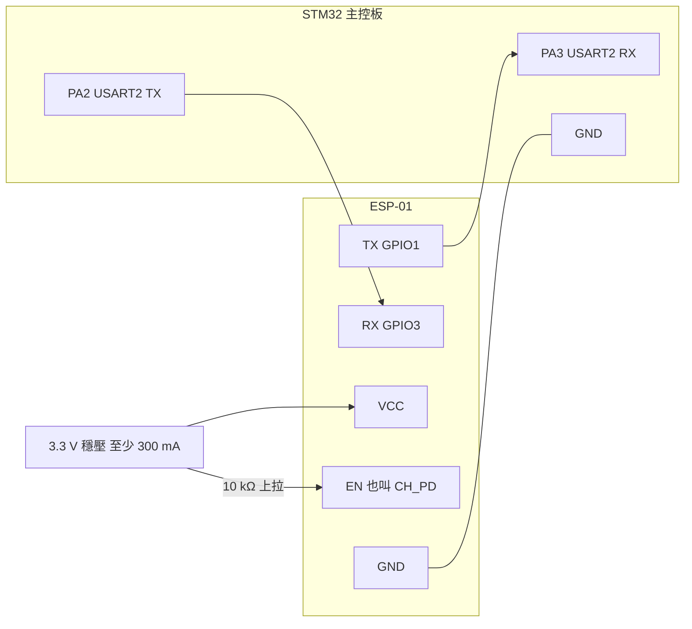

| ESP-01 腳位 | 接到 | 說明 |
|---|---|---|
| TX（GPIO1） | STM32 **PA3**（USART2_RX） | 一邊的「嘴巴」要對著另一邊的「耳朵」，所以 TX 接 RX |
| RX（GPIO3） | STM32 **PA2**（USART2_TX） | |
| VCC | **3.3 V**，穩壓器至少 300 mA | Wi-Fi 發射瞬間電流約 250 mA；模組旁加 100–470 µF 電解電容 + 0.1 µF 陶瓷電容 |
| GND | 和 STM32 共地 | 沒有共地，兩邊對「0 和 1」的認知會不一樣 |
| EN / CH_PD | 3.3 V（10 kΩ 上拉） | 不接高電位模組不會啟動 |
| RST | 上拉 | |
| GPIO0、GPIO2 | 開機時必須是高電位 | ESP-01S 板上已有上拉，建議直接用 ESP-01S |

**供電要特別注意**（出處：`B570_Bridge.ino` 檔頭與 [README](../README.md)）：

- ESP-01 是 3.3 V 元件，USB-TTL 轉接板也必須是 3.3 V 版本。STM32 和 ESP-01 都是 3.3 V 邏輯，可以直接對接。
- 如果 App 連線時 OLED 閃爍、或 ESP-01 一直重開機，通常是電源撐不住發射電流：改用獨立的 3.3 V 穩壓（例如 AMS1117 + 470 µF）。
- 獨立穩壓的**輸入**建議接 5 V。如果只能從電池（約 12 V）取電，請改用小型降壓（buck）模組：AMS1117 這類線性穩壓器會把多出來的電壓全部變成熱，(12.6 − 3.3) V × 0.25 A ≈ 2.3 W，會非常燙。B570 主控板上哪裡能取電，請以 WHEELTEC 原廠接線圖為準。

為什麼電容和共地這麼重要，請看[電源設計](通訊系統及軟硬體設計與選型.md#25-電源設計)。

---

## 5. 兩種連線方式

### 5.1 為什麼有兩種

ESP-01 只有 Wi-Fi、沒有藍牙，所以手機和車子之間一定要走 Wi-Fi。Wi-Fi 網路裡需要一台「基地台」（AP，Access Point），其他裝置（STA，Station）加入它。於是有兩種排法：

| | 直連模式（預設） | 熱點模式 |
|---|---|---|
| 比喻 | 車子自己開一間小基地台，手機去敲門 | 手機開派對（個人熱點），車子來參加 |
| 誰是基地台 | 車上的 ESP-01（SoftAP，名稱 `B570-XXXX`） | 手機的個人熱點 |
| 車子的位址 | 固定 `192.168.4.1` | 熱點分配，例如 `172.20.10.5`（OLED 會顯示） |
| 手機 Wi-Fi 開關 | 要打開（不用連任何網路） | 可以一直關著 |
| 手機上網 | 照常（車子的 Wi-Fi 被當成「本地網路」） | 照常（手機本來就用行動網路分享給熱點） |
| 延遲 | 受手機 Wi-Fi 省電、手機同時連其他 Wi-Fi 影響 | 通常最低（手機當基地台不省電，ESP 也關閉休眠） |
| 第一次設定 | 不用設定，掃 QR 就好 | 先直連一次、在 App 輸入熱點名稱密碼；或燒錄前內建 |
| 適合 | 第一次配對、在家測試、改設定 | 帶出去玩、戶外、邊看影片邊開 |

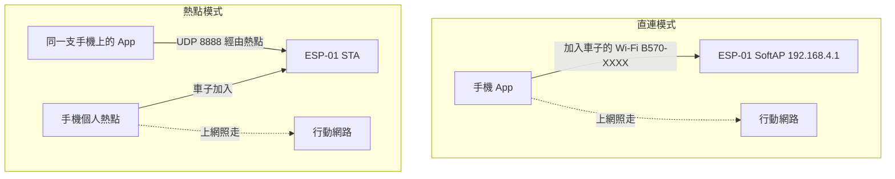

### 5.2 為什麼兩種模式手機都能照常上網

**直連模式**：一般「連上一個 Wi-Fi」時，Android 會把它當成上網的預設路線；車子的 Wi-Fi 沒有網際網路，手機就會「有 Wi-Fi 卻不能上網」。B570 Pilot 改用 Android 10 起提供的 `WifiNetworkSpecifier` 向系統要一條「本地網路」：它沒有上網能力，系統**不會**把它設成預設網路，其他 App 繼續走行動數據；只有 B570 Pilot 自己的 UDP socket（程式收發網路封包的端點，綁在哪條網路上，封包就走哪條）綁在這條網路上。

> **比喻**：公司總機（預設網路）照常接外線，B570 Pilot 另外拉一條直通車子的專線。

**熱點模式**：手機本身就是基地台，它的上網來源本來就是行動網路，車子只是熱點的一個客人。

**小提醒**：直連時如果手機**同時**連著家裡的 Wi-Fi，兩個 Wi-Fi 會搶同一個射頻，延遲會變高，App 的延遲診斷會提醒「手機同時連著其他 Wi-Fi，延遲會變高」。

### 5.3 邊看 YouTube 邊遙控

可以。兩種連線方式手機都照常上網，在**同一支手機**上請用：

- **分割畫面**：B570 Pilot 一半、YouTube 一半。App 在分割畫面裡會自動改成精簡版面，緊急停止一定看得到。
- **YouTube 小視窗**（子母畫面）：B570 Pilot 全螢幕，影片浮在角落。

要注意的是：**整個切到別的 App 時，車子會自動煞停並保持平衡**。App 一退到背景（`onStop`）或失去視窗焦點，就把控制量歸零（[`MainActivity.kt`](../AndroidApp/app/src/main/java/com/b570/pilot/MainActivity.kt)）；就算連線也斷了，車上的失聯保護也會讓車子原地站好。邊看影片邊遙控建議用熱點模式，延遲最穩（App 內「設定 › 關於」常見問題）。

### 5.4 第一次配對（直連模式）

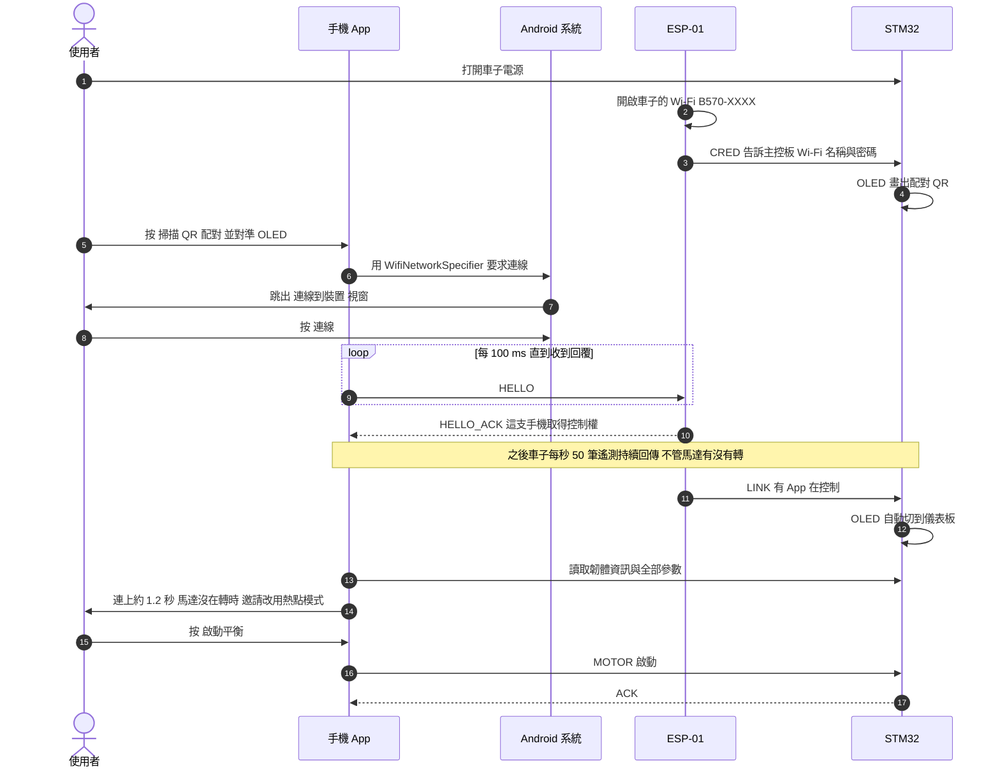

圖裡的 HELLO、LINK、MOTOR 等訊息名稱，見 [2.4 幾種主要訊息](#24-幾種主要訊息)。

幾個細節：

- 車子第一次開機時，ESP-01 會自動產生 Wi-Fi 名稱 `B570-XXXX`（XXXX 是晶片 ID 的後 4 碼十六進位）和 **8 碼隨機密碼**，存進 EEPROM。密碼的字元集刻意拿掉容易看錯的 `i l o 0 1`（[`b570_wificfg.h`](../ESP01/B570_Bridge/b570_wificfg.h)）。
- 頻道設定為自動（預設）時，ESP-01 開啟車子的 Wi-Fi 前會先掃描一次，從 1、6、11 三個互不重疊的頻道中挑最乾淨的一個。
- 系統的「連線到裝置」視窗只有第一次會出現；之後打開 App 會自動連線。第一次等超過 0.7 秒，App 會提示「請在系統視窗按「連線」，之後就會自動連線」。
- 連上後約 1.2 秒（馬達沒在轉時；正在開車就等停下來再問），App 會問要不要改用熱點模式（見[下一節的截圖](#55-熱點模式設定與帶出去玩)）。
- 同一時間只有**一支手機**能控制這台車，其他手機會看到「另一支手機正在控制這台車」。

### 5.5 熱點模式：設定與帶出去玩

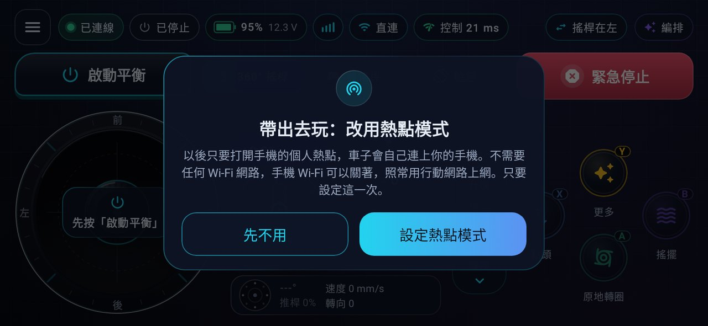

*第一次直連成功後（不是展示模式、馬達沒在轉），App 邀請你改用熱點模式。背景是駕駛頁，馬達膠囊顯示「已停止」、連線方式是「直連」。*

按「設定熱點模式」會開熱點表單；按「先不用」之後也可以到「設定 › 連線方式」改。

**設定方法一：用 App（不用重新燒錄）**

1. 先用直連模式連上車子。
2. 在 App 的邀請視窗按「設定熱點模式」，或到「設定 › 連線方式 › 改用熱點模式」。
3. 輸入手機熱點的名稱與密碼（名稱大小寫要完全一樣）→ 下一步 → 套用。
4. 車上的 Wi-Fi 模組（ESP-01）會在 0.5 秒後自己重新開機，主控板不受影響（如果正在平衡，就繼續原地站著）。App 顯示進度：車子重新開機中 → 請開啟手機熱點 → 在熱點上尋找車子 → 完成。這裡的「車子重新開機中」指的就是 Wi-Fi 模組。

**設定方法二：燒錄前內建（免直連、免掃 QR、手機 Wi-Fi 一次都不用開）**

1. 把 [`ESP01/B570_Bridge/b570_preset_local.example.h`](../ESP01/B570_Bridge/b570_preset_local.example.h) 複製成同資料夾的 `b570_preset_local.h`。
2. 填好你的熱點：

   ```c
   #define PRESET_ID           1            // 1..255；改了名稱或密碼要加 1
   #define PRESET_STA_SSID     "MyPhone"    // 手機個人熱點名稱（1..32 bytes，大小寫要相同）
   #define PRESET_STA_PW       "12345678"   // 熱點密碼（8..63 字元；"" = 開放熱點）
   ```

3. 燒錄 ESP-01。車子第一次開機就直接是熱點模式。
4. 打開手機熱點 → 打開車子 → App 連線頁出現「熱點上的車」→ 點一下，之後開 App 就會自動連上。

說明：

- `b570_preset_local.h` 已列入 `.gitignore`，你的熱點密碼**不會**被 commit 上傳。沒有這個檔案時 `PRESET_ID = 0`，表示不使用內建熱點。
- 每個 `PRESET_ID` 只套用一次（套用紀錄存在 ESP-01 的 EEPROM）；之後在 App 修改熱點或改回直連，都以 App 的設定為準。要換一組內建熱點，就把 `PRESET_ID` 加 1 再燒錄。

**手機熱點的限制**（ESP-01 只支援 2.4 GHz 與 WPA2）：

| 項目 | 要求 |
|---|---|
| 頻段 | **2.4 GHz**。Android：頻段選 2.4 GHz 或「延伸相容性」；iPhone 熱點：開「最大化相容性」 |
| 安全性 | **WPA2**，或 WPA2/WPA3 混合；不可以「只有 WPA3」 |
| 名稱 | 1–32 bytes，可以有中文（但 OLED 字型只有英數符號，中文每個字會顯示成 `???`：一個 UTF-8 位元組一個問號） |
| 密碼 | 8–63 個可列印 ASCII 字元（英數與符號），或不設密碼（開放熱點） |

> App 熱點表單的字數計數（例如 12/32）算的是 **UTF-8 位元組**：一個中文字佔 3 bytes，英文字母佔 1 byte。

**帶出去玩（只用手機熱點）**：

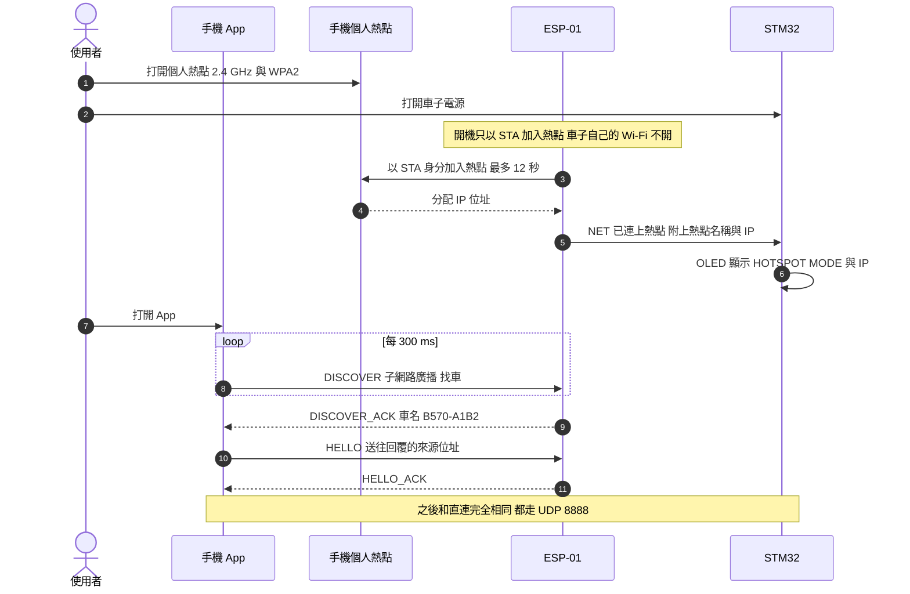

在熱點網路裡，車子的 IP 是熱點分配的、每次可能不同，所以 App 先用 **DISCOVER** 廣播問「有沒有 B570？」，再用回覆裡的車名比對你記住的車。**廣播**（broadcast）就是一次送給同一個網段裡的所有裝置，像在教室裡大喊「B570 在嗎？」，只有車子會回答。

**順序建議**：

- **最快**：先開手機熱點、再開車子電源 → 開機 12 秒內就加入熱點。
- 先開車子也沒關係：車子找不到熱點會暫時改開直連 Wi-Fi（OLED 顯示 `NO HOTSP` 和 QR，不用掃）；3 分鐘內打開熱點，通常 15 秒內、最久約 20 秒連上；超過 3 分鐘才開熱點，最多約 40 秒。
- 開車途中走出熱點範圍：3 分鐘內回到範圍，通常 15 秒內自動連回。

### 5.6 車子找不到熱點時會怎樣（ESP-01 的備援狀態機）

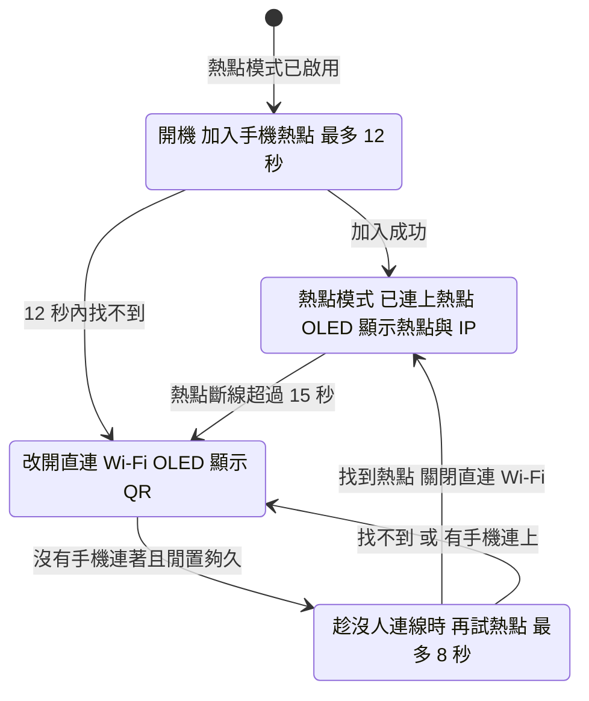

開機加入熱點（JOIN）的這 12 秒裡，車子自己的 `B570-XXXX` Wi-Fi **不會開**；只有在改開直連之後（AP）它才出現，所以「關閉直連 Wi-Fi」只發生在重試成功（RETRY → STA）的時候。完整的狀態機（含斷線後 15 秒內恢復的中間狀態）見[ESP 端的熱點狀態機](通訊系統及軟硬體設計與選型.md#esp-端的熱點狀態機)與 [`b570_netsm.h`](../ESP01/B570_Bridge/b570_netsm.h) 檔頭的圖。

「閒置夠久」的規則（[`b570_netsm.h`](../ESP01/B570_Bridge/b570_netsm.h)）：

| 時段 | 直連 Wi-Fi 要連續閒置多久才再試熱點 |
|---|---|
| 剛改開直連後的第一次 | 12 秒（`FIRST_IDLE_MS`：QR 剛出現，你可能正要掃描，先不打擾） |
| 改開直連後的前 3 分鐘 | 6 秒（`FAST_IDLE_MS`） |
| 3 分鐘之後 | 30 秒（`RETRY_IDLE_MS`） |
| 直連的手機離開後 | 重新開始 1 分鐘的 6 秒快速重試 |

每次重試最多 8 秒，但開始 0.5 秒後如果確定「找不到熱點」或「密碼錯誤」就提早放棄，不讓直連的手機等太久。連續 2 次密碼錯誤就不再快速重試。

### 5.7 App 怎麼決定先找熱點還是直連

App 的「智慧連線」（`ConnectPlanner`，[`data/Hotspot.kt`](../AndroidApp/app/src/main/java/com/b570/pilot/data/Hotspot.kt)）會先看手機熱點有沒有開：車子設定為熱點模式**而且**手機熱點開著，就先在熱點上找最多 20 秒（涵蓋車子開機加入熱點的 12 秒），找不到才改直連；手機熱點沒開就只找 1.5 秒；剛掃完 QR 則一律直連（OLED 顯示 QR = 車子正在直連模式）。完整規則見 [PROTOCOL.md §3.6](PROTOCOL.md) 與 [ARCHITECTURE.md](../AndroidApp/ARCHITECTURE.md)。

---

## 6. App 畫面導覽

App 只有**橫向**、沉浸式全螢幕（隱藏系統列），左右兩個橫向都可以。需求：Android 10 以上（`minSdk 29`）。

- **一般分頁**（監測、整定、編排、設定）：左邊是**導覽軌**（駕駛、監測、整定、編排、設定，最下面一顆紅色**緊急停止**），上方是**狀態條**（車名、馬達狀態、連線、電量、訊號、延遲）。
- **駕駛分頁**是全螢幕遙控器，沒有導覽軌；按左上角 ≡ 叫出滑入式導覽（裡面也有緊急停止和「中斷連線」）。
- **返回鍵**：滑入式導覽開著 → 先關掉；在其他分頁 → 回駕駛；在駕駛 → 問你要不要中斷連線。

### 6.1 連線頁

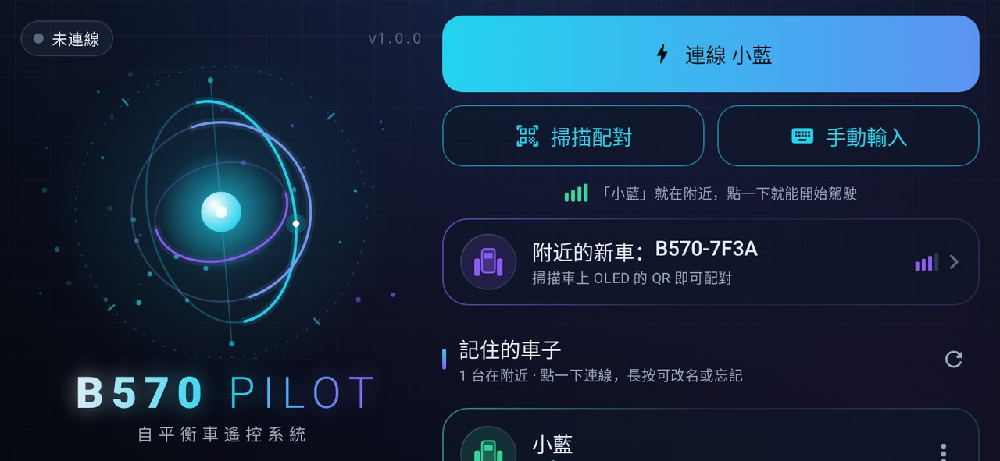

*有記住的車在附近時的連線頁。*

- 左邊：連線狀態膠囊（未連線 / 尋找車子… / 連線 Wi-Fi… / 握手中… / 已連線 / 訊號中斷 / 連線失敗）、App 版本、陀螺儀主視覺。
- 右上主按鈕會依情況變化：沒有記住的車 → 「配對你的平衡車」三步驟 + 掃描 QR 配對；剛好一台記住的車在附近 → 「連線 <車名>」（圖中是暱稱「小藍」）；其他情況 → 掃描 QR 配對。
- 「掃描配對」開相機掃 OLED 的 QR；「手動輸入」可直接打 Wi-Fi 名稱和密碼。
- 「附近的新車：B570-7F3A」：Wi-Fi 掃描看到、但還沒配對的車，點了會開掃描。
- 「記住的車子」：點一下連線，長按可改名或忘記；每台車會標示「在附近 / 不在範圍內」與訊號格數。

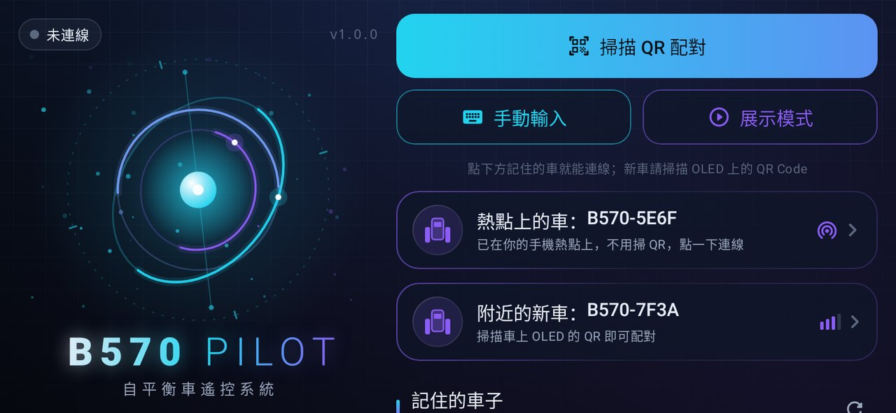

*手機熱點開著（或記住的車裡有熱點模式的車）、而且還沒連線時，連線頁每 5 秒在熱點網路上找一次車。*

- 「熱點上的車：B570-5E6F」= 這台車已經在你的手機熱點上，**不用掃 QR，點一下就連線**。
- 下方仍保留「展示模式」入口：沒有車也能試玩。

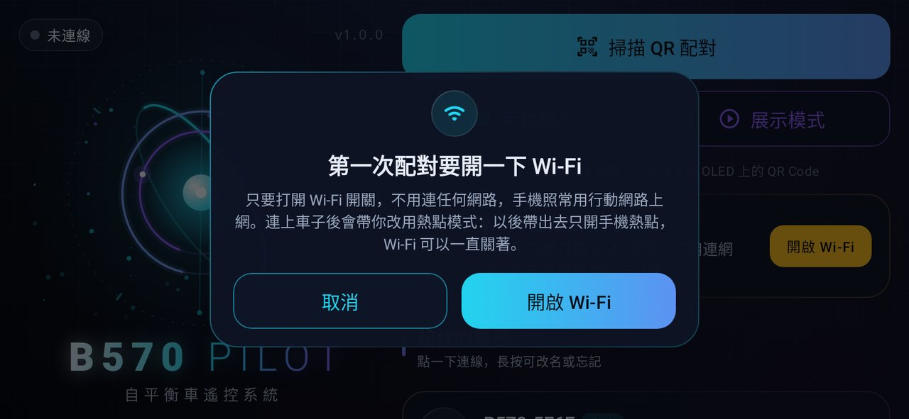

*第一次配對時如果手機 Wi-Fi 是關的，App 會先請你打開 Wi-Fi 開關。*

只要打開 Wi-Fi 開關，不用連任何網路，行動網路照常。連上車子之後 App 會帶你改用熱點模式，以後帶出去只開手機熱點，Wi-Fi 可以一直關著。

### 6.2 駕駛頁

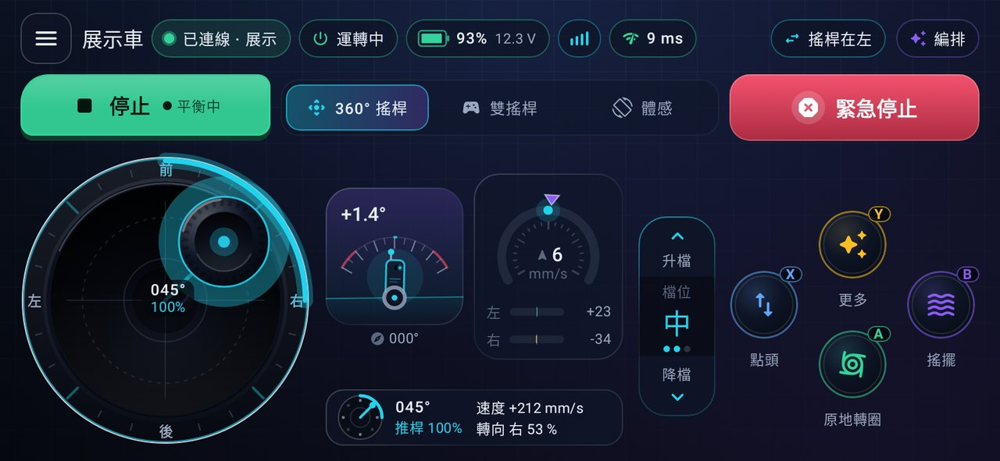

*展示模式下，360° 搖桿往右前方 45° 推滿。*

由上而下、由左而右：

| 位置 | 元件 | 作用 |
|---|---|---|
| 左上 | ≡ | 叫出滑入式導覽 |
| 上緣 | 車況膠囊 | 車名、連線狀態、馬達（運轉中 / 已停止）、電量 93 % 12.3 V、訊號格、延遲；空間不夠時依重要度自動收起 |
| 右上 | 搖桿在左 / 編排 | 360° 搖桿換到另一手（會記住）；進編排頁 |
| 第二列左 | 停止（平衡中） | 啟動平衡 / 停止切換鈕 |
| 第二列中 | 模式選擇 | 360° 搖桿 / 雙搖桿 / 體感 |
| 第二列右 | **緊急停止** | 紅色大按鈕，一碰就停 |
| 左下 | 360° 搖桿 | 外環刻度、推的方向會發光；讀數「045° / 100%」= 方位角與推桿量 |
| 中間 | 姿態儀、速度表 | 傾角 +1.4°、航向 000°；車速與左右輪速 |
| 中下 | 向量讀數 | 實際送出的值：速度 +212 mm/s、轉向 右 53 % |
| 右中 | 檔位翹板 | 升檔 / 降檔，目前「中」 |
| 右下 | A/B/X/Y | A 原地轉圈、B 搖擺、X 點頭、Y 更多（編排） |

> **算算看**：圖中斜推 45°，360° 搖桿把推桿量**按方向拆開**，前進和右轉各是 cos 45° ≈ 70.7 %。中速檔速度比例 0.60、轉向比例 0.75，所以速度 = 0.707 × 0.60 × 500 ≈ **212 mm/s**，轉向 = 0.707 × 0.75 ≈ **53 %**——和畫面上的數字一致。到了車上，轉向 530 ‰ 再乘上 `MAX_TURN` 40 換成原廠的轉向單位：0.53 × 40 ≈ 21。

三種駕駛模式：

| 模式 | 怎麼操作 | 適合 |
|---|---|---|
| 360° 搖桿（預設） | 一手圓形類比搖桿，另一手按 A/B/X/Y 與檔位；搖桿內圈 6 % 是**死區**（推這麼一點點當作 0，避免手指輕微晃動就讓車子動）；推的量會套一條 **expo 曲線**（指數曲線：預設輸出 = 0.65 × 推量 + 0.35 × 推量³，推一半大約只輸出三分之一，推到底仍是 100 %），讓小推量更細膩，可在「設定 › 操控 › 搖桿曲線」調整 | 大部分人 |
| 雙搖桿 | 左手直立油門（前進 / 後退）、右手橫向方向（左 / 右），兩根拇指同時操作互不干擾 | 習慣遙控車的人 |
| 體感 | 按住左右任一「按住駕駛」鈕，前後傾手機控制速度、像方向盤一樣轉手機控制轉向；手機一被翻轉或掉落（偏離零點超過 75°）就中止 | 好玩、展示 |

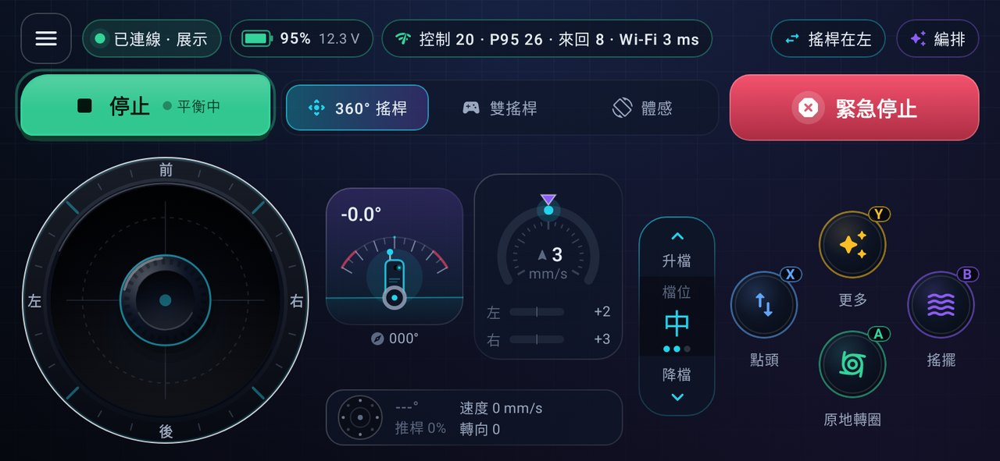

*點一下延遲膠囊，原地展開細節（8 秒後自動收回，不是浮層，不會擋到緊急停止）。*

「控制 20 · P95 26 · 來回 8 · Wi-Fi 3 ms」的意思：

| 數字 | 意義 |
|---|---|
| 控制 20 ms | 手機送出指令 → 車上真正套用，平滑後的值（EMA，指數移動平均）。這個數字還包含遙測回傳的時間約 3–8 ms，是控制延遲的上限。顏色：< 40 綠、< 100 黃、其餘紅 |
| P95 26 ms | 最近 5 秒內 95 % 的指令都比這個快（看偶發卡頓） |
| 來回 8 ms | PING 從手機到主控板再回來的時間 |
| Wi-Fi 3 ms | 只到 ESP-01 就回來的時間（純 Wi-Fi 延遲） |

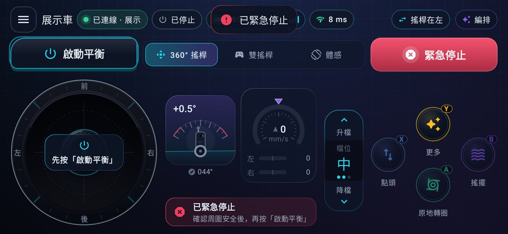

*按下緊急停止之後。*

- 上方提示「已緊急停止」，馬達膠囊變成「已停止」，左上按鈕變回「啟動平衡」。
- 搖桿上蓋著「先按「啟動平衡」」，下方卡片提醒「確認周圍安全後，再按「啟動平衡」」。
- 按下緊急停止後搖桿會鎖 350 ms，**還按著的拇指必須放開重按**才會再送指令，避免另一根拇指還壓著油門、一啟動就衝出去。

### 6.3 監測頁

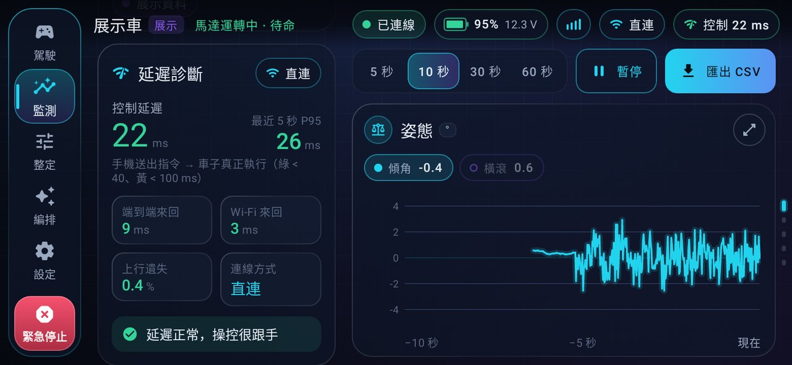

*監測頁：左欄延遲診斷，右邊即時曲線。*

- **延遲診斷卡**：控制延遲 22 ms、最近 5 秒 P95 26 ms、端到端來回 9 ms、Wi-Fi 來回 3 ms、上行遺失 0.4 %、連線方式「直連」，最下面一句白話結論「延遲正常，操控很跟手」。延遲高時會改成說明慢在哪裡，例如 Wi-Fi 慢、手機同時連著其他 Wi-Fi、車上處理慢、指令遺失。
- **工具列**：時間範圍 5 / 10 / 30 / 60 秒、暫停、匯出 CSV。
- **曲線**：姿態（傾角、橫滾）、輪速、PWM 分量（直立環 / 速度環 / 轉向環各出多少力）、角速度、電池，共五張；點右上角可以放大。左欄往下捲還有狀態卡、12 個數據小卡和事件紀錄。

> **看懂上行遺失**：車上每秒結算一次「這 1 秒收到幾個 App 幀」（遙測的 `link_q`），App 拿它對照同一段時間自己送出的數量，就知道有多少指令在路上掉了。

### 6.4 整定頁

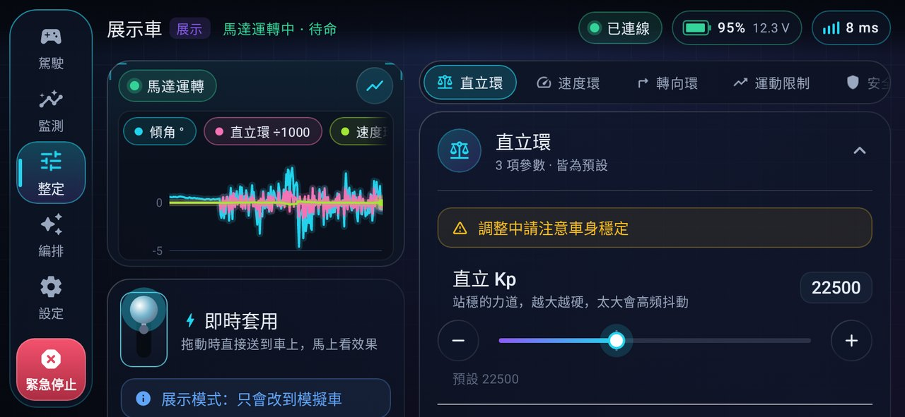

*整定頁：左邊即時曲線與操作，右邊分組參數。*

- 左上**即時曲線**同時畫傾角、直立環輸出與速度環輸出（兩者都 ÷1000，和傾角畫在同一張圖），調參數時直接看效果。
- **即時套用**撥桿：打開時，拖動滑桿就直接送到車上；關掉時改成先改好幾個，再按浮動的「套用 N 項變更」一次送出。
- 右邊參數分組：直立環、速度環、轉向環、運動限制、安全保護、系統。每個參數都有白話說明（例如直立 Kp「站穩的力道，越大越硬，太大會高頻抖動」）、−/＋ 鍵（長按連續）、預設值。
- 還有：儲存到車上、讀取、零點校正、恢復預設、設定檔（原廠 / 穩定 / 運動 / 自訂）。
- 改了沒存時，整定頁顯示「有未儲存修改」、監測頁顯示「參數未儲存」，車上 OLED 參數頁也會出現 `*`。

**參數一覽**（預設值與範圍出自 [`WHEELTEC/params.c`](../WHEELTEC/params.c)，完整表在 [PROTOCOL.md §4.2](PROTOCOL.md)）。先記住一件事：六個 PID 係數（`BAL_KP` / `BAL_KD`、`VEL_KP` / `VEL_KI`、`TURN_KP` / `TURN_KD`）都以「放大 100 倍」的數值存放，程式使用時再 ÷100（`control.c` 的 `Balance()`、`Velocity()`、`Turn()`）。所以速度環 Kp 寫 16000，真正的係數是 160。

| 群組 | 參數 | 預設 | 範圍 | 白話 |
|---|---|---|---|---|
| 直立環 | `BAL_KP` | 22500 | 0–60000 | 站穩的力道（÷100 = 225） |
| 直立環 | `BAL_KD` | 108 | 0–600 | 抑制前後晃動的阻尼（÷100 = 1.08） |
| 直立環 | `ZERO_ANGLE` | 0° | −10 到 +10° | 機械零點：車子真正平衡時的傾角 |
| 速度環 | `VEL_KP` / `VEL_KI` | 16000 / 80 | 0–40000 / 0–400 | 追上目標速度、讓車停得住 |
| 轉向環 | `TURN_KP` / `TURN_KD` | 4200 / 0 | 0–12000 / 0–300 | 轉向力道 / 行進時抑制擺頭 |
| 運動限制 | `MAX_SPEED` | 500 mm/s | 100–1000 | 車速上限；高速檔推到底 = 這個值（中速 60 %、慢速 30 %） |
| 運動限制 | `MAX_TURN` | 40 | 5–80 | 轉向上限：1000 ‰ 對應的原廠轉向量（原廠一般 27、高速 54） |
| 運動限制 | `ACCEL` / `TURN_ACCEL` | 2000 mm/s² / 12000 ‰/s | 100–6000 / 500–20000 | 加速度、轉向變化率上限，越小越柔和 |
| 安全保護 | `FAILSAFE_MS` | 400 ms | 150–2000 | 失聯多久自動煞停 |
| 安全保護 | `PICKUP_EN` | 1（開） | 0–1 | 拿起停機 |
| 安全保護 | `LOWBAT_V` | 10.0 V | 9.0–12.0 | 低電壓停機門檻 |
| 安全保護 | `FALL_ANGLE` | 40° | 20–60 | 傾倒停機角度 |
| 系統 | `TELEM_HZ` | 50 Hz | 10–100 | 遙測頻率（實際 = 100 ÷ 整數，例如設 70 會變 100） |
| 系統 | `ANGLE_ALGO` | 2（卡爾曼） | 1–3 | 姿態演算法，存檔並重開機才生效 |

> **Kp「放大 100 倍」是什麼意思**：直立環程式是 `-Balance_Kp / 100 * Angle_bias - Gyro_bias * Balance_Kd / 100`（`control.c` 的 `Balance()`）。預設 `BAL_KP` = 22500，代表真正的 Kp 是 225：車身偏離零點 1°，直立環就輸出約 225（PWM 上限是 6900）。如果同時以 10 °/s 在倒，陀螺儀原始值約 164，`BAL_KD` = 108 也要 ÷100 = 1.08，所以 Kd 項再加約 164 × 1.08 ≈ 177。P 項看「歪了多少」，D 項看「倒得多快」。更多直覺與公式見[控制演算法](通訊系統及軟硬體設計與選型.md#32-控制演算法)。

**整定建議順序**（出自 [README](../README.md)）：① 零點校正 → ② 直立環 Kp（加到開始高頻抖動再退 30 %）→ ③ 直立環 Kd（壓住抖動）→ ④ 速度環 Kp / Ki（Ki ≈ Kp ÷ 200）→ ⑤ 轉向環。

### 6.5 編排頁

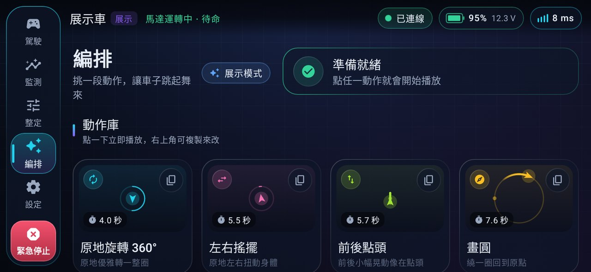

*編排首頁：狀態橫幅「準備就緒」與動作庫。*

- 動作庫有 12 種內建動作，例如原地旋轉 360°（4.0 秒）、左右搖擺（5.5 秒）、前後點頭（5.7 秒）、畫圓（7.6 秒）、8 字繞行、正方形、之字前進、太空漫步、衝刺折返、派對舞、華爾滋、巡邏。
- 點卡片立即播放；右上角複製鈕可以複製到「我的編排」再修改。
- 播放需要「已連線 + 馬達運轉中」，否則 App 會提示先啟動平衡。

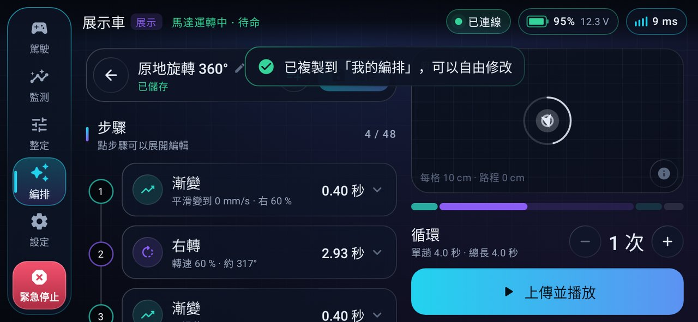

*把「原地旋轉 360°」複製出來編輯。*

- 左邊**步驟時間軸**（4 / 48 = 目前 4 步，上限 48 步）：例如第 1 步「漸變 0.40 秒，平滑變到 0 mm/s · 右 60 %」、第 2 步「右轉 2.93 秒，轉速 60 % · 約 317°」。點步驟可以展開編輯。
- 右邊**路徑預覽**（每格 10 cm）、時間條、循環次數、「上傳並播放」。

車上的韌體只認得 4 種步驟模式（[`WHEELTEC/motion.c`](../WHEELTEC/motion.c) 的 `seq_eval()`）：

| 模式 | 意思 | 例子 |
|---|---|---|
| 定值 HOLD | 這段時間維持固定速度與轉向 | 200 mm/s 直走 1 秒 |
| 正弦轉向 SINE_TURN | 速度固定，轉向按正弦波左右擺 | 搖擺、蛇行 |
| 正弦速度 SINE_SPEED | 轉向固定，速度按正弦波前後擺 | 點頭 |
| 漸變 RAMP | 從上一步結束的值線性變到這一步的值 | 平順起步、收尾 |

編輯器為了好懂，提供 9 種「動作」，上傳時換成上面 4 種模式（[`ui/screens/choreo/ChoreoModel.kt`](../AndroidApp/app/src/main/java/com/b570/pilot/ui/screens/choreo/ChoreoModel.kt) 的 `MoveKind`）：

| 編輯器裡的動作 | 送到車上的模式 |
|---|---|
| 前進、後退、左轉、右轉、弧線 | 定值 HOLD（只差在速度、轉向的正負與是否為 0） |
| 停頓 | 定值 HOLD，速度與轉向都是 0 |
| 搖擺 | 正弦轉向 SINE_TURN |
| 點頭 | 正弦速度 SINE_SPEED |
| 漸變 | 漸變 RAMP |

> **算算看**：上面截圖的「原地旋轉 360°」共 4 步：① 漸變 0.4 秒，把轉向推到右 60 %；② 定值（畫面上叫「右轉」）2.933 秒；③ 漸變 0.4 秒回到 0；④ 停頓 0.3 秒。總長 0.4 + 2.933 + 0.4 + 0.3 ≈ **4.0 秒**，和畫面的「單趟 4.0 秒」一致。
>
> 再看動作庫的「左右搖擺」，其中一步是 `sineTurn(0, 900, 4000, 50)`：速度 0、轉向幅度 900 ‰、持續 4000 ms、週期 50 × 20 ms = 1 秒，所以 4 秒內左右擺 4 個來回。

**為什麼編排在車上執行**：整段動作一次上傳到 STM32，由 10 ms 的控制週期一步一步播放，時間精準，不受手機排程和 Wi-Fi 抖動影響。播放中推搖桿超過 30 mm/s 或 50 ‰，車子會判定「手動接管」並中止編排。

### 6.6 設定頁

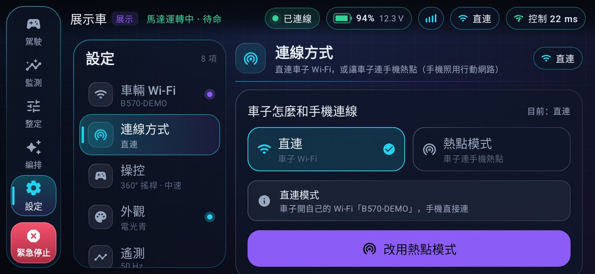

*設定頁採主從式：左邊分類、右邊內容。圖中是「連線方式」。*

| 分類 | 內容 |
|---|---|
| 車輛 Wi-Fi | 車子 Wi-Fi 名稱 / 密碼（可顯示）、修改、恢復原廠；ESP-01 韌體版本、頻道、連線裝置數、發射功率、通訊統計 |
| 連線方式 | 直連 / 熱點模式、車子目前狀態（已連上熱點 + IP + 訊號 / 搜尋中 / 找不到已改回直連）、2.4 GHz 與 WPA2 說明、開啟手機熱點設定頁 |
| 操控 | 預設駕駛模式、預設檔位、搖桿曲線、體感靈敏度、觸覺回饋、保持螢幕常亮 |
| 外觀 | 四種強調色 |
| 遙測 | 遙測頻率（省流量 ↔ 最平滑） |
| 展示模式 | 進入展示模式；「開啟 App 時自動進入」 |
| 記住的車子 | 連線過的車、改名、忘記；「開啟 App 自動連線」與「斷線自動重連」開關 |
| 關於 | 版本資訊、使用說明（快速上手、熱點模式、安全、延遲小技巧、常見問題）、致謝 |

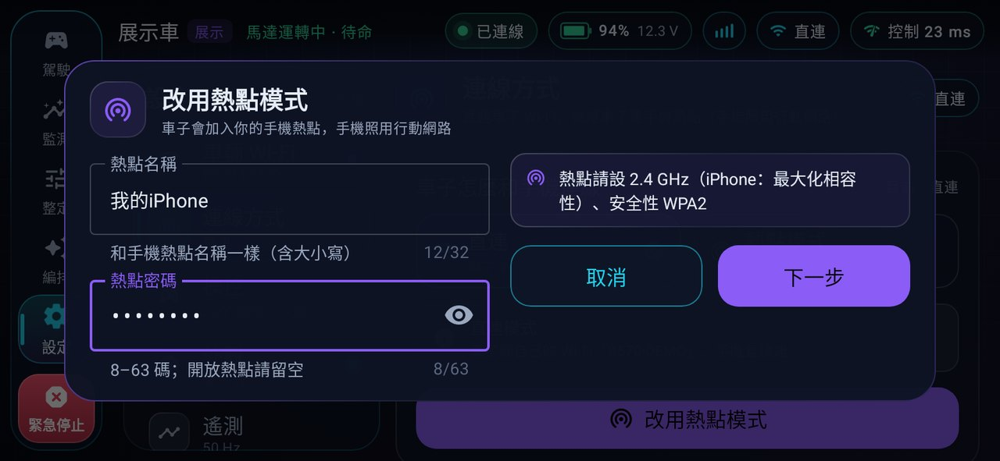

*改用熱點模式的表單：熱點名稱（計數為 UTF-8 bytes）、熱點密碼（8–63 碼；開放熱點留空）、右側提醒熱點請設 2.4 GHz 與 WPA2。*

### 6.7 展示模式

沒有車子也能玩：展示模式走的是**真實的通訊協定與解碼路徑**，由 App 內的模擬車（[`data/DemoTelemetrySource.kt`](../AndroidApp/app/src/main/java/com/b570/pilot/data/DemoTelemetrySource.kt)）每秒產生 50 筆遙測：平衡晃動、加速前傾、對搖桿反應、電池緩慢下降。指令也比照韌體規則回覆，例如馬達運轉中存檔會被拒絕。上面大部分截圖都是在展示模式拍的，所以車名顯示「展示車」、狀態膠囊有「展示」字樣。

---

## 7. 車上的 OLED 與按鍵

### 7.1 OLED 頁面

OLED 有三個頁面，按鍵**雙擊**切換：儀表板 → 配對 → 參數資訊。App 連上時自動切到儀表板，斷線時自動切回配對頁（[`WHEELTEC/show.c`](../WHEELTEC/show.c)）。


*在電腦上用真實韌體程式碼渲染的 OLED 畫面（圖中的版本號是渲染當時的版本）。*

| 畫面 | 內容 |
|---|---|
| boot（開機） | 「B570 PILOT」、韌體版本、「IMU init, hold still」：MPU6050 初始化約 1 秒，**這時請保持車身靜止** |
| dash（儀表板） | 第 1 行：`STOP` / `RUN`、連線狀態、電壓、電池圖示（低於 15 % 會閃）；第 2 行：`A` 傾角 + 刻度條（滿格 ±20°）；第 3 行：`V` 目標速度 / 實際速度 mm/s；第 4 行：`L` `R` 左右 PWM、`T` 轉向；第 5 行：狀態訊息 |
| pair（配對） | 左邊 Wi-Fi QR Code，右邊 `SCAN ME`、車子 Wi-Fi 名稱、密碼（太長會捲動）、手機狀態、電池、`STOP` / `RUN` |
| info（參數） | 韌體版本、`*`（有未存檔的修改）、直立環 P/D、速度環 P/I、轉向環 P/D、零點 `Z`、姿態演算法（DMP / KF / CF）、控制中斷耗時 µs |

儀表板第 1 行的**連線狀態**：

| 顯示 | 意思 |
|---|---|
| `APP` | App 正在控制（直連） |
| `HOT` | App 正在控制（熱點模式） |
| `WiFi` | 有手機連上車子的 Wi-Fi，但 App 還沒開始控制 |
| `----` | ESP-01 在線，但沒有手機 |
| `ESP?` | 超過 2 秒沒收到 ESP-01 的心跳（沒接好、沒電、或沒燒錄） |

儀表板第 5 行的**狀態訊息**：

| 顯示 | 意思 |
|---|---|
| `Click to balance` | 剛開機，單擊按鍵（或 App 按啟動平衡）就開始平衡 |
| `Stopped (key)` / `Stopped (app)` | 被按鍵 / App 停止 |
| `Picked up!` | 偵測到車子被拿起而停機 |
| `Fell - set upright` | 傾倒停機，請扶正 |
| `LOW BATTERY` | 低電壓停機 |
| `EMERGENCY STOP` | App 緊急停止 |
| `IMU FAULT-check` | 姿態感測器沒反應，請檢查 MPU6050 後重新開機 |
| `App drive  Q52` | App 控制中；Q = 最近 1 秒收到的 App 幀數（靜止約 12、推搖桿時約 52：CTRL 10 或 50 次，加上 PING 2 次） |
| `Balancing` | 平衡中，沒有 App 在控制 |
| `Link lost-holding` | App 失聯，原地保持平衡中 |
| `SEQ 2/5 loop 1` | 正在播放編排第 2 / 5 步、第 1 輪 |

配對頁的 QR 內容是 `WIFI:T:WPA;S:<名稱>;P:<密碼>;;`，手機內建相機也認得。以 `B570-A1B2` / `k7m3x9qa` 為例，內容是 35 bytes；QR 版本 3（29×29 個模組，每模組 2 像素 = 58 像素）放得進 64 像素高的螢幕。這也是為什麼車子 Wi-Fi 名稱限制 1–12 個字元（英數、`_`、`-`）、密碼 8–16 碼且不能有 `; , : \ "`：保證 QR 不用跳脫字元、而且塞得進 OLED（[PROTOCOL.md §3.4](PROTOCOL.md)）。


*熱點模式相關畫面。*

| 畫面 | 意思 |
|---|---|
| pair | 直連模式的配對頁（同上） |
| hot_search | `HOTSPOT MODE` / `Joining hotspot`（旋轉符號）/ 熱點名稱 / `2.4GHz + WPA2` / `Turn on hotspot`：正在加入熱點，請打開手機熱點 |
| hot_ok | `Phone hotspot:` / 熱點名稱 / `IP 172.20.10.5` / `App OK`（還沒連上時顯示 `Open app`）：已加入熱點，不需要 QR |
| hot_fallback | 右上角 `NO HOTSP`：找不到熱點，暫時改開直連 Wi-Fi，可以掃 QR 直連；沒人連時會自動再找熱點 |

如果 ESP-01 根本沒送來 Wi-Fi 帳密，配對頁會顯示 `PAIRING` / `Waiting ESP-01` / `ESP TX->PA3` / `ESP RX<-PA2 230400`，直接提示你檢查接線與鮑率。

### 7.2 按鍵（PA5）

按鍵每 10 ms 掃描一次，有去彈跳（20 ms）處理（[`BSPcode/key.c`](../BSPcode/key.c)、`control.c` 的 `Key_Handle()`）：

| 操作 | 判定方式 | 馬達停止時 | 馬達運轉時 |
|---|---|---|---|
| 單擊 | 放開後 300 ms 內沒有再按 | 啟動平衡；電壓太低或車身太斜時不啟動，OLED 顯示 `Can't start:bat/tilt` | 停止 |
| 雙擊 | 放開後 300 ms 內再按一次 | 切換 OLED 頁面 | 切換 OLED 頁面 |
| 長按 | 按住 2 秒 | **機械零點校正並存入 Flash**：先扶住車身在平衡點，再長按。成功顯示 `Zero calibrated OK`；傾斜超過 ±10° 顯示 `Zero: hold upright` | 停止 |

> **什麼是機械零點**：每台車的重心和感測器安裝角度都有一點點誤差，車子真正平衡時，感測器量到的傾角不一定剛好是 0°。零點校正就是告訴車子「這個角度才是站直」。零點不對，車子會一直往前或往後溜。

### 7.3 LED（PA4）

| 狀態 | LED |
|---|---|
| 馬達停止 | 慢閃（約每 1 秒切換一次） |
| 運轉中、沒有 App | 快閃（約每 0.25 秒切換一次） |
| 運轉中、App 控制中 | 恆亮 |

---

## 8. 安全機制

平衡車有兩個輪子、會自己動，**安全永遠優先**。B570 Pilot 的安全設計分成「車上自己會做的」和「App 幫忙做的」兩層：就算手機當機、Wi-Fi 斷掉，車上那一層仍然有效。

### 8.1 車上的保護（STM32）

| 狀況 | 怎麼偵測 | 門檻：預設（可調範圍） | 車子怎麼做 | 怎麼恢復 |
|---|---|---|---|---|
| App 失聯 | 超過 `FAILSAFE_MS` 沒收到任何 App 幀，或 ESP-01 回報 App 已離線 | 400 ms（150–2000） | **馬達不停**，目標速度與轉向平順歸零、原地保持平衡；中止編排；回報 `LINK_LOST` | 連回後自動恢復 |
| 緊急停止 | App 送 MOTOR 緊急停止 | — | 在 UART 中斷裡**立刻**切斷馬達（`Motor_Kill()`，不等下一個控制週期）、中止編排、目標歸零 | 按啟動平衡 |
| 傾倒 | 傾角偏離零點超過 `FALL_ANGLE` | 40°（20–60） | 停機、回報 `FELL` | 扶正後往前輕推輪子自動啟動，或手動啟動 |
| 被拿起 | 原廠偵測演算法：輪子靜止 → 車身被往上抬（Z 軸加速度大）→ 輪子離地空轉 | `PICKUP_EN` = 1 | 停機、回報 `PICKED_UP` | 放下後往前輕推輪子自動啟動 |
| 低電壓 | 1 秒平均電壓低於 `LOWBAT_V` | 10.0 V（9.0–12.0） | 停機、回報 `LOW_BATTERY`；電壓不足時無法啟動 | 充電 |
| 姿態感測器失效 | 主迴圈等不到控制中斷的節拍（連續 2 次各等 100 ms） | 約 200 ms | 切斷馬達，停機原因 8（IMU） | 一律拒絕啟動，檢查 MPU6050 後重新開機 |
| 啟動前檢查 | `can_start()` | 電壓 ≥ `LOWBAT_V`、傾斜 < `FALL_ANGLE`、不是 IMU 故障 | 拒絕啟動，App 收到 `NOT_READY` | 修正後再啟動 |
| 存檔 / 零點校正 | 只在馬達停止時允許 | — | 運轉中回 `BUSY` | 先停止 |
| 姿態演算法切換 | 只記錄，存檔並重新開機後才生效 | — | 避免運轉中角度跳動 | 重新開機 |

另外，回覆在路上掉了、App 重送同一個指令時（同種類 + 同序號、1.5 秒內），零點校正、存檔、播放、啟動都**只執行一次**，車子只重送上次的回覆。

> **為什麼失聯時不直接斷電**：平衡車一斷電就會倒。失聯時讓它「原地站好」比「直接躺下」安全，也比較不會摔壞。真的要它停，請按緊急停止或車上按鍵。

> **「放下並輕推」是什麼**：`Put_Down()` 先等車身在零點 ±10° 內、兩輪靜止，接著 500 ms 內兩輪同時往前轉一點點（每 5 ms 4–39 格，大約 0.1–1 m/s），就判定「有人把它放下並推了一下」，自動啟動平衡。剛開機、被拿起、傾倒這三種停機原因才會觸發，而且要開著 `PICKUP_EN`。

馬達狀態的變化：

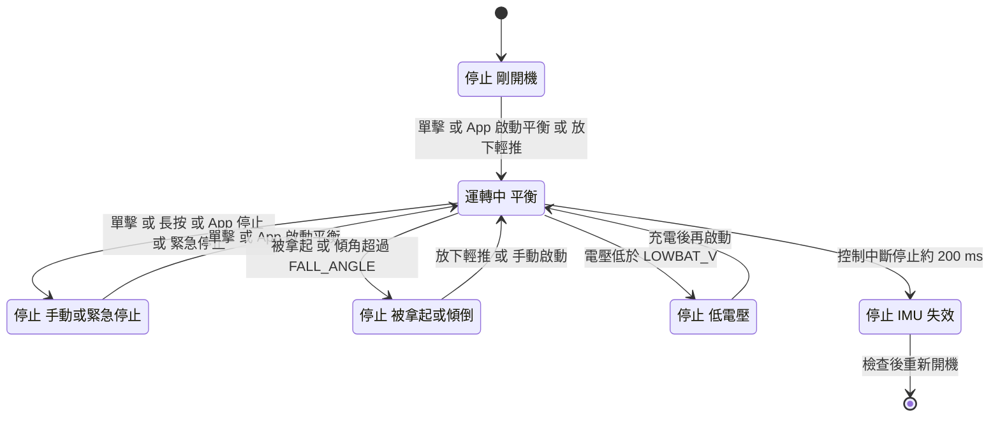

注意：

- App 失聯**不在**這張圖裡，因為失聯時馬達仍在運轉，只是目標歸零。
- 圖上只畫了「運轉中 → IMU 失效」，但 IMU 失效在**任何狀態**都可能發生：`Core/Src/main.c` 主迴圈的看門狗不看馬達狀態，等不到控制中斷就切斷馬達。

### 8.2 App 的保護

出處：[ARCHITECTURE.md §11.6 安全不變式](../AndroidApp/ARCHITECTURE.md) 與 §10。

- **放手就停**：放開搖桿、觸控被取消、離開駕駛頁、App 退到背景、失去視窗焦點（下拉通知欄）、打開滑入式導覽、切換駕駛模式 → 控制量立刻歸零。
- **訊號中斷或自動重連中**：搖桿自動停用；恢復之後**必須放開重新按下**才會再送，避免「拇指一直壓著，訊號一回來車子就衝出去」。
- **緊急停止一定按得到**：駕駛頁右上、導覽軌最下面、滑入式導覽裡都有；觸碰瞬間觸發，沒有進場動畫，不會被提示或選單蓋住。
- **緊急停止不排隊**：直接送出，取消還在重送的「啟動」和「播放」；之後每 100 ms 補送，直到遙測確認馬達已停（1.5 秒還沒確認會跳危險提示）。
- **斷線時按的緊急停止不會被丟掉**：App 記下這台車，連回同一台車時（自動重連或訊號恢復；手動重連則限按下後 60 秒內），在任何其他指令之前先補送，並提示「已連回，補送緊急停止」。
- **快捷動作和編排**需要「已連線 + 馬達運轉中」。
- **同一時間只有一支手機能控制**：ESP-01 用「session」記住擁有者。擁有者按「中斷連線」或手機離開車子的 Wi-Fi 時立即釋放；App 當掉或走遠時，1.5 秒沒有任何封包也會自動釋放。

---

## 9. 快速開始

### 9.1 需要的東西

| 類別 | 項目 | 用途 |
|---|---|---|
| 硬體 | WHEELTEC B570 平衡車 | 主角 |
| 硬體 | ESP-01 或 ESP-01S（建議 01S；需要 1 MB Flash 的版本） | Wi-Fi 橋接 |
| 硬體 | ST-Link | 燒錄 STM32（SWD：SWDIO、SWCLK、GND、3.3 V） |
| 硬體 | **3.3 V** USB-TTL 轉接板 | 第一次燒錄 ESP-01 |
| 硬體 | 杜邦線、100–470 µF 電容；必要時獨立 3.3 V 穩壓 | ESP-01 接線與供電 |
| 硬體 | Android 10 以上的手機 | 遙控 |
| 軟體 | STM32CubeIDE | 編譯、燒錄 STM32 韌體 |
| 軟體 | Arduino IDE + esp8266 開發板套件 **3.1.2** | 編譯、燒錄 ESP-01 |
| 軟體 | Android Studio（或 JDK 17 + Android SDK 35） | 建置 App |
| 軟體（選用） | Python 3、gcc / g++、Git Bash（Windows） | PC 工具與主機端測試。Git Bash 本身**沒有** gcc / g++，Windows 上要另外安裝 MinGW-w64（例如透過 MSYS2）或改用 WSL |

建議的順序是：先在 USB-TTL 上把 ESP-01 燒好 → 燒錄 STM32 → 把 ESP-01 接到車上 → 安裝 App。這樣 ESP-01 的線只要接一次，不用接好又拆。

### 9.2 步驟一：在 USB-TTL 上燒錄 ESP-01

1. Arduino IDE 的「偏好設定 › 額外的開發板管理員網址」加入 `https://arduino.esp8266.com/stable/package_esp8266com_index.json`，在開發板管理員安裝 **esp8266 3.1.2**。
2. 開啟 [`ESP01/B570_Bridge/B570_Bridge.ino`](../ESP01/B570_Bridge/B570_Bridge.ino)。
3. （選用）要內建手機熱點，照 [5.5 節](#55-熱點模式設定與帶出去玩)建立 `b570_preset_local.h`。
4. 工具選單設定：

   | 設定 | 值 |
   |---|---|
   | 開發板 | Generic ESP8266 Module |
   | Flash Size | `1MB (FS:none OTA:~502KB)` |
   | CPU Frequency | 160 MHz（延遲較低） |
   | Flash Mode | DOUT |
   | Upload Speed | 115200 |
   | Erase Flash | Only Sketch（保留 Wi-Fi 帳密）；第一次可選 All Flash Contents，會重新產生密碼 |
   | Reset Method | 轉接板沒有自動重置線路時選 no dtr (aka ck) |

5. 把 ESP-01 接到 **3.3 V** 的 USB-TTL 轉接板（這時 ESP-01 還沒接到車上）：

   | USB-TTL（3.3 V） | ESP-01 | 說明 |
   |---|---|---|
   | TX | RX（GPIO3） | 一邊的「嘴巴」對另一邊的「耳朵」，TX、RX 交叉接 |
   | RX | TX（GPIO1） | |
   | 3.3 V | VCC 與 EN（CH_PD） | EN 要拉高模組才會啟動 |
   | GND | GND | 共地 |
   | GND | GPIO0 | **只在燒錄時接**：GPIO0 接地再上電 = 進入燒錄模式 |

   用舊版 ESP-01（不是 01S）時，RST 和 GPIO2 也要上拉到 3.3 V（ESP-01S 板上已經有）。如果轉接板的 3.3 V 輸出電流不夠、燒到一半斷線，可以改用外部 3.3 V 穩壓供電（記得和轉接板共地）。
6. GPIO0 接地後再上電，按 Arduino IDE 的「上傳」。
7. 燒完**先把 GPIO0 的接地線拔掉，再斷電重開一次**。GPIO0 還接地的話，開機會再次進入燒錄模式，橋接程式根本不會跑；而且 ESP8266 有個已知問題：燒錄後第一次軟體重開可能停在燒錄模式，所以一定要真的斷電。
8. 檢查：沒有內建熱點時，ESP-01 重開後會開出自己的 Wi-Fi，手機的 Wi-Fi 清單應該看得到 `B570-XXXX`。

之後要更新 ESP-01 可以用 **OTA 無線更新**（不用拆線）：電腦連上車子的 Wi-Fi，Arduino IDE 連接埠選網路埠 `b570-xxxx`，密碼 = 車子的 Wi-Fi 密碼。如果還是要用 USB-TTL 重燒，記得**先拔開 STM32 的 PA2 / PA3**，否則兩邊會搶線。

> ESP-01 的序列埠就是和 STM32 溝通的那條線，所以 ESP 韌體**絕不印任何除錯文字**，否則會破壞資料流。

### 9.3 步驟二：燒錄 STM32

1. STM32CubeIDE：**File ▸ Import ▸ General ▸ Existing Projects into Workspace**，選這個資料夾（根目錄有 `.project`、`.cproject`）。
2. 專案按右鍵 **Refresh**，讓 IDE 看到新增的檔案。
3. **Project ▸ Clean** → **Build**。
4. 用 ST-Link 燒錄（Run / Debug）。
5. 開機後 OLED 顯示「B570 PILOT」和韌體版本，然後是「IMU init, hold still」——這時保持車身靜止。還沒接 ESP-01 時，儀表板第 1 行會顯示 `ESP?`（雙擊按鍵切到配對頁會看到 `Waiting ESP-01`），這是正常的。

> 如果實車的前進或轉向方向相反，改 [`WHEELTEC/Inc/app_config.h`](../WHEELTEC/Inc/app_config.h) 的 `MOTION_INVERT_SPEED` / `MOTION_INVERT_TURN` 為 1 再重燒，App 不用改（詳見 [FAQ Q4](#q4-車子前進方向相反或左右轉相反)）。

### 9.4 步驟三：把 ESP-01 接到車上

照 [4.3 ESP-01 接線](#43-esp-01-接線)：ESP TX → PA3、ESP RX ← PA2、3.3 V（≥ 300 mA，加電容）、共地、EN 接 3.3 V。**GPIO0 不要接地**。開機後 OLED 應該自動切到配對頁並顯示 QR Code（有內建熱點時則是 `HOTSPOT MODE`）；如果一直是 `ESP?` 或 `Waiting ESP-01`，請看 [FAQ Q11](#q11-oled-一直顯示-waiting-esp-01-或-esp)。燒錄有問題請看 [FAQ Q15](#q15-esp-01-燒錄失敗)。

### 9.5 步驟四：安裝 App

- 方法一：Android Studio 開啟 `AndroidApp/`，接上手機直接 Run。
- 方法二：在 `AndroidApp/` 執行 `./gradlew assembleRelease`（JDK 17、Android SDK 35；Windows 的 PowerShell 用 `.\gradlew assembleRelease`，命令提示字元用 `gradlew.bat assembleRelease`），把產生的 APK（Android 的安裝檔）`AndroidApp/app/build/outputs/apk/release/app-release.apk` 傳到手機安裝。Release 版目前用 debug 金鑰簽章，正式上架前請換成自己的金鑰。

### 9.6 步驟五：第一次連線

1. 打開車子電源，等 OLED 顯示 QR Code。
2. 打開手機的 Wi-Fi 開關（不用連任何網路）。
3. App 連線頁按「掃描 QR 配對」，對準 OLED。第一次會要求相機和「附近的 Wi-Fi 裝置」權限（Android 10–12 是位置權限）。
4. 系統跳出「連線到裝置」視窗，按「連線」。
5. 連上約 1.2 秒後（馬達還沒轉時），App 會問要不要改用熱點模式：想帶出去玩就按「設定熱點模式」，想先在家試就按「先不用」。
6. 把車子扶正放在地上，按「啟動平衡」，推 360° 搖桿。

### 9.7 步驟六：帶到戶外

1. 手機打開個人熱點（2.4 GHz、WPA2）。手機 Wi-Fi 可以關著。
2. 打開車子電源，OLED 會顯示 `HOTSPOT MODE` 和車子的 IP。
3. 打開 App，自動連上（或在連線頁點「熱點上的車」）。

### 9.8 更新與重燒

三個部分的版本（目前 STM32 fw 2.1.0、ESP-01 1.1.1、App 1.0.0）、怎麼更新、設定會不會保留，請看 [README 的「更新與重燒」表](../README.md)。

---

## 10. 專案資料夾結構

```
（專案根目錄，同時是 STM32CubeIDE 專案）
├─ Core/                         CubeMX 產生的啟動碼與周邊初始化
│  ├─ Inc/                       main.h（腳位名稱）、usart.h、tim.h…
│  └─ Src/                       main.c（初始化 + 主迴圈 + IMU 看門狗）、usart.c、tim.c、adc.c…
├─ Drivers/                      ST 官方 HAL 與 CMSIS 函式庫（不用改）
├─ BSPcode/                      板級驅動
│  ├─ key.c                      按鍵狀態機（單擊 / 雙擊 / 長按）
│  ├─ oled.c                     OLED 底層繪圖
│  ├─ encoder.c                  讀編碼器計數
│  ├─ bsp_adc.c                  電池電壓
│  ├─ iic.c                      軟體 I2C（MPU6050）
│  └─ LED.c、delay.c、usart3.c
├─ WHEELTEC/                     應用程式（大部分改造都在這裡）
│  ├─ Inc/app_config.h           功能開關：版本、方向反轉、超音波、原廠藍牙
│  ├─ control.c                  控制中斷：姿態 → 三環 → PWM、安全檢查、按鍵
│  ├─ motion.c                   運動指令層：斜率限制、啟停狀態機、失聯保護、編排播放、事件
│  ├─ rc_link.c                  和 ESP-01 的 UART 通訊：DMA 收發、指令分派、遙測
│  ├─ proto.c                    幀的編碼解碼與 CRC（與 Python 參考實作一致）
│  ├─ params.c                   17 個參數：預設、範圍、夾限、存 Flash
│  ├─ show.c                     OLED 介面（儀表板 / 配對 / 參數 / 熱點）
│  ├─ qr_mini.c                  精簡 QR Code 產生器（版本 1–3）
│  ├─ MPU6050.c、inv_mpu*.c      MPU6050 與 DMP 驅動
│  ├─ KF.c、filter.c             卡爾曼濾波、互補濾波
│  ├─ ReadDistance.c             超音波（選用）
│  └─ DataScope_DP.c             原廠留下的資料傳輸程式（目前沒有呼叫）
├─ WHEELTEC.ioc                  CubeMX 設定檔（USART2 230400、DMA…已同步修改）
├─ STM32F103C8TX_FLASH.ld        連結腳本：程式區 63 KB，最後 1 KB（0x0800FC00）留給參數
├─ ESP01/B570_Bridge/            ESP-01 Arduino 草稿碼
│  ├─ B570_Bridge.ino            主程式：UDP ⇄ UART、LINK / CRED / NET、OTA
│  ├─ b570_proto.h               幀編解碼
│  ├─ b570_session.h             誰在控制（session）
│  ├─ b570_wificfg.h             車子 Wi-Fi 帳密規則、EEPROM、選頻
│  ├─ b570_sta.h、b570_netsm.h   熱點模式設定與備援狀態機
│  ├─ b570_uarttx.h              不阻塞的 UART 傳送佇列
│  ├─ b570_preset.h              內建手機熱點的機制
│  └─ b570_preset_local.example.h  內建熱點範本（複製成 b570_preset_local.h，已被 gitignore）
├─ AndroidApp/                   Android App（Gradle 專案）
│  ├─ ARCHITECTURE.md            App 架構與 API
│  └─ app/src/
│     ├─ main/java/com/b570/pilot/
│     │  ├─ protocol/            純 Kotlin 協定：CRC、幀、訊息、遙測、參數表
│     │  ├─ link/                連線層：直連 / 熱點、權限、控制延遲、送出節奏
│     │  ├─ data/                CarRepository、記住的車、設定、展示車、快速連線
│     │  └─ ui/                  畫面（connect、drive、monitor、tune、choreo、settings、scanner）
│     └─ test/                   JVM 單元測試（含 Robolectric 多點觸控 UI 測試）
├─ docs/
│  ├─ PROTOCOL.md                通訊協定規格（唯一標準）
│  ├─ 系統介紹.md                 本文件
│  ├─ 通訊系統及軟硬體設計與選型.md  設計理由與選型
│  └─ img/                       OLED 預覽圖、App 截圖
├─ tools/
│  ├─ b570_proto.py              協定 Python 參考實作 + PC 測試工具
│  ├─ make_pair_qr.py            產生可列印的配對 QR 貼紙
│  ├─ fw_host_test/              STM32 邏輯的主機端測試
│  └─ esp_host_test/             ESP-01 邏輯的主機端測試
└─ README.md                     專案首頁
```

樹狀圖裡的幾個名詞：**CubeMX** 是 ST 的圖形化設定工具，在畫面上設定腳位與周邊，就會產生初始化程式碼（設定存在 `WHEELTEC.ioc`）；**HAL** 是 ST 官方的硬體抽象函式庫（`HAL_` 開頭的函式），讓你不用直接操作暫存器；**CMSIS** 是 ARM 為 Cortex-M 定義的標準標頭檔；**JVM 單元測試**是在電腦的 Java 虛擬機上跑的測試，不用手機；**Robolectric** 是在電腦上模擬 Android 環境的測試框架。

`Debug/`、`Release/` 是 STM32CubeIDE 的編譯輸出，`AndroidApp/app/build/` 是 Gradle 的編譯輸出，都可以重新產生。

> 小知識：新增或修改的原始碼都登記為 UTF-8（`.settings/org.eclipse.core.resources.prefs`），避免 IDE 用 GBK 讀檔把中文註解變成亂碼（[README](../README.md)）。

---

## 11. 測試與驗證

B570 Pilot 的很多邏輯不需要實車就能測：三端的協定與核心邏輯都寫成可以在電腦上編譯的程式碼。

| 測什麼 | 指令 | 需要 | 測了什麼 |
|---|---|---|---|
| STM32 韌體邏輯 | `bash tools/fw_host_test/run.sh` | gcc | 在 PC 上編譯**真正的** `proto.c`、`rc_link.c`、`motion.c`、`params.c`，模擬 UART DMA 與 Flash：參數夾限與存檔、加速度限制、失聯保護、編排、緊急停止、重送去重… |
| ESP-01 邏輯 | `bash tools/esp_host_test/run_tests.sh` | g++（C++17）、Python | 協定與解析器（與 `tools/b570_proto.py` 差分比對）、session、Wi-Fi 設定、熱點狀態機、UART 佇列、內建熱點 |
| Android App | 在 `AndroidApp/` 執行 `./gradlew testDebugUnitTest` | JDK 17、Android SDK 35 | 協定測試向量、解析器、QR、參數、展示車、緊急停止、熱點搜尋、控制延遲、駕駛多點觸控 UI 測試（Robolectric，不需要模擬器） |
| 協定測試向量 | `python tools/b570_proto.py vectors` | Python 3 | 印出 [PROTOCOL.md](PROTOCOL.md) 的測試向量，三端都以它為準 |
| 實車即時遙測 | `python tools/b570_proto.py monitor` | 電腦連上車子 Wi-Fi | 即時顯示遙測與控制延遲 |
| 從電腦改參數 | `python tools/b570_proto.py set BAL_KP 23000` | 同上 | 另有 `params`（讀全部參數）、`motor on` / `motor off` / `motor estop`、`wifi` 子指令 |

**Windows 使用者注意**：

- `.sh` 腳本請用 Git Bash 執行。但 Git Bash 本身**沒有 gcc / g++**，直接跑會出現 `gcc: command not found`：請另外安裝 MinGW-w64（例如透過 MSYS2）或改用 WSL，並確認 `gcc --version`、`g++ --version`、`python --version` 都能執行。
- 編譯器不叫 `gcc` / `g++` 時，可以用環境變數指定，例如 `CC=clang bash tools/fw_host_test/run.sh`、`CXX=clang++ bash tools/esp_host_test/run_tests.sh`。
- Android 測試在 PowerShell 用 `.\gradlew testDebugUnitTest`，命令提示字元用 `gradlew.bat testDebugUnitTest`。

各項測試的數量與結果記錄在 [README 的「驗證紀錄」](../README.md#驗證紀錄)。

**電腦測不到、需要實車確認的項目**（出自 README）：馬達方向（相反就改 `MOTION_INVERT_*`）、ESP-01 供電穩定度、各廠牌手機的連線彈窗與低延遲模式、OLED QR 實際掃描距離。

---

## 12. 常見問題 FAQ

### Q1. 每次都要掃 QR Code 嗎？

不用。配對一次後打開 App 就會自動連線；在「設定 › 記住的車子」可以關掉自動連線。

### Q2. 為什麼掃 QR 之後要開 Wi-Fi？手機會不會不能上網？

車上的 ESP-01 只有 Wi-Fi，直連模式下手機的 Wi-Fi 開關一定要打開，但**不用連任何網路**。App 用 `WifiNetworkSpecifier` 把車子的 Wi-Fi 當成「本地網路」，系統不會拿它上網，行動數據照常（見 [5.2](#52-為什麼兩種模式手機都能照常上網)）。改用熱點模式之後，手機 Wi-Fi 可以一直關著。

### Q3. 熱點模式一直連不上？

依序檢查：

1. 熱點是 **2.4 GHz**（Android 選 2.4 GHz 或「延伸相容性」，iPhone 開「最大化相容性」）。
2. 安全性是 **WPA2** 或 WPA2/WPA3 混合，不是「只有 WPA3」。
3. 熱點名稱大小寫、密碼和 App 裡輸入的完全一樣。
4. 看 OLED：`Joining hotspot` = 還在找；`NO HOTSP` = 找不到，已改開直連 Wi-Fi。這時打開手機 Wi-Fi 掃 QR 直連，到「設定 › 連線方式」修正熱點資料。

### Q4. 車子前進方向相反、或左右轉相反？

把 [`WHEELTEC/Inc/app_config.h`](../WHEELTEC/Inc/app_config.h) 的 `MOTION_INVERT_SPEED`（前後）或 `MOTION_INVERT_TURN`（左右）改成 1，重新燒錄 STM32，App 不用改。這兩個開關只反轉「遙控的目標值」（`Motion_Movement()`、`Motion_TurnTarget()`），不影響平衡本身；如果車子根本站不穩，問題在別的地方（見 [Q6](#q6-車子一直往前或往後跑或一放下就倒)）。

### Q5. 「控制 xx ms」很高，操控慢半拍怎麼辦？

1. 看「監測 › 延遲診斷」的那句結論，它會告訴你慢在 Wi-Fi 還是車上。
2. 直連時中斷手機連著的其他 Wi-Fi（同時連兩個 Wi-Fi 會變慢），或改用熱點模式（延遲通常最低）。
3. 讓車子靠近手機，避開微波爐、藍牙喇叭等 2.4 GHz 干擾源。
4. 「Wi-Fi 來回」很小、「控制延遲」卻很大 → 主控板韌體可能太舊，請更新 STM32 韌體。
5. 「控制」已經只有 20–40 ms、車子卻還是覺得慢 → 那是加速度限制和速度環的反應，不是通訊延遲：到整定頁提高 `ACCEL` / `TURN_ACCEL`，或試「運動」設定檔。

### Q6. 車子一直往前或往後跑，或一放下就倒？

1. 先做**零點校正**：扶住車身在平衡點，車上按鍵長按 2 秒，或用整定頁的零點校正。
2. 開機時 OLED 顯示「IMU init, hold still」那一秒內要保持靜止。
3. 檢查電壓：低於 `LOWBAT_V`（預設 10.0 V）會停機也無法啟動。
4. 還是不穩，照 [6.4 的建議順序](#64-整定頁)調直立環 Kp / Kd。也可以在整定頁按「恢復預設」回到預設值（PID 預設值就是原廠調好的係數）。**注意：恢復預設也會把機械零點歸 0**，按完要重新做一次零點校正（步驟 1）；零點校正會順便把全部參數存進 Flash（見 [Q12](#q12-在-app-調好的參數關機後會不見嗎)）。

### Q7. 按「啟動平衡」沒反應？

車子會拒絕啟動的情況：電壓低於 `LOWBAT_V`、車身傾斜超過 `FALL_ANGLE`、姿態感測器故障（OLED `IMU FAULT-check`，要重新開機）。用車上按鍵時 OLED 會顯示 `Can't start:bat/tilt`。

### Q8. 忘記車子的 Wi-Fi 密碼？

直連模式時，雙擊車上按鍵切到 OLED 配對頁，QR Code 旁邊就有名稱和密碼文字，直接重新掃描就好。熱點模式下配對頁顯示的是熱點資訊（熱點名稱、IP，沒有 QR 也沒有車子的密碼），請用 App 連上之後到「設定 › 車輛 Wi-Fi」按「顯示密碼」。想換一組新的，可以在同一頁「修改」或「恢復原廠」（恢復原廠會重新產生密碼，之後要重新掃 QR）。

### Q9. App 顯示「另一支手機正在控制這台車」？

同一時間只能有一支手機控制。請另一支手機按「中斷連線」，車子會立刻釋放控制權；如果那支手機的 App 當掉、被關掉或走遠，1.5 秒沒有任何封包，車子也會自動釋放。

### Q10. 可以邊遙控邊看 YouTube 嗎？

可以，用分割畫面或 YouTube 小視窗（子母畫面）。整個切到別的 App 時車子會自動煞停並保持平衡。詳見 [5.3](#53-邊看-youtube-邊遙控)。

### Q11. OLED 一直顯示 `Waiting ESP-01` 或 `ESP?`？

STM32 沒收到 ESP-01 的資料。檢查：ESP-01 有沒有燒錄 B570_Bridge、TX/RX 有沒有交叉接（ESP TX → PA3、ESP RX ← PA2）、有沒有共地、3.3 V 電源夠不夠力、EN 有沒有拉高、GPIO0 是不是還接著地（接地開機會停在燒錄模式）。用 USB-TTL 重燒過 ESP-01 的話，記得把 PA2 / PA3 接回去。

### Q12. 在 App 調好的參數，關機後會不見嗎？

只「套用」的話參數只在 RAM 裡，**關機就沒了**。要按整定頁的「儲存到車上」才會寫進 Flash（馬達要先停止）。OLED 參數頁的 `*`、整定頁的「有未儲存修改」和監測頁的「參數未儲存」都表示還沒存。另外，零點校正會把**全部**參數一起存進 Flash。

### Q13. 改了姿態演算法，好像沒變？

`ANGLE_ALGO` 存檔之後要**重新開機**才會切換，避免運轉中角度跳動。OLED 參數頁最後一行的 DMP / KF / CF 顯示目前實際在跑的演算法。

### Q14. 沒有車子，可以先試 App 嗎？

可以，連線頁按「展示模式」。模擬車會回應所有操作，所有功能都能玩。

### Q15. ESP-01 燒錄失敗？

確認：

1. USB-TTL 是 **3.3 V** 版本，TX、RX 有交叉接（見 [9.2 的接線表](#92-步驟一在-usb-ttl-上燒錄-esp-01)）。
2. GPIO0 接地**再**上電，才會進入燒錄模式。
3. ESP-01 如果已經裝在車上，燒錄時要拔開 STM32 的 PA2 / PA3（否則兩邊會搶線）。
4. 轉接板沒有自動重置線路時，Reset Method 選 no dtr (aka ck)。
5. 燒完**先拔掉 GPIO0 的接地線，再斷電重開一次**；GPIO0 還接地的話，開機會又進入燒錄模式。

### Q16. 可以控制好幾台車嗎？

每台車的 Wi-Fi 名稱都不同（`B570-XXXX`，由晶片 ID 決定），App 會記住每一台，長按桌面圖示最多列出最近 3 台的「連線 <車名>」捷徑。一次連一台。

---

## 13. 名詞小辭典

依主題分成五組，每組大致照「先基礎、後進階」排列。

### 13.1 Wi-Fi 與網路

| 名詞 | 白話解釋 |
|---|---|
| **AP / SoftAP** | 基地台（Access Point）。SoftAP 是「用軟體把裝置變成基地台」，直連模式下 ESP-01 就是 SoftAP。 |
| **STA** | Station，加入基地台的裝置。熱點模式下 ESP-01 是 STA，加入手機的熱點。 |
| **SSID** | Wi-Fi 的名稱，例如 `B570-A1B2`、`MyPhone`。 |
| **個人熱點** | 手機把行動網路分享出去，自己變成一台基地台。 |
| **2.4 GHz / 5 GHz** | Wi-Fi 的兩個頻段。ESP-01 只支援 2.4 GHz。 |
| **WPA2 / WPA3** | Wi-Fi 加密方式。ESP-01 支援 WPA2，不支援只有 WPA3 的網路。 |
| **IP 位址** | 裝置在網路上的門牌號碼。直連時車子固定是 192.168.4.1。 |
| **埠（port）** | 同一台裝置上區分不同服務的編號。B570 的 ESP-01 聽 UDP 8888。 |
| **UDP** | 一種網路傳輸方式：直接把封包丟出去，不建立連線、不等重傳。掉一個封包不會卡住後面的，最適合「只在乎最新值」的遙控。相對的 TCP 會保證順序與送達，但掉包時後面的資料要等。 |
| **socket** | 程式收發網路封包的端點。綁在哪條網路上，封包就走哪條；B570 Pilot 把自己的 UDP socket 綁在車子的 Wi-Fi 上。 |
| **廣播（broadcast）** | 一次送給同一個網段裡所有裝置的封包。熱點模式下 App 用廣播的 DISCOVER 找車。 |
| **WifiNetworkSpecifier** | Android 10 起的 API：App 可以要求連一個指定的 Wi-Fi 當「本地網路」，系統不會拿它當上網的預設路線。 |
| **Session** | 「這段時間是哪支手機在控制」。ESP-01 以 HELLO 的來源 IP:port 記錄擁有者。 |
| **延遲 / P95** | 延遲是訊號從一端到另一端花的時間。P95 是「95 % 的樣本都比這個快」，用來看偶發的卡頓。 |
| **EMA** | 指數移動平均，一種讓數字變平滑的算法，新樣本權重大、舊樣本慢慢淡出。駕駛頁的「控制 xx ms」就是 EMA 平滑後的值。 |

### 13.2 序列通訊與通訊協定

| 名詞 | 白話解釋 |
|---|---|
| **UART** | 非同步序列埠，用 TX（送）、RX（收）兩根線一個 bit 一個 bit 傳資料。STM32 和 ESP-01 之間就是 UART。 |
| **鮑率（baud rate）** | UART 每秒傳幾個 bit，兩邊必須設一樣。B570 用 230400。 |
| **8N1** | UART 格式：8 個資料位元、無同位檢查、1 個停止位元；加上起始位元，每個 byte 佔 10 bit。 |
| **DMA** | 直接記憶體存取：讓硬體自己把序列埠收到的資料搬進記憶體，CPU 不用一個 byte 一個 byte 去拿。 |
| **環形緩衝區** | 頭尾相接的緩衝區，寫到底就從頭繼續寫。STM32 的 UART 接收用 256 bytes 的環形 DMA 緩衝。 |
| **幀（frame）** | 一則完整的訊息，台灣也常稱「訊框」。B570 的幀 = 開頭碼 `A5 5A` + 長度 + 種類 + 序號 + 內容 + CRC。 |
| **SEQ（序號）** | 每個幀的編號（0–255 循環）。回覆帶著請求的序號，App 才知道是哪個請求的回覆；重送時序號不變，車子才認得出「這是重送」。 |
| **little-endian** | 多位元組數字「低位元組放前面」的排法。例如 300 = 0x012C，傳成 `2C 01`。 |
| **二補數** | 電腦表示負數的方法。16 bit 的數字超過 32767 就代表負數：實際值 = 讀到的值 − 65536，例如 0xFF06 = 65286 → −250。 |
| **CRC** | 循環冗餘檢查：根據內容算出的 16 bit 檢查碼，內容錯一個 bit 檢查碼就對不上。B570 用 CRC-16/CCITT-FALSE。 |
| **ACK** | 「收到了」的回覆。B570 的 ACK 會附上狀態碼，例如 0 OK、2 BUSY（忙碌中）、4 NOT_READY（還不能做）。 |
| **心跳** | 定期送出的「我還在」訊號。App 靜止時每秒仍送 10 次 CTRL 當心跳；ESP-01 每 500 ms 送一次 LINK 給 STM32。 |
| **遙測（telemetry）** | 車子定期回報的狀態資料：傾角、輪速、PWM、電壓、旗標…。預設每秒 50 筆。 |
| **Failsafe（失聯保護）** | 一段時間收不到指令就自動進入安全狀態。B570 預設 400 ms 後目標歸零、原地平衡。 |

### 13.3 控制

| 名詞 | 白話解釋 |
|---|---|
| **IMU** | 慣性測量單元：量加速度與角速度的感測器。B570 用的是 MPU6050。 |
| **陀螺儀 / 加速度計** | 陀螺儀量「轉得多快」（°/s），加速度計量「受力方向」（可推算哪邊是下面）。兩者互補。 |
| **DMP** | MPU6050 晶片內建的數位運動處理器，可以直接算出姿態角。 |
| **卡爾曼濾波 / 互補濾波** | 把陀螺儀（短時間準、久了會漂）和加速度計（長時間準、短時間吵）融合成穩定傾角的兩種方法。 |
| **PID（P、I、D）** | 最常見的控制方法。P 看「差多少」、I 看「累積差了多久」、D 看「變化多快」。B570 用三個環：直立環 PD、速度環 PI、轉向環 PD。 |
| **並聯 PID** | B570 三個控制環的組合方式：各自算出一個 PWM 分量，最後直接相加（左輪 = 直立 + 速度 + 轉向，右輪 = 直立 + 速度 − 轉向，見 `control.c`）。「串級控制」則是把一個環的輸出當成另一個環的目標。B570 程式上是相加，但速度環的輸出在數學上等於改變直立環的目標角度，所以也可以看成串級（推導見[相加為什麼等於串級](通訊系統及軟硬體設計與選型.md#相加為什麼等於串級)）。 |
| **機械零點** | 車子真正平衡時感測器量到的傾角，每台車略有不同，用零點校正設定。 |
| **斜率限制** | 限制目標值每個週期最多變多少，讓加減速平順。B570 的 `ACCEL`、`TURN_ACCEL` 就是斜率上限。 |
| **‰（千分比）** | 轉向的單位：1000 ‰ = `MAX_TURN`（高速檔推到底）。 |
| **死區** | 搖桿中心附近「推了也當作 0」的小範圍，避免手指輕微晃動就讓車子動。360° 搖桿是內圈 6 %。 |
| **expo 曲線** | 把推桿量套上一條指數曲線：中心附近變化小、推到底仍是 100 %，小推量比較好控制。 |

### 13.4 硬體與周邊

| 名詞 | 白話解釋 |
|---|---|
| **GPIO** | 通用輸入輸出腳位：程式可以直接把它拉高 / 拉低，或讀它現在是高還是低。 |
| **bit-bang** | 不用專門的硬體模組，而是用程式一下一下翻轉 GPIO 來模擬通訊時序。B570 的 OLED 和 MPU6050 的 I2C 都是這樣驅動。 |
| **I2C** | 兩條線（時脈 SCL + 資料 SDA）的感測器匯流排。STM32 用它讀 MPU6050。 |
| **中斷** | 硬體事件發生時，CPU 先暫停手邊的工作去處理它。B570 的控制迴圈由 MPU6050 的中斷驅動。 |
| **外部中斷（EXTI）** | 由腳位電位變化觸發的中斷。MPU6050 的 INT 腳接 PA12（EXTI12），每 5 ms 觸發一次。 |
| **計時器（TIM）/ 通道（CH）** | STM32 內建的計時硬體，每個計時器有幾個通道，可以各自輸出 PWM、量測脈波，或用「編碼器模式」自動數編碼器的格數。 |
| **PWM** | 脈衝寬度調變：用很快的開關比例控制馬達平均電壓。B570 是 10 kHz，數值 0–7200 對應 0–100 %。 |
| **H 橋** | 用四個開關控制馬達正反轉的電路。 |
| **編碼器** | 裝在馬達上的感測器，輪子轉動時送出脈波，數脈波就知道轉了多少、轉多快。 |
| **正交解碼 / 4 倍頻** | 編碼器有 A、B 兩相，相位差 90°；看兩相的上升與下降邊緣，每個脈波可以數 4 次，也能分辨正反轉。 |
| **ADC** | 類比數位轉換器，把電壓變成數字。STM32 的 ADC 是 12 bit（0–4095）。 |
| **分壓** | 用兩顆電阻把高電壓按比例縮小，讓 ADC 量得到。B570 的電池電壓縮小成 1/11。 |
| **Flash / EEPROM** | 關機也不會消失的記憶體。STM32 把參數存在 Flash 最後 1 KB；ESP-01 用 EEPROM 區存 Wi-Fi 帳密。 |
| **SWD / ST-Link** | STM32 的燒錄除錯介面（只要 SWDIO、SWCLK 兩根訊號線）與 ST 的燒錄器。 |

### 13.5 軟體、工具與 App

| 名詞 | 白話解釋 |
|---|---|
| **CubeMX / HAL** | CubeMX 是 ST 的圖形化設定工具，設定好腳位與周邊就會產生初始化程式碼（存在 `WHEELTEC.ioc`）；HAL 是 ST 官方的硬體抽象函式庫，`HAL_` 開頭的函式都是它。 |
| **OTA** | 無線更新韌體（Over-The-Air）。ESP-01 支援，不用拆線。 |
| **APK** | Android App 的安裝檔。 |
| **QR Code 版本** | QR 的大小等級。版本 3 是 29×29 個模組，B570 的 OLED 配對碼最多用到版本 3。 |
| **展示模式** | App 內建的模擬車，不需要實車就能體驗所有功能。 |

---

想更深入？下一步建議讀 [通訊系統及軟硬體設計與選型](通訊系統及軟硬體設計與選型.md)（為什麼選 UDP、為什麼用 ESP-01、延遲怎麼一路壓下來），再對照 [PROTOCOL.md](PROTOCOL.md) 看每個位元組的定義。
