# 通訊系統及軟硬體設計與選型（教學）

這份文件寫給想**看懂、重做、改造** B570 Pilot 的同學與 Maker：你會一點 C 語言、寫過一點 Android，但還沒碰過「嵌入式網路通訊」或「平衡車控制」。
我們會從「為什麼要這樣做」講起，再講「怎麼做」，每個數字都對應到 repo 裡的程式碼或規格，你可以一邊讀一邊打開檔案對照。

| 想看的東西 | 去哪裡 |
|---|---|
| 這套系統能做什麼、怎麼使用 | [系統介紹](系統介紹.md) |
| 快速開始、燒錄、驗證紀錄 | [README](../README.md) |
| 通訊協定的完整規格（唯一標準、含測試向量） | [PROTOCOL.md](PROTOCOL.md) |
| Android App 的 API 與畫面架構 | [AndroidApp/ARCHITECTURE.md](../AndroidApp/ARCHITECTURE.md) |
| 本文：設計理由與選型（教學） | 你正在看的這份 |

> 閱讀建議：第一次讀，先看第 0 章與 1.1、1.5、1.6、1.8 節，就能掌握整個通訊系統；要動手改硬體再看第 2 章；要改程式再看第 3 章。

## 目錄

- [0. 需求與限制](#0-需求與限制)
- [1. 通訊系統](#1-通訊系統)
  - [1.1 整體通訊路徑與分層](#11-整體通訊路徑與分層) ·
    [1.2 無線技術選型](#12-無線技術選型) ·
    [1.3 直連模式](#13-直連模式) ·
    [1.4 熱點模式](#14-熱點模式) ·
    [1.5 封包格式逐位元組教學](#15-封包格式逐位元組教學)
  - [1.6 可靠度設計](#16-可靠度設計) ·
    [1.7 遙測與控制延遲量測](#17-遙測與控制延遲量測) ·
    [1.8 延遲預算與改善實錄](#18-延遲預算與改善實錄) ·
    [1.9 UART 與 DMA](#19-uart-與-dma)
- [2. 硬體設計與選型](#2-硬體設計與選型)
  - [2.1 主控 STM32F103C8T6](#21-主控-stm32f103c8t6) ·
    [2.2 姿態感測 MPU6050](#22-姿態感測-mpu6050-與三種姿態演算法) ·
    [2.3 馬達、驅動與編碼器](#23-馬達驅動與編碼器) ·
    [2.4 無線模組 ESP-01](#24-無線模組-esp-01)
  - [2.5 電源設計](#25-電源設計) ·
    [2.6 接線總表](#26-接線總表) ·
    [2.7 OLED 與按鍵](#27-oled-與按鍵)
- [3. 軟體設計](#3-軟體設計)
  - [3.1 STM32 韌體架構](#31-stm32-韌體架構) ·
    [3.2 控制演算法](#32-控制演算法) ·
    [3.3 ESP-01 韌體架構](#33-esp-01-韌體架構) ·
    [3.4 Android App 架構](#34-android-app-架構) ·
    [3.5 測試策略](#35-測試策略)
- [4. 選型與設計決策總表](#4-選型與設計決策總表)
- [附錄 A 常數速查表](#附錄-a-常數速查表)

---

## 0. 需求與限制

### 0.1 這台車要做到什麼

原本的 WHEELTEC B570 是一台能自己站穩的兩輪平衡車。我們想把它變成「**用手機遙控、反應快、看得到內部狀態**」的遙控平衡車。把願望一條一條寫下來：

1. **低延遲**：推搖桿，車子要「馬上」有反應。遙控的手感，大約從 50 ms 以上開始會覺得「黏」。
2. **雙向**：手機送指令給車（上行），車子也要回報傾角、輪速、電壓……給手機畫圖（下行）。
3. **遙控時手機照常上網**：不能因為連上車子，LINE、地圖就斷線。
4. **連線要直覺、要快**：第一次掃個 QR 就好，之後打開 App 自動連上。
5. **安全**：手機斷線、App 被關掉、有人按緊急停止，車子都要有明確、可預期的反應。
6. **在現有硬體上完成**：主控板是原廠的 STM32F103C8T6，無線只加一顆很便宜的 ESP-01。

### 0.2 手上只有什麼（限制）

| 元件 | 重要規格 | 對設計的影響 |
|---|---|---|
| STM32F103C8T6（主控） | Cortex-M3 72 MHz、Flash 64 KB、RAM 20 KB | 程式要精簡；最後 1 KB Flash 拿來存參數，程式只剩 63 KB |
| ESP-01（ESP8266 Wi-Fi 模組） | 1 MB Flash、約 80 KB 可用 RAM、**只有 2.4 GHz Wi-Fi、沒有藍牙**、只拉出 UART 與 2 支 GPIO | 只能用 Wi-Fi；跟 STM32 之間只能走 UART |
| Android 手機 | 一般手機一次只連一個 Wi-Fi（部分 Android 12 以上機型可以同時連兩個） | 連車子的 Wi-Fi 不能搶走手機的上網路徑 |
| 平衡車本體 | 平衡控制每 10 ms 跑一次 | 指令最晚 10 ms 內就會被用到，通訊延遲要跟這個時間尺度相當 |

### 0.3 把需求翻成「可以量的」設計目標

工程上很重要的一步：**把模糊的願望變成數字**，之後才能驗證有沒有做到。

| 需求 | 設計目標（數字） | 主要手段（後面章節） |
|---|---|---|
| 低延遲 | 手機送出 → 車上套用 **< 20 ms**（典型）；App 顯示的「控制 xx ms」**< 40 ms 為綠燈** | UDP、ESP 不排隊、STM32 每 10 ms 主動收指令（1.8） |
| 平順 | 搖桿在動時每 20 ms 送一次控制（50 Hz） | App 專用傳送執行緒（3.4）、`ControlPacer`（1.8） |
| 雙向可觀測 | 遙測預設 50 Hz（可調 10–100 Hz），一筆 42 bytes | `TELEM` 幀（1.7） |
| 手機照常上網 | 車子的網路永遠不是手機的「預設網路」 | `WifiNetworkSpecifier` 本地網路、熱點模式（1.3、1.4） |
| 快速連線 | 掃一次 QR；之後自動連；重連約 45 秒內持續嘗試 | OLED 動態 QR（1.3）、記住的車、自動重連（1.4、附錄 A） |
| 安全 | App 失聯 **400 ms** 後搖桿指令歸零，目標速度再經斜率限制平順降到 0（原地平衡）；緊急停止在 UART 中斷內**立即**斷電；傾倒 40°、低電壓 10.0 V 停機 | 失聯保護、ESTOP、安全檢查（1.6、3.1） |
| 資源 | 一幀最長 207 bytes；STM32 編譯結果 Flash 60.5 KB / 63 KB、RAM 6.2 KB / 20 KB | 二進位小封包、靜態配置（1.5、2.1） |

### 0.4 名詞小辭典

先把後面會一直出現的詞講清楚：

| 名詞 | 白話解釋 |
|---|---|
| 延遲（latency） | 一件事從「發生」到「被處理」花的時間。例如手機送出指令到車上真正用到它。 |
| 抖動（jitter） | 延遲忽大忽小的程度。平均 10 ms 但偶爾 200 ms，操控起來就會「頓一下」。 |
| 頻寬 | 每秒能傳多少資料，例如 UART 230400 bps 約每秒 23 KB。 |
| 幀（frame） | 我們自訂的一小段完整訊息：開頭記號 + 長度 + 種類 + 序號 + 內容 + 檢查碼。 |
| 封包 / datagram | UDP 一次送出的一包資料。我們規定一包只放一幀。 |
| 心跳（heartbeat） | 定期送出、代表「我還活著」的訊息。收不到心跳就判定失聯。 |
| SEQ（序號） | 每幀帶的 0–255 滾動編號，用來配對請求與回覆、辨識重送。 |
| CRC | 循環冗餘檢查碼，用來發現傳輸中位元出錯的「指紋」。 |
| 中斷（interrupt） | 硬體事件發生時，CPU 暫停手上的工作先去處理它，處理完再回來。 |
| DMA | 直接記憶體存取：一個「搬運工」硬體，自己把 UART 收到的位元組搬進記憶體，CPU 不用逐一處理。 |
| 鮑率（baud rate） | UART 每秒傳幾個位元。230400 bps 傳一個位元組（含起始、停止位元共 10 位元）約 43.4 µs。 |
| SoftAP | 讓 ESP-01 自己當「Wi-Fi 基地台」，手機連上它。 |
| STA（station） | 讓 ESP-01 當「用戶端」，去連別人的 Wi-Fi（例如手機熱點）。 |
| Session | 「目前是哪一支手機在控制」的登記。同一時間只有一個擁有者。 |
| 遙測（telemetry） | 車子定期回報的狀態資料（傾角、輪速、電壓……）。 |
| UDP / TCP | 兩種網路傳輸協定。UDP 一包一包送，不保證送達、也不重傳；TCP 保證資料按順序完整送達，掉包時會等重傳完才交出後面的資料。 |
| DHCP | 基地台自動分配 IP 位址給連上來的裝置的機制。 |
| MAC 位址 | 網路卡的硬體編號，每張網卡不同。 |
| FIFO | 先進先出（First In, First Out）的小緩衝區，例如 UART 硬體裡暫存待送位元組的那一小塊。 |
| PWM（脈波寬度調變） | 用「快速開、關」的時間比例控制馬達的平均電壓。例如 10 kHz、每個週期開 60% 的時間，馬達就像接到 60% 的電壓。開的比例叫「工作週期（duty cycle）」。 |
| IMU（慣性量測單元） | 陀螺儀 + 加速度計的組合，用來量車身姿態。本車是 MPU6050。 |
| Flash | 斷電不會消失的記憶體，程式和參數都存在這裡。不能直接覆寫，要先「整頁擦除」再寫入；擦除期間 CPU 會停住。 |
| OTA（Over-The-Air） | 透過 Wi-Fi 無線更新韌體，不用接燒錄線。 |
| EMA（指數移動平均） | 一種平滑方法：新平均 = α × 新樣本 + (1 − α) × 舊平均。α 越小越平滑、反應越慢。 |
| 斜率限制（slew rate limit） | 每 10 ms 只讓目標值往設定值移動一小步，避免突然跳變。對速度而言就是限制加速度，所以有時也叫「加速度限制」。 |

---

## 1. 通訊系統

### 1.1 整體通訊路徑與分層

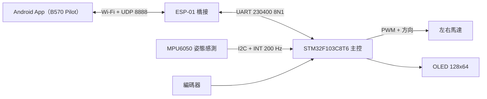

一條指令的旅程：**App 組幀 → UDP 送到 ESP-01 → ESP 原封不動寫進 UART → STM32 解析、套用 → STM32 回報遙測 → ESP 原封不動用 UDP 送回 App**。

這個設計最關鍵的一點是：**UART 上的幀和 UDP 裡的幀格式完全一樣**（[PROTOCOL §2](PROTOCOL.md#2-幀格式uart-與-udp-完全相同)）。所以 ESP-01 不需要「翻譯」，它只看幀的 TYPE 決定要轉給誰，像郵局的分揀員只看信封上的區號、不拆信。好處：

- ESP 的工作量極小：解析器檢查完 CRC 後，轉送時直接用它保留的原始位元組 `f.raw`，不重新組幀（`B570_Bridge.ino` 的 `onUdpFrame()`、`onUartFrame()`）。
- 新增一種 App ⇄ STM32 的訊息時，**ESP 韌體完全不用改**。
- 同一個解析器（parser）三端共用一套語意，可以用同一組測試向量驗證。

**TYPE 分區：每一種訊息歸誰處理**（[`ESP01/B570_Bridge/b570_proto.h`](../ESP01/B570_Bridge/b570_proto.h) 的 `isAppToStm()` 等函式）：

| TYPE 範圍 | 方向 | ESP-01 怎麼做 | 例子 |
|---|---|---|---|
| `0x01–0x3F` | App → STM32 | 只轉送「session 擁有者」送來的幀到 UART | CTRL、MOTOR、PARAM_SET |
| `0x40–0x4F` | App → ESP | 自己處理，**不轉送** | HELLO、WIFI_SET、DISCOVER |
| `0x50–0x5F` | ESP ⇄ STM32 | 只在 UART 上，**絕不上 UDP** | LINK、CRED、NET |
| `0x80–0xBF` | STM32 → App | 每幀用一個 datagram 送給 session 擁有者；沒有 session 就丟掉 | TELEM、ACK、EVENT |
| `0xC0–0xCF` | ESP → App | ESP 自己產生 | HELLO_ACK、ESP_PONG、DISCOVER_ACK |

用「範圍」而不是一個一個列舉，好處是路由規則只有五行，未來加新訊息只要選對範圍。

**分層看三端**（每一層只跟上下層打交道，換掉某一層不影響其他層）：

| 層 | Android App | ESP-01 | STM32 |
|---|---|---|---|
| 應用層 | 搖桿、整定、編排畫面（`ui/`）、`CarRepository` | Session、Wi-Fi 設定、熱點狀態機 | 平衡控制、參數、編排、安全檢查 |
| 協定層 | `protocol/`（`FrameCodec`、`FrameParser`） | `b570_proto.h`（`buildFrame`、`Parser`） | `WHEELTEC/proto.c` + `WHEELTEC/rc_link.c` |
| 傳輸層 | UDP socket（`link/CarConnection.kt`） | `WiFiUDP` + `Serial` | USART2 + DMA |
| 實體層 | 手機 Wi-Fi | 2.4 GHz Wi-Fi / UART | UART（PA2 / PA3） |

### 1.2 無線技術選型

手機要跟車子講話，有很多種無線方案。我們用五個問題來比較：

1. **延遲與抖動**夠不夠低？
2. **手機原生支援**嗎？（不用再買接收器）
3. 連車子時**會不會打斷手機上網**？
4. **額外成本**？
5. **ESP-01 做得到嗎？**

| 方案 | 延遲 / 抖動 | 手機原生 | 打斷上網 | 額外成本 | ESP-01 可行 | 備註 |
|---|---|---|---|---|---|---|
| **Wi-Fi + UDP（採用）** | 低；手機 → ESP 單程約 2–6 ms | 是 | 不會（本地網路或熱點模式） | 無 | 可以 | 掉一包不會卡住下一包 |
| Wi-Fi + TCP | 平均低，但掉包時要等重傳，後面的資料全部被卡住 | 是 | 不會 | 無 | 可以 | 「隊頭阻塞」：舊指令擋住新指令 |
| WebSocket | 同 TCP，再多一層 HTTP 握手與分框 | 是 | 不會 | 無 | 勉強（RAM 吃緊） | 適合網頁，不適合即時遙控 |
| MQTT | 要經過一台 broker（伺服器），多一跳 | 要裝函式庫 | 不會 | 要有 broker | 可以 | 適合 IoT 回報資料，不適合 10 ms 級控制 |
| 傳統藍牙 SPP | 中等 | Android 可以 | 不會 | 要加藍牙模組（如 HC-05） | **不行**（ESP8266 沒有藍牙） | 多一顆模組、多一組 UART |
| BLE | 受「連線間隔」限制，實際由手機決定 | 是 | 不會 | 要加模組 | **不行** | 單包資料量小、連線間隔變動 |
| nRF24L01 等 2.4 GHz 私有無線 | 很低 | **否** | 不會 | 要自製遙控器 | 不相關 | 手機沒有這種無線電 |
| 4G / 雲端遠端 | 高且變動大（經過網際網路與伺服器） | 是 | 不會 | 要 4G 模組或伺服器、可能有月費 | 不行 | 適合「遠端」，不適合貼身遙控 |

**結論**：ESP-01 只有 Wi-Fi，所以選 Wi-Fi；在 Wi-Fi 上選 **UDP**，因為遙控指令是「**狀態**」不是「**事件**」——每 20 ms 就有一個新的搖桿值，掉了一包，下一包馬上補上，**舊資料根本不值得重傳**。真正需要可靠送達的少數指令（存檔、校正……），我們自己在應用層做「逾時重送 + 去重」（1.6 節），只花在需要的地方。

> 小練習：如果改用 TCP，Wi-Fi 掉一個包時會發生什麼？答：TCP 保證「按順序」交付，後面已經到的 CTRL 都得等那個掉的包重傳成功才能交給程式，車子收到的是一串過期的指令。

### 1.3 直連模式

直連模式（預設）：**ESP-01 開自己的 Wi-Fi 基地台（SoftAP），手機直接連上它**。不需要路由器，到哪裡都能用。

#### ESP-01 這一端

- SSID（Wi-Fi 名稱）預設是 `B570-XXXX`，`XXXX` 是 ESP8266 晶片 ID 的低 16 位元（大寫 16 進位，`defaultSsid()`）。每台車名字不同，App 用它認車。
- 密碼是第一次開機隨機產生的 8 碼（`genPassword()`），存進 EEPROM。
- 基地台位址固定 `192.168.4.1`，UDP 埠 `8888`，最多 2 台裝置連上（`MAX_STATIONS`）。
- 加密方式 WPA2。

**隨機密碼怎麼產生**（[`b570_wificfg.h`](../ESP01/B570_Bridge/b570_wificfg.h)）：

- 字元集 `abcdefghjkmnpqrstuvwxyz23456789` 共 31 個字，**刻意拿掉容易看錯的 `i l o 0 1`**（使用者可能要照著 OLED 手動輸入）。
- 8 碼的組合數 = 31⁸ ≈ 8.5 × 10¹¹。
- 亂數來源是 ESP8266 的硬體亂數產生器（`ESP.random()`）；程式先打開射頻（`WiFi.mode(WIFI_STA)`）再產生密碼，因為射頻開著時硬體亂數才是真亂數。
- 用「**拒絕取樣**」避免偏差：一個隨機 byte 是 0–255，若直接 `% 31`，前面幾個字元出現機率會比較高（256 不是 31 的倍數）。程式只接受 `< 248`（= 256 − 256 % 31）的值，再取餘數，每個字元機率就完全相同。

**自動選頻道**：2.4 GHz 的頻道彼此重疊，只有 1、6、11 三個互不干擾。ESP 開機時掃描附近的基地台，用 `ChannelScore` 幫 1 / 6 / 11 各打一個「擁擠分數」，挑最低分的：

- 每個掃到的基地台，權重 `w = clamp(RSSI + 100, 0, 70) + 10`（訊號越強越吵；就算很弱也算 10 分）。
- 對候選頻道 c，若基地台頻道與 c 相距 `d < 5`，加 `(5 − d) × w` 分。

計算範例：附近有 AP-1 在頻道 1（−40 dBm）、AP-2 在頻道 3（−80 dBm）。

| 候選 | AP-1（w = 70） | AP-2（w = 30） | 總分 |
|---|---|---|---|
| 頻道 1 | d = 0 → 5 × 70 = 350 | d = 2 → 3 × 30 = 90 | 440 |
| 頻道 6 | d = 5 → 0 | d = 3 → 2 × 30 = 60 | 60 |
| 頻道 11 | d = 10 → 0 | d = 8 → 0 | **0（選它）** |

分數相同時用亂數挑，避免兩台車同時開機挑到同一個頻道。整個掃描最多 1.5 秒（`SCAN_BUDGET_MS`），只在 AP 還沒開起來的時候做（開機時，或熱點模式找不到熱點、準備改開 AP 時），所以不可能打擾到已連線的手機。

#### Android 這一端：為什麼「行動數據照常可用」

如果叫使用者到系統設定頁去連 `B570-XXXX`，這是一個「沒有網際網路的 Wi-Fi」，各家手機處理方式不一樣：有的跳出「此網路無法連上網際網路」的提示、有的自動切回別的網路（車子就斷了）、有的把上網流量導到這個 Wi-Fi（LINE 就斷了）。行為不可預期，就不能當成產品的基礎。

我們改用 Android 10（API 29）開始提供的 **`WifiNetworkSpecifier`**（[`link/CarConnection.kt`](../AndroidApp/app/src/main/java/com/b570/pilot/link/CarConnection.kt) 的 `startDirect()`）：

```kotlin
val spec = WifiNetworkSpecifier.Builder()
    .setSsid(creds.ssid)
    .setWpa2Passphrase(creds.password)
    .build()
NetworkRequest.Builder()
    .addTransportType(NetworkCapabilities.TRANSPORT_WIFI)
    .removeCapability(NetworkCapabilities.NET_CAPABILITY_INTERNET)   // 關鍵：宣告「這是沒有網際網路的本地網路」
    .setNetworkSpecifier(spec)
    .build()
```

這等於跟系統說：「我這個 App 要**私下**連一個本地裝置，它沒有網際網路。」系統因此：

1. 第一次會跳出「連線到裝置」的系統視窗讓使用者同意（之後會記住）。
2. **不會把它設成預設網路**——其他 App 和系統的上網流量照樣走行動數據（或原本的家用 Wi-Fi）。
3. 只有我們明確「綁定」到這個網路的 socket 才會走它：`network.bindSocket(socket)`。

**為什麼不用 `bindProcessToNetwork()`？** 它會把整個 App 行程的所有連線（包含 DNS 查詢）都導到車子這個沒有網際網路的網路上，影響範圍太大。我們只綁「跟車子講話的那一個 UDP socket」，影響最小、最精準。程式註解特別寫明「絕不呼叫 bindProcessToNetwork」。

#### 配對：OLED 上的 QR Code

QR 內容是業界通用的 Wi-Fi 格式（手機內建相機也認得）：

```
WIFI:T:WPA;S:B570-A1B2;P:k7m3x9qa;;
```

`T:` 加密方式、`S:` SSID、`P:` 密碼，最後兩個分號結束。為了讓 QR **不需要跳脫字元**、而且一定塞得進 OLED，SSID 和密碼有限制（[PROTOCOL §3.4](PROTOCOL.md#34-app--esp)）：

- SSID：1–12 字元，只能 `A-Z a-z 0-9 _ -`。
- 密碼：8–16 個可列印 ASCII（0x21–0x7E，**不含空白**），**不能有** `; , : \ "`（這幾個在 QR 格式裡有特殊意義）。

算一下最長會多長：`WIFI:T:WPA;S:`（13）+ SSID（12）+ `;P:`（3）+ 密碼（16）+ `;;`（2）= **46 bytes**。QR 版本 3、低容錯（L）最多可放 53 bytes，夠用。一般的車（`B570-A1B2` + 8 碼密碼）是 35 bytes，用版本 3、中容錯（M，最多 42 bytes）。版本 3 是 29 × 29 個模組，每模組畫 2 × 2 像素 = 58 像素，剛好放進 128 × 64 OLED 的左半邊（細節見 3.1 節）。


上圖是用 fw 2.0.0 的程式碼渲染的，所以開機頁與資訊頁顯示 `2.0.0`；目前 2.1.0 的版面相同，版本號以 [`WHEELTEC/Inc/app_config.h`](../WHEELTEC/Inc/app_config.h) 為準。

QR 是**在車上即時產生**的，不是印好的貼紙：使用者在 App 改了 Wi-Fi 名稱或密碼，ESP 存檔後約 0.5 s 重新開機（`RESTART_DELAY_MS`），開機約 1 s 後把新帳密（`CRED` 幀）送給 STM32（`CRED_BOOT_DELAY_MS`），OLED 上的 QR 隨即重新產生——前後約數秒。需要實體貼紙時，可以用 `tools/make_pair_qr.py` 產生。

#### 第一次配對的完整流程

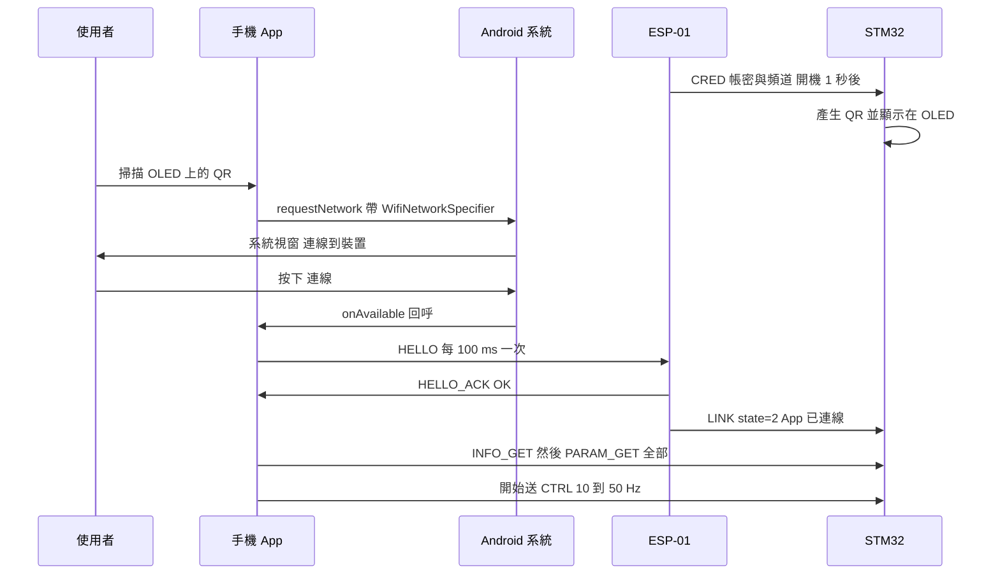

HELLO 在握手階段每 100 ms 送一次（`HELLO_EVERY_HANDSHAKE`），因為 Wi-Fi 剛連上的頭幾個封包常常會掉，送密一點能縮短連線時間；握手最多等 5 秒（`HANDSHAKE_TIMEOUT_MS`）。

### 1.4 熱點模式

#### 為什麼需要第二種模式

直連模式很方便，但有幾個先天限制：

- 手機的 Wi-Fi 開關一定要開著。
- 如果手機**同時**還連著家裡的 Wi-Fi（部分 Android 12 以上手機支援「兩個 Wi-Fi 同時連」），手機的無線電要在兩個頻道之間分時切換，延遲會變高、忽高忽低。
- 手機的 Wi-Fi 省電機制會讓封包不定時延遲（1.8 節）。

**熱點模式**反過來：**手機開「個人熱點」，ESP-01 以 STA 身分加入手機的熱點**。

- 手機是基地台，基地台不會進入省電睡眠；ESP 也關掉自己的省電（`WIFI_NONE_SLEEP`）。
- 手機的 Wi-Fi 開關可以一直關著，上網走行動數據。
- 所有資料都在手機與車子之間直接傳，**不經過網際網路或雲端**。

#### 怎麼設定

1. **用 App 設定**：先直連，App「設定 → 連線方式」填熱點名稱與密碼 → App 送 `STA_SET`（只接受 session 擁有者，或目前沒有 session 時）→ ESP 回 `ESP_ACK` 後 500 ms 重新開機（`RESTART_DELAY_MS`，留時間讓回覆送出去）。
2. **燒錄前內建**：在 `b570_preset_local.h` 填熱點（這個檔案已列入 `.gitignore`，不會被上傳；範本是 `b570_preset_local.example.h`，例如 `"MyPhone"` / `"12345678"`）。第一次開機就直接是熱點模式。每個 `PRESET_ID` 只套用一次（套用紀錄寫在 EEPROM 第 248 byte 起，`PRESET_MARK_OFFSET`），之後使用者在 App 改的設定不會被蓋掉；換一組內建熱點時把 `PRESET_ID` 加 1。


**為什麼一定要 2.4 GHz、WPA2？** ESP8266 的無線電只支援 2.4 GHz，也不支援只開 WPA3 的網路。所以熱點要設成 2.4 GHz（iPhone 開「最大化相容性」）、安全性 WPA2 或 WPA2/WPA3 混合。

#### 怎麼找到車子：DISCOVER 廣播

車子加入熱點後，IP 是手機的 DHCP 隨機分配的（例如 `172.20.10.5`），App 事先不知道。解法是**廣播問路**：

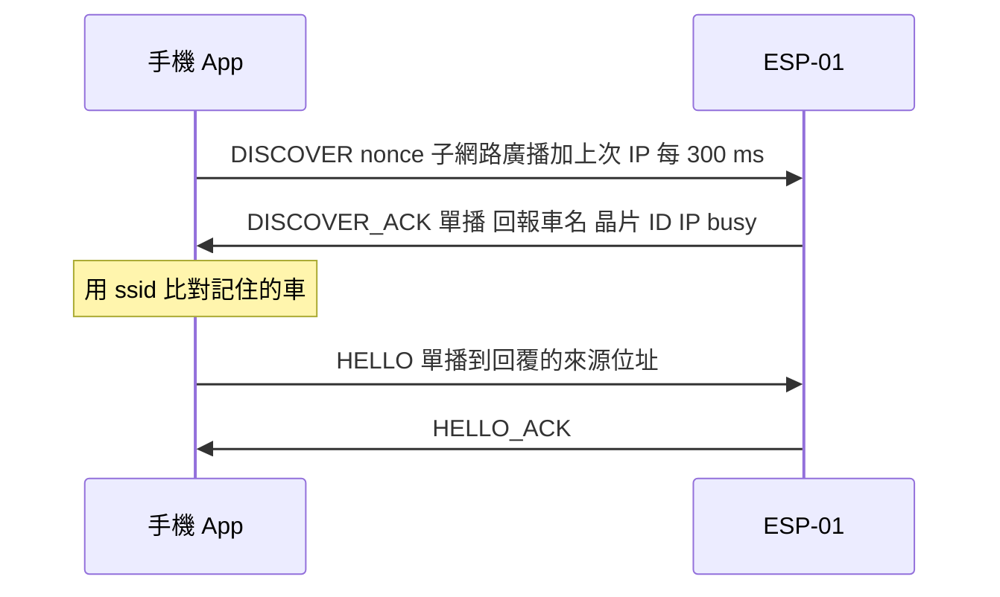

- `DISCOVER` 帶一個隨機 `nonce`，回覆會原樣帶回，用來確認「這是回我的」。
- `DISCOVER_ACK.ssid` 是車名（例如 `B570-A1B2`），App 用它比對記住的車；`busy = 1` 表示已經有別的手機在控制。
- 找到之後一律送往 `DISCOVER_ACK` 的**來源位址**，之後的 HELLO / session 規則和直連完全一樣。
- 熱點不是 Android 的一個 `Network` 物件（手機自己就是基地台），所以這個 socket **不綁定**任何 Network，由系統依子網路決定走哪個介面。也因此熱點模式不需要開手機 Wi-Fi，也不需要「附近裝置 / 位置」權限。

App 端找多久（`data/Hotspot.kt` 的 `ConnectPlanner`）：

| 情況 | 在熱點上找多久 | 找不到時 |
|---|---|---|
| 熱點模式的車、手機熱點開著 | 20 s（`HOTSPOT_JOIN_DISCOVERY_MS`，涵蓋 ESP 加入熱點的時間） | 有密碼才改直連 |
| 熱點模式的車、手機熱點沒開 | 1.5 s | 有密碼就直連 |
| 一般的車、手機熱點開著 | 2 s | 直連 |
| 沒有 AP 密碼（從熱點上找到、沒掃過 QR） | 熱點開著 20 s / 沒開 4 s | 無法直連 |

連線中若車子約 1 s 沒聲音，App 每 1 s 重新廣播一次 DISCOVER（車子重開機後 IP 可能變了）；車子所在的網路介面消失 2.5 s（熱點被關掉）或 8 s 完全沒回應，就判定斷線，交給自動重連。

#### ESP 端的熱點狀態機

車子不能「找不到熱點就變成磚頭」：找不到時要退回直連模式（OLED 顯示 QR），但又要在熱點出現時自動回去。這段邏輯是一個**純狀態機**（[`b570_netsm.h`](../ESP01/B570_Bridge/b570_netsm.h)）：時間和 Wi-Fi 狀態由呼叫端餵進來，它只回傳「要做什麼動作」，因此可以在電腦上測試。

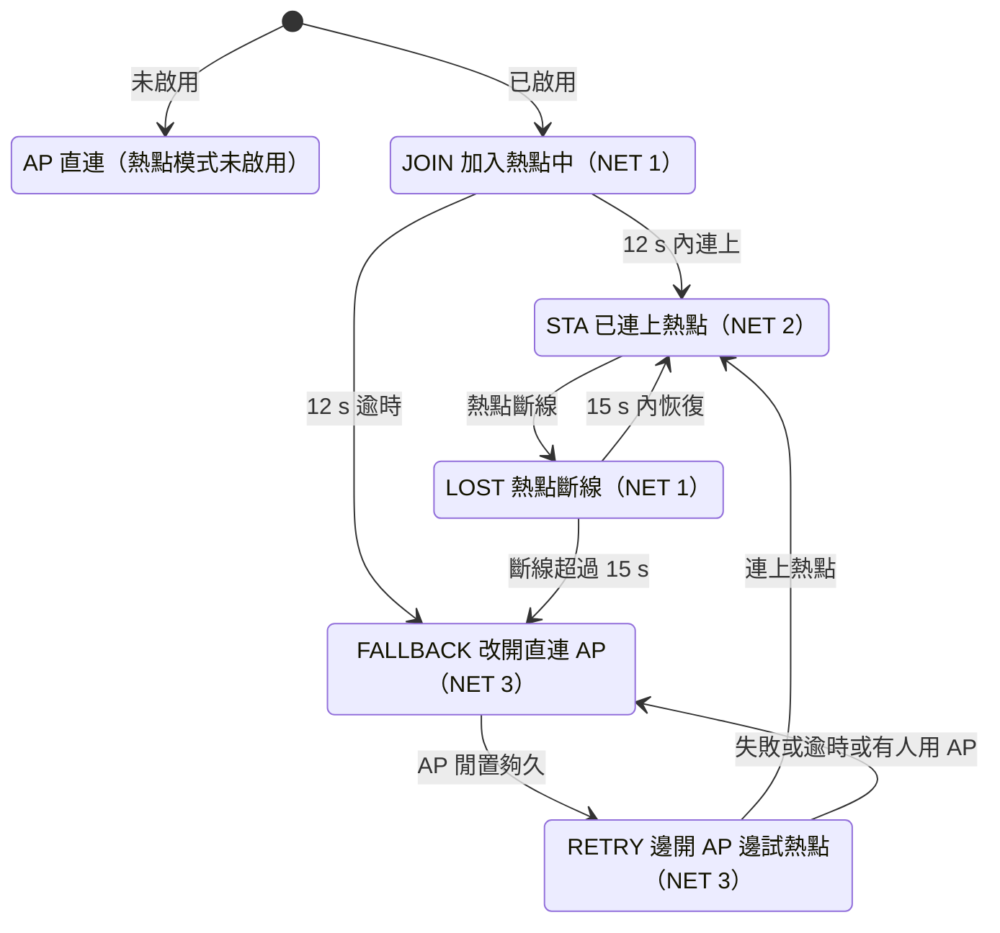

| 常數（`NetSm::`） | 值 | 意義 |
|---|---|---|
| `JOIN_BUDGET_MS` | 12000 | 開機加入熱點的時間上限 |
| `STA_LOST_MS` | 15000 | 熱點斷線多久改開 AP |
| `FAST_WINDOW_MS` | 180000 | 每次改開 AP 起算 3 分鐘的「快速重試期」 |
| `FAST_IDLE_MS` | 6000 | 快速期內，AP 連續閒置 6 s 就試一次熱點 |
| `FIRST_IDLE_MS` | 12000 | 改開 AP 後的**第一次**要閒置 12 s（OLED 剛顯示 QR，使用者可能正在掃） |
| `RETRY_IDLE_MS` | 30000 | 快速期過後，每閒置 30 s 才試一次 |
| `REARM_WINDOW_MS` | 60000 | 直連的手機離開 AP 後，重新開始 1 分鐘快速期 |
| `RETRY_BUDGET_MS` | 8000 | 每次重試的時間上限 |
| `RETRY_MIN_MS` | 500 | 重試開始 0.5 s 內不採信 SDK 的失敗狀態（可能是上一次留下的） |
| `WRONG_PW_STRIKES` | 2 | 連續 2 次密碼錯誤才放棄快速重試 |

幾個值得學的設計細節：

- **提早放棄**：熱點不在時，ESP8266 SDK 掃完一輪（約 2 s）就會回報「找不到」（`STATION_NO_AP_FOUND`），狀態機立刻結束這次重試，不必等滿 8 s。結果快速期每輪約 8 s，射頻離開 AP 頻道約 25% 的時間（主機端模擬實測 23%），直連使用者幾乎感覺不到。
- **密碼錯誤要看兩次**：訊號很弱時，WPA2 握手逾時也會被 SDK 回報成「密碼錯誤」。只看一次會誤判，所以連續 2 次才認定。
- **會卡住的動作只在沒人用時做**：`WiFi.mode()` 切換模式會阻塞至少約 100 ms、掃描會讓射頻離開 AP 頻道。狀態機保證這類動作只在「沒有 session、AP 上也沒有手機」時發出；唯一的例外 `A_YIELD_RETRY`（重試中有手機連上 AP，立刻停止 STA 連線）本身不阻塞。
- **每次切換模式都重設 `WIFI_NONE_SLEEP`**（`radioTune()`），避免 STA 預設的省電模式偷偷回來。

實際效果（[README](../README.md)）：先開車子、3 分鐘內才開熱點，通常 15 秒內、最久約 20 秒連上；超過 3 分鐘才開，最多約 40 秒。

ESP 用 `NET` 幀（每 2 s 一次，狀態改變時立即送）告訴 STM32 目前的模式，OLED 就能顯示「搜尋熱點中 / 已連上 + IP / 找不到改回直連 + QR」：


App 連線頁會直接列出「熱點上的車」，點一下就連，不用掃 QR：


### 1.5 封包格式逐位元組教學

#### 幀的結構

```
offset:  0     1     2     3      4     5..4+LEN     5+LEN 6+LEN
       +-----+-----+-----+------+-----+------------+------------+
       | A5  | 5A  | LEN | TYPE | SEQ | PAYLOAD... | CRC16 (LE) |
       +-----+-----+-----+------+-----+------------+------------+
       |<-- SOF -->|<------ CRC range ------------>|
```

上圖的 offset 是「第幾個 byte」（從 0 起算）；`SOF` 是開頭記號（Start Of Frame）；`CRC range` 標出 CRC 的計算範圍 = `LEN` 到 `PAYLOAD` 最後一個 byte。

| 欄位 | 長度 | 為什麼這樣設計 |
|---|---|---|
| `A5 5A`（SOF） | 2 | 讓解析器在一串位元組中找到「幀的開頭」。用兩個 byte 比一個 byte 更不容易被雜訊誤認。 |
| `LEN` | 1 | payload 長度 0–200。超過 200 一定是錯的，可以馬上丟棄、不用等到 CRC 才發現。最長幀 = 200 + 7 = 207 bytes。 |
| `TYPE` | 1 | 訊息種類，同時決定路由（1.1 節的分區）。 |
| `SEQ` | 1 | 0–255 滾動序號，用於配對回覆、辨識重送（1.6 節）。 |
| `PAYLOAD` | LEN | 內容。所有多位元組數字都是 **little-endian**（低位元組在前），`f32` 是 IEEE-754 單精度浮點數。 |
| `CRC16` | 2 | 檢查碼，little-endian。計算範圍是 `LEN, TYPE, SEQ, PAYLOAD`（SOF 是固定值，算進去沒有意義）。 |

為什麼選 little-endian？STM32（Cortex-M3）、ESP8266 都是 little-endian，在 C 裡可以直接 `memcpy` 浮點數（`rc_link.c` 的 `send_params()` 就是這樣做）；只有 Kotlin / Java 要自己轉換（`protocol/Bytes.kt`）。

#### CRC-16/CCITT-FALSE 怎麼算

CRC 可以想成：把資料當成一個很長的二進位多項式，除以一個固定的「生成多項式」，**餘數**就是 CRC。收方用同樣方法算一次，餘數不同就代表資料壞了。我們用的參數：

| 參數 | 值 | 意思 |
|---|---|---|
| 多項式 poly | `0x1021`（x¹⁶ + x¹² + x⁵ + 1） | 生成多項式 |
| 初值 init | `0xFFFF` | 暫存器的起始值（不是 0，所以資料前面多幾個 `00` 也會被發現） |
| 反射 | 不反射 | 每個 byte 從最高位元開始處理 |
| xorout | `0` | 最後不再做 XOR |
| 驗證值 | `"123456789"` → `0x29B1` | 任何實作都應該算出這個值 |

16 位元 CRC 能抓到**所有**單一位元錯誤，以及**所有**長度 ≤ 16 位元的連續錯誤（burst），比單純「加總檢查碼」強得多。STM32 的實作只有幾行（[`WHEELTEC/proto.c`](../WHEELTEC/proto.c)）：

```c
uint16_t proto_crc16(const uint8_t *data, uint16_t len)
{
	uint16_t crc = 0xFFFF;
	while (len--) {
		crc ^= (uint16_t)(*data++) << 8;          /* 新 byte 放進高 8 位元 */
		for (uint8_t i = 0; i < 8; i++)           /* 逐位元「長除法」 */
			crc = (crc & 0x8000) ? (uint16_t)((crc << 1) ^ 0x1021) : (uint16_t)(crc << 1);
	}
	return crc;
}
```

ESP 端（`b570_proto.h` 的 `crc16Update()`）用的是「一次處理一個 byte、不查表」的位元運算版本，結果完全相同，主機端測試會驗證這件事。

#### 實例：一個 CTRL 幀逐 byte 解說

用 [PROTOCOL.md](PROTOCOL.md#測試向量python-toolsb570_protopy-vectors) 的測試向量：**CTRL，速度 300 mm/s、轉向 −250 ‰、SEQ = 7**。

```
A5 5A 05 01 07 2C 01 06 FF 00 D4 4D
```

| byte | 值 | 意義 |
|---|---|---|
| 0–1 | `A5 5A` | SOF |
| 2 | `05` | LEN = 5（payload 5 bytes） |
| 3 | `01` | TYPE = CTRL |
| 4 | `07` | SEQ = 7 |
| 5–6 | `2C 01` | `i16 speed` = 0x012C = **300**（little-endian：低位元組 `2C` 在前） |
| 7–8 | `06 FF` | `i16 turn` = 0xFF06 = 65286 − 65536 = **−250**（二補數） |
| 9 | `00` | `u8 flags`（保留，0） |
| 10–11 | `D4 4D` | CRC = 0x4DD4（little-endian） |

CRC 計算過程（範圍是 `05 01 07 2C 01 06 FF 00` 這 8 bytes），每處理完一個 byte 暫存器的值：

| 處理的 byte | `05` | `01` | `07` | `2C` | `01` | `06` | `FF` | `00` |
|---|---|---|---|---|---|---|---|---|
| CRC 暫存器 | `0xB155` | `0xF2DB` | `0x64BA` | `0x73CC` | `0x92D5` | `0x163D` | `0x5107` | **`0x4DD4`** |

CRC 的「除法」是二進位、**不進位**的除法：減法用 XOR 代替（1 − 1 = 0、1 − 0 = 1，跟 XOR 一樣，而且不會借位）。所以每一步長除法就簡化成「左移一位；移出去的那一位是 1，就 XOR 生成多項式 0x1021」。

把第一個 byte 拆開看（初值 `0xFFFF`，先 XOR `0x05 << 8` 得 `0xFAFF`，再做 8 次「左移；若移出的最高位是 1 就 XOR 0x1021」）。注意第二欄看的是**上一列結果**的最高位（bit15），也就是這一次左移時被移出去的那一位：

| 第幾次 | 移出的 bit15（上一列結果的最高位） | 結果 |
|---|---|---|
| 0（起始） | — | `0xFAFF` |
| 1 | 1 | `0xE5DF` |
| 2 | 1 | `0xDB9F` |
| 3 | 1 | `0xA71F` |
| 4 | 1 | `0x5E1F` |
| 5 | 0 | `0xBC3E` |
| 6 | 1 | `0x685D` |
| 7 | 0 | `0xD0BA` |
| 8 | 1 | `0xB155` |

再一個更短的例子，**MOTOR 啟動、SEQ = 2**：`A5 5A 01 03 02 01 67 DD`——LEN 1、TYPE 0x03、SEQ 2、payload `01`（1 = 啟動），CRC 範圍 `01 03 02 01` 算出 `0xDD67`，寫成 `67 DD`。

> 自己驗證：執行 `python tools/b570_proto.py vectors`，會印出全部測試向量，並跑解析器自我測試。

#### 串流解析器：雜訊、多幀黏在一起、一幀被拆成兩段都要能處理

UART 是一條「位元組的河流」，沒有天然的邊界：一次讀到的資料可能包含好幾幀（多幀黏在一起），也可能一幀要分兩次才收齊（被拆成兩段）；ESP-01 開機時還會用 74880 鮑率吐出一串開機訊息，在 230400 的 STM32 眼中就是亂碼。解析器（STM32 的 `proto_feed()`、ESP 的 `Parser`、Python 的 `Parser`、App 的 `FrameParser`，四份語意完全一致）的規則：

1. 在緩衝區裡找 `A5 5A`。找不到時，前面的位元組都丟掉，**但結尾單獨的 `A5` 先留著**（它可能是下一次才收到 `5A` 的 SOF 前半）。
2. 有了 SOF，至少要等到 LEN 到齊；`LEN > 200` → 丟掉 1 byte，回到步驟 1。
3. 等整幀到齊（`LEN + 7` bytes），算 CRC。
4. CRC 對 → 交出這一幀，丟掉整幀；CRC 錯 → **只丟 1 個 byte**，在剩下的資料中重新找 SOF。

為什麼 CRC 錯時只丟 1 byte？因為那個「假的 SOF」可能是雜訊，真正的幀開頭可能就藏在它後面幾個 byte；整段丟掉會連真的幀一起丟掉。

範例（`b570_proto.py` 的自我測試）：送進 `00 A5 FF` + 完整的 CTRL 幀 + PING 幀的前 5 bytes，第二次再送 PING 的剩下部分 + `A5`，第三次送 `5A 00`：

- `00` 不是 SOF → 丟；`A5 FF` 不是 `A5 5A` → 丟。
- 找到 CTRL 的 `A5 5A`，整幀到齊、CRC 對 → 交出 CTRL。
- PING 只到了 5 bytes → 等。第二次資料來了 → 交出 PING；結尾的 `A5` 保留。
- 第三次 `5A 00`：湊成 `A5 5A 00`，LEN = 0 但 TYPE、SEQ、CRC 還沒到 → 繼續等。

UDP 有天然邊界，我們規定**每個 datagram 只放一幀**，收方仍然用同一個串流解析器（不用寫第二套）。ESP 對每個 datagram 會先 `g_udpParser.reset()`，不跨 datagram 拼接，避免一個壞掉的封包污染下一個。

### 1.6 可靠度設計

#### 三種訊息，三種可靠度策略

| 類型 | 例子 | 掉了怎麼辦 | 理由 |
|---|---|---|---|
| **狀態型**（最新值覆蓋舊值） | `CTRL`、`TELEM` | 不重送，等下一個 | 下一包 20–100 ms 內就到，重送舊值只會更糟 |
| **請求 / 回覆型** | `PARAM_SET`、`ZERO_CAL`、`PARAM_SAVE`、`SEQ_PLAY`、`MOTOR` | App 逾時 400 ms 就重送，最多重送 3 次、共送 4 次（`REQ_TIMEOUT_MS`、`REQ_RETRIES`） | 一定要知道成功與否 |
| **事件型** | `EVENT`（傾倒、低電壓、存檔完成…） | 不重送；重要狀態另外在遙測的 `flags` / `stop_reason` 裡持續回報 | 事件是「提示」，真正的狀態看遙測 |

App 端的請求是**一次只有一個在等**（`requestMutex`），失敗最長約 400 ms × (1 次原本 + 3 次重送) = 1.6 s 才回報 `TIMEOUT`（程式是 `for (attempt in 0..retries)`，`0..3` 共 4 圈）。

#### SEQ 規則：讓重送「安全」

光有重送還不夠。想像：App 送「零點校正」，STM32 做了、回 ACK，但 ACK 在 Wi-Fi 上掉了。App 以為沒成功又送一次——STM32 **又校正一次**（車子這時可能已經被拿起來，校正值就錯了）。更危險的是 `MOTOR 啟動`：使用者按了緊急停止之後，一個遲到的「啟動」重送把馬達又打開。

解法是三條規則（[PROTOCOL §2 SEQ 規則](PROTOCOL.md#seq-規則請求--回覆配對與重送)）：

1. **回覆幀的 SEQ = 請求幀的 SEQ**。App 只接受 SEQ 相同的回覆，遲到的舊回覆不會被誤認。
2. **重送沿用同一個 SEQ、同一份位元組**（App 的 `Session.request()` 整幀只組一次）。
3. STM32 對有副作用的指令（`ZERO_CAL`、`PARAM_SAVE`、`SEQ_PLAY`、`MOTOR 啟動`）記住「最後一個 TYPE + SEQ」：**1.5 s 內同 TYPE 同 SEQ 再來 = 重送 → 只重發上次的回覆，不重做**。這就是「exactly-once（剛好執行一次）」。

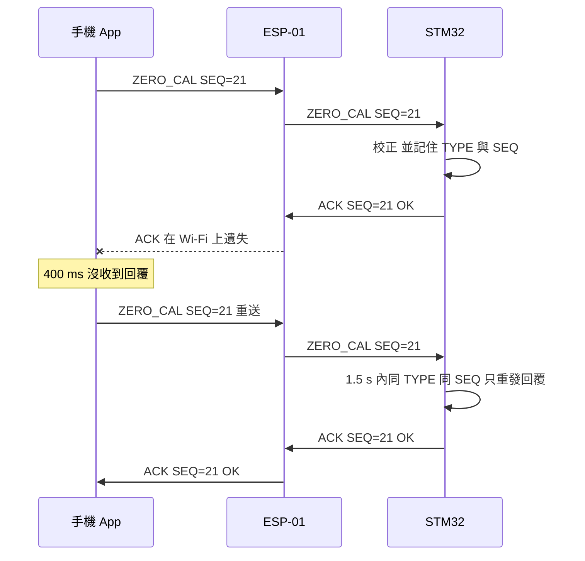

實作在 [`WHEELTEC/rc_link.c`](../WHEELTEC/rc_link.c)：`is_retry()` 判斷、`remember()` 記錄（150 個控制週期 = 1.5 s）。`MOTOR 啟動`用**獨立**的欄位 `start_seq / start_tick` 記錄，不會被其他指令覆蓋。`PARAM_SAVE` 還在寫 Flash 時收到重送就先不回，寫完的 ACK 會帶原本的 SEQ。

天生就可以重送的指令（`MOTOR 停止 / 緊急停止`、`PARAM_SET`、`PARAM_GET`、`SEQ_STOP`…）不需要去重：做兩次結果一樣。

**ACK 狀態碼**：

| 值 | 名稱 | 什麼時候 |
|---|---|---|
| 0 | OK | 成功 |
| 1 | BAD_ARG | 參數錯（例如零點校正時傾斜超過 ±10°） |
| 2 | BUSY | 現在不行（例如馬達運轉中要存檔） |
| 3 | FAIL | 執行失敗（例如 Flash 寫入驗證不符） |
| 4 | NOT_READY | 條件未滿足（例如電壓太低不能啟動、編排沒載入） |
| 5 | UNKNOWN_TYPE | 不認識的 TYPE |

#### Session：同一時間只有一支手機能控制

ESP 的 `AppSession`（[`b570_session.h`](../ESP01/B570_Bridge/b570_session.h)）：

1. 收到 `HELLO`：沒有 session、或來源 IP 跟目前擁有者相同、或擁有者已逾時 → 成為擁有者（記錄 **IP:port**），回 OK；否則回 BUSY（App 顯示「另一支手機正在控制這台車」）。
2. 擁有者 **1500 ms** 沒有任何封包 → session 結束（`TIMEOUT_MS`）。
3. 在直連模式，ESP 用 DHCP 表查出擁有者手機的 MAC 位址；那支手機一斷開 Wi-Fi，session **立即**結束，不用等 1.5 s。
4. 非擁有者送來的 `0x01–0x3F`（給 STM32 的指令）一律丟棄。`WIFI_SET`、`STA_SET` 等改設定的指令只接受擁有者（或沒有 session 時）。`DISCOVER` 則任何人都可以送（不然沒人找得到車）。

#### 心跳與失聯保護

- **CTRL 同時就是心跳**：App 連線期間一直送，就算沒操作也送 `(0, 0)`，最少 10 Hz。STM32 把**任何** App 幀（TYPE < 0x40）都當成「App 還活著」（`Motion_OnAppFrame()`）。
- ESP 每 500 ms 送 `LINK` 給 STM32（`LINK_PERIOD_MS`），內容是 0 無裝置 / 1 有手機連上 Wi-Fi / 2 App session 進行中。STM32 超過 2 s（`ESP_TIMEOUT_TICKS` = 200 週期）沒收到 LINK，就當 ESP 不在線。
- STM32 判斷「App 在線」= 距上一個 App 幀 < `FAILSAFE_MS`（預設 400 ms），**而且** ESP 沒有回報「沒有 session」。
- 一旦從「在線」變「失聯」（`motion.c` 的 `Motion_Tick()`）：搖桿目標歸零、中止編排、送 `EVENT LINK_LOST`、遙測 `flags` 的 FAILSAFE 位元設 1。

**失聯時為什麼不直接切斷馬達？** 平衡車切斷馬達就會倒。最安全的狀態是「**目標速度平順地降到 0，原地保持平衡**」——目標值仍然經過斜率限制（3.2 節），不會急煞。

400 ms 怎麼來的？App 靜止時心跳是 10 Hz（每 100 ms），400 ms 內會有 4 個 CTRL，連續掉 2 個也不會誤判；而一台以 0.5 m/s 前進的車，400 ms 內最多再走 20 cm 就開始減速。範圍 150–2000 ms 可在 App 調整。

#### 緊急停止：最高優先權的路徑

| 端 | 做法（程式位置） |
|---|---|
| App | `CarRepository.emergencyStop()`：控制量立刻歸零 → 取消所有還在排隊 / 重送的「啟動、播放」請求（`abortMotion()`）→ **不經請求佇列**直接送 `MOTOR ESTOP` → 每 25 ms 再連發 2 個（共 3 個，`ESTOP_BURST`）→ 之後每 100 ms 補送，直到遙測連續 400 ms 顯示馬達已停（`ESTOP_HOLD_MS`）；1.5 s 還沒確認就跳危險提示 |
| App（斷線中按的） | 記下來，連回同一台車時**在任何其他指令之前**補送（手動重連 60 s 內有效，`PENDING_ESTOP_MS`） |
| STM32 | 在 **UART 中斷內**呼叫 `request_stop()` → `Motor_Kill()`：方向腳全部拉低、PWM 設 0，**不等下一個控制週期**；同時中止編排、目標歸零。極少數情況下，若 UART 中斷剛好打斷控制中斷正在 `Set_Pwm()` 輸出 PWM，控制中斷返回後會把這一筆 PWM 寫完，最晚在下一個 10 ms 週期被 `Turn_Off()`（看到 `Flag_Stop = 1`）關掉 |
| STM32 | `MOTOR 啟動` 的重送去重：緊急停止之後才到的舊「啟動」重送，只會重發舊回覆，不會重新啟動 |

#### 安全相關時間常數一覽

| 誰 | 常數 | 值 | 做什麼 |
|---|---|---|---|
| STM32 | `FAILSAFE_MS`（參數 11） | 400 ms | 沒收到 App 幀 → 目標歸零、原地平衡 |
| STM32 | `ESP_TIMEOUT_TICKS` | 2 s | 沒收到 LINK → 當 ESP 不在線 |
| STM32 | 主迴圈 IMU 看門狗 | 約 200 ms | 控制中斷停了（MPU6050 斷線）→ 切斷馬達、停機原因 8 |
| ESP | `AppSession::TIMEOUT_MS` | 1500 ms | 擁有者沒封包 → 結束 session |
| App | `HELLO_RESEND_NS` | 1 s | 1 s 沒收到車子資料 → 每 300 ms 重送 HELLO |
| App | `LINK_LOST_NS` | 1.5 s | 顯示「訊號中斷」、搖桿封鎖 |
| App | `REQ_TIMEOUT_MS`、`REQ_RETRIES` | 400 ms × (1 + 3 次重送) = 最長 1.6 s | 請求逾時重送 |
| App | `ESTOP_RESEND_MS` | 100 ms | 緊急停止補送間隔 |

#### 資安小提醒

- 直連用 WPA2 加密，每台車有自己的隨機密碼；QR 只顯示在車子的 OLED 上——**能看到 OLED 的人才能配對**，這是「實體接觸即授權」的設計。
- 改 Wi-Fi 設定只接受 session 擁有者；`STA_INFO` 的熱點密碼只回給擁有者，其他人收到的 `pw_len = 0`。
- OTA（透過 Wi-Fi 無線更新 ESP 韌體，3.3 節）的密碼 = 車子 Wi-Fi 密碼。
- 限制：協定本身沒有加密或簽章，安全性依賴 Wi-Fi 層（WPA2）。在熱點模式下，能加入你手機熱點的人本來就是你允許的人。

### 1.7 遙測與控制延遲量測

#### TELEM 幀（`0x81`，payload 42 bytes）

| 位移 | 型別 | 欄位 | 單位 / 說明 |
|---|---|---|---|
| 0 | u16 | tick | 控制週期計數（10 ms），會溢位 |
| 2 | i16 | pitch | 0.01°，平衡傾角（**未扣零點**的原始值） |
| 4 | i16 | roll | 0.01° |
| 6 / 8 | i16 | gyro_bal / gyro_turn | MPU6050 原始值，16.4 LSB = 1 °/s |
| 10 / 12 | i16 | vel_l / vel_r | 左右輪速 mm/s |
| 14 / 16 | i16 | pwm_l / pwm_r | 左右馬達 PWM（±6900） |
| 18 / 20 / 22 | i16 | pwm_bal / pwm_vel / pwm_turn | 直立環、速度環、轉向環各自的輸出 |
| 24 / 26 | i16 | tgt_speed / tgt_turn | 經斜率限制後的目標 mm/s、‰ |
| 28 | u16 | battery | 0.01 V |
| 30 | u8 | flags | bit0 馬達運轉、bit1 App 在線、bit2 編排播放中、bit3 低電壓、bit4 直立、bit5 失聯保護中、bit6 有未存檔修改、bit7 已拿到 Wi-Fi 帳密 |
| 31 | u8 | stop_reason | 0 運轉中、1 開機、2 按鍵、3 App、4 拿起、5 傾倒、6 低電壓、7 緊急停止、8 IMU |
| 32 / 33 | u8 | seq_step / seq_loop | 編排目前步驟（未播放 = `0xFF`）、循環次數 |
| 34 | u8 | src | 控制來源：0 無、1 App、2 編排 |
| 35 | u8 | link_q | 最近 1 秒收到的 App 幀數 |
| 36 | i16 | heading | 0.01°，Z 軸陀螺積分（會漂移，僅供顯示） |
| 38 | u16 | loop_us | 控制中斷執行時間 µs |
| 40 | u8 | ctrl_seq | 最後收到的 CTRL 的 SEQ |
| 41 | u8 | ctrl_age | 收到那個 CTRL 之後經過幾個控制週期（≥ 255 = 255） |

- 為什麼用整數 + 固定倍率（例如 0.01°）而不是 float？一個 i16 只要 2 bytes，float 要 4 bytes；0.01° 的解析度已經遠超過感測器的雜訊。
- 頻率由參數 `TELEM_HZ`（預設 50）決定。控制週期是 100 Hz，所以實際頻率只能是 100 Hz 的整數分之一：`實際 = 100 / round(100 / 設定值)`。例：設 30 → `round(3.33) = 3` → 實際 33.3 Hz（`TELEM_HZ` 是整數參數，`params.c` 的 `clamp_param()` 先算出 33.33 再四捨五入，韌體回傳的是 33；`RC_Link_Tick()` 再用 `round(100 / 33) = 3` 分頻，實際仍是 33.3 Hz）；設 70 → `round(1.43) = 1` → 100 Hz（回傳 100）。
- 解碼端只要求 ≥ 40 bytes：新版 App 讀得懂舊版韌體的 40 bytes（沒有最後兩欄，這是**向後相容**），只讀前 40 bytes 的舊版 App 遇到 42 bytes 也不受影響（**向前相容**）——訣竅是新欄位只加在最後面。

#### 「控制延遲」怎麼量

使用者抱怨過：「App 收資料收得很順，只是控制訊號發過去很延遲」。下行（遙測）看起來沒問題，可疑的是**上行**。但 PING 只能量「一個封包來回花多久」，量不到「指令在車上**什麼時候真正被套用**」（中間還有等控制週期、指令在手機或主控板端排隊等等）。要量這件事，就得知道「我送的哪一個 CTRL、在什麼時候被車子用到」。做法是讓遙測**回聲**：

- STM32 收到 CTRL 時記下它的 SEQ（`ctrl_seq`）和當時的 tick（`ctrl_tick`）。
- 遙測回報 `ctrl_seq` 與 `ctrl_age = 這筆遙測的 tick − 收到時的 tick`。
- App 記得每個 SEQ 的送出時間（`ControlTiming`），收到遙測就能算。

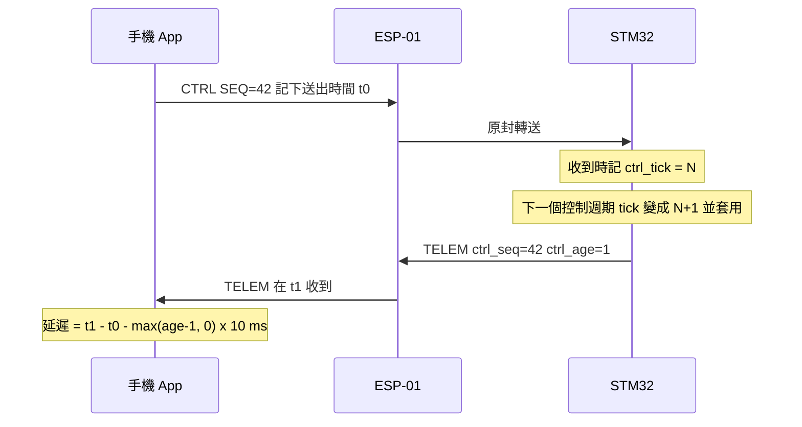

先定義兩個時間：

- `t_send`：App 送出「SEQ 等於 `ctrl_seq` 的那個 CTRL」的時間。
- `t_recv`：App 收到這筆遙測的時間。

```
控制延遲 = (t_recv − t_send) − max(ctrl_age − 1, 0) × 10 ms
```

為什麼是 `ctrl_age − 1`？STM32 記的是「收到時的 tick」，而 `Motion_Tick()` 是**先把 tick 加 1 再套用**指令，遙測在同一個控制中斷的最後送出。所以「套用的那一個週期」送出的遙測 `ctrl_age = 1`；`ctrl_age = a` 代表已經套用了 `a − 1` 個週期，要扣掉那段「套用之後才送遙測」的時間。

實際上 `ctrl_age` 常常是 1 或 2：遙測預設 50 Hz，也就是**每 2 個控制週期才送一次**。如果 CTRL 剛好在「沒有送遙測」的那個週期被套用，下一筆遙測要再等 10 ms 才出門，這時 `ctrl_age = 2`，那 10 ms 是「已經套用、等遙測出門」的時間，不屬於控制延遲，要扣掉。（早期版本直接扣 `a × 10 ms`，每個樣本少算 10 ms，是跨端複查時發現、用真實韌體程式在電腦上跑過才確認的。）

**計算範例**（`b570_proto.py` 的 `control_latency_ms()` 自我測試）：CTRL 在 1000 ms 送出，遙測在 1045 ms 收到：

| ctrl_age | 計算 | 控制延遲 |
|---|---|---|
| 1 | 45 − max(0, 0) × 10 | 45 ms |
| 2 | 45 − 1 × 10 | 35 ms |
| 255 | 還沒收過 CTRL 或太久 | 不採用 |

這個值 = 手機 → Wi-Fi → ESP → UART → 主控板套用（含等下一個控制週期），**再加上這筆遙測的下行時間**（約 3–8 ms），所以是控制延遲的「上限」。App 對樣本做平滑（EMA，指數移動平均，見 0.4 節）並算最近 5 秒的 P95（第 95 百分位數，看偶發卡頓），顯示在駕駛頁「控制 xx ms」：< 40 ms 綠、< 100 ms 黃、其他紅。


#### 用三個量測「分段診斷」

| 量測 | 怎麼量 | 涵蓋哪幾段 |
|---|---|---|
| Wi-Fi 來回 | `ESP_PING`（每 2 s）→ ESP 直接回 `ESP_PONG` | 手機 ⇄ ESP（純 Wi-Fi） |
| 端到端來回 | `PING`（每 500 ms）→ STM32 回 `PONG` | 手機 ⇄ ESP ⇄ UART ⇄ STM32 |
| 控制延遲 | CTRL → 遙測回聲 | 手機 → STM32 **真正套用** + 遙測下行 |

規則：控制延遲正常會比 Wi-Fi 來回多 4–15 ms；**多 30 ms 以上 = 慢在 UART / 主控板**。監測頁的「延遲診斷」就是用這些規則給出一句白話建議。


**上行遺失率**：STM32 每 100 個控制週期（1 s）結算一次「這 1 秒收到幾個 App 幀」放進 `link_q`。App 對照**同一段時間**自己送出幾個給主控板的幀，就能算出上行遺失率。難點是兩邊的「1 秒」要對齊：App 的 `LinkQSettleTracker` 從 `link_q` 改變的時刻學出 STM32 的結算時間點，再把手機端的時間窗往前推「上行 + 下行延遲」（用控制延遲的平滑值；舊韌體沒有控制延遲，就改用 PING 來回，兩者都沒有時先假設 10 ms）。沒對齊時，送出速率一變（開始推搖桿）就會算出 10% 以上的假遺失。

### 1.8 延遲預算與改善實錄

#### 延遲預算：一次搖桿動作到輪子反應

| 段落 | 典型時間 | 依據 |
|---|---|---|
| ① App 等下一個 20 ms 傳送刻度 | 0–20 ms | 傳送執行緒固定 20 ms 一個刻度（`PERIOD_NS`） |
| ② 手機 → ESP（Wi-Fi 空中） | 2–6 ms | [PROTOCOL §5](PROTOCOL.md#5-時序建議) |
| ③ ESP 收到 UDP → 寫進 UART | < 1 ms | ESP 每圈先收 UDP，整幀直接寫進硬體 FIFO |
| ④ UART 傳 12 bytes | 0.52 ms | 12 × 43.4 µs |
| ⑤ 等下一個控制週期 | 0–10 ms | 控制週期 10 ms |
| **②–⑤ 合計（手機送出 → 車上套用）** | **< 20 ms** | |
| ⑥ App 顯示的「控制 xx ms」另含遙測下行 | +3–8 ms | UART 2.1 ms + ESP + Wi-Fi |
| ⑦ 之後：斜率限制 + 平衡車動態 | 數十到數百 ms | 這是「**反應**」不是通訊延遲（3.2 節） |

③ + ④ 在 ESP 主機端測試裡用 230400 8N1、128 bytes 硬體 FIFO 模擬（`tools/esp_host_test/test_main.cpp` 的 `testUplinkLatency()`）：駕駛中 CTRL 從「UDP 收到」到「最後一個位元上線」**平均 0.62 ms、最大 2.9 ms**；同時在上傳編排（兩個 207 bytes 的 `SEQ_LOAD`）和改參數時，平均約 2 ms、最大約 23.6 ms。

**UART 傳送時間速查**（230400 bps、8N1 = 每 byte 10 位元 = 43.4 µs）：

| 幀 | 總長 | 時間 |
|---|---|---|
| CTRL（payload 5） | 12 bytes | 0.52 ms |
| ACK / LINK（payload 2） | 9 bytes | 0.39 ms |
| TELEM（payload 42） | 49 bytes | 2.13 ms |
| PARAM_VALUES 全部 17 個（payload 86） | 93 bytes | 4.04 ms |
| 最長幀（payload 200） | 207 bytes | 8.98 ms |

**頻寬負載**：下行 TELEM 50 Hz × 49 bytes = 2450 B/s，約佔 230400 bps（23040 B/s）的 10.6%（遙測 100 Hz 時約 21%）；上行 CTRL 50 Hz × 12 bytes = 600 B/s，約 2.6%。UART 很空，不是瓶頸。

> 小觀念：「延遲」是訊息在路上花的時間；「反應」是車子收到指令後物理上的變化速度。如果「控制 xx ms」已經只有 20–40 ms，車子仍覺得慢，就是斜率限制（`ACCEL`）或速度環的問題（調參數），不是通訊。

#### 改善實錄：遇過的五個延遲問題

**問題 1：依賴 UART IDLE 中斷 → 改成每 10 ms 主動輪詢 DMA**

- 症狀：控制指令偶爾延遲很久，但下行很順。
- 原因：STM32 原本只在「UART 線路閒置（IDLE）」、「DMA 半滿」、「DMA 全滿」三種時機處理收到的資料。如果 IDLE 中斷因故沒有觸發，資料要等 DMA 半滿（128 bytes）才被處理。最壞情況估算：上行幾乎只有 12 bytes 的 CTRL，50 Hz 下每秒 600 bytes，湊滿 128 bytes 要約 213 ms。
- 解法：每個 10 ms 控制週期**一開始**就呼叫 `RC_Link_PollRx()`，直接讀 DMA 計數器看收到了多少、處理新資料。就算 IDLE 中斷失效，指令最多也只晚 10 ms。
- 附帶修正：DMA 的回呼函式改成「一律以 DMA 計數器為準」，不用 HAL 傳進來的位置參數（半滿 / 全滿時固定是 128 / 256）。否則輪詢剛處理過更新的位置，遲到的回呼會被誤判成「繞了一圈」而重複處理約 250 bytes 舊資料。

**問題 2：手機端封包堆積（bufferbloat）→ `ControlPacer` + 小傳送緩衝**

- 症狀：Wi-Fi 一時變慢（干擾、手機在掃描）之後，控制延遲變成好幾秒。
- 原因：手機照樣每秒送 50 個 CTRL；送不出去的封包在作業系統的 socket 傳送緩衝裡排隊，可以排上百個。車子收到的是好幾秒前的舊指令。ESP-01 的緩衝很小、送不出去就丟，所以下行遙測反而看起來很順。
- 解法（[`link/ControlPacer.kt`](../AndroidApp/app/src/main/java/com/b570/pilot/link/ControlPacer.kt) 與 `CarConnection.configureSocket()`）：
  - socket 傳送緩衝設成 2048 bytes（`SEND_BUFFER_BYTES`；系統有下限，實際約 4 KB，也就是只能排幾個封包）。Wi-Fi 變慢時 `send()` 會等，而不是排隊；等到時送出的是**當下最新**的搖桿值。
  - `ControlPacer` 決定每個 20 ms 刻度要不要送（見下表）。
  - 搖桿值存在一個 `AtomicInteger`（高 16 位元速度、低 16 位元轉向），觸控事件直接寫入；傳送執行緒每次讀**最新值**，舊值從來不排隊。

`ControlPacer` 的送出規則：

| 情況 | 送出頻率 | 常數 |
|---|---|---|
| 搖桿在動，或停下後 300 ms 內 | 每刻度（50 Hz） | `ACTIVE_TICKS = 15` |
| 靜止 | 每 5 刻度（10 Hz 心跳） | `IDLE_INTERVAL = 5` |
| 壅塞（控制延遲 EMA > 150 ms，< 80 ms 才恢復） | 最多每 3 刻度（約 16 Hz） | `CONGESTED_INTERVAL = 3`、`CONGESTED_ON_MS = 150`、`CONGESTED_OFF_MS = 80` |
| 放開搖桿（值變成 0）那一刻 | 下一個刻度一定送，不受降頻影響 | `releaseNow` |

**問題 3：Wi-Fi 省電 → 手機 WifiLock、ESP 關閉休眠**

- 原因：Wi-Fi 裝置省電時會睡覺，只在基地台的 DTIM 信標時醒來收資料，封包可能被延後 100–300 ms。（基地台會定期廣播「信標（beacon）」；DTIM 是其中特別標記「有暫存資料要給睡覺中的裝置」的那幾個信標，通常每 100–300 ms 一次。）
- 手機端：持有 `WIFI_MODE_FULL_LOW_LATENCY` WifiLock（App 在前景、螢幕亮時關閉 Wi-Fi 省電）；Android 14（API 34）以前另外持有 `WIFI_MODE_FULL_HIGH_PERF`（`acquireWifiLocks()`）。
- ESP 端：STA 預設是 modem-sleep，會讓「手機 → 車」（正好是控制指令方向）等 DTIM 喚醒。所以每次切換 Wi-Fi 模式後都重新呼叫 `WiFi.setSleepMode(WIFI_NONE_SLEEP)`（`radioTune()`）。

**問題 4：手機同時連兩個 Wi-Fi → 偵測並建議熱點模式**

- 原因：直連時手機若還連著家裡的 Wi-Fi，兩個頻道不同，無線電要分時切換，延遲變高、忽高忽低。
- 解法：`watchDualWifi()` 監看「還有沒有另一個有網際網路的 Wi-Fi」，有的話 `LinkStats.dualWifi = true`，監測頁提醒使用者。根本解法是熱點模式（1.4 節）。

**問題 5：排程與 QoS 細節**

- 收發執行緒優先權設成 `THREAD_PRIORITY_URGENT_AUDIO`（音訊等級）：每 20 ms 醒來一次、工作很少，被排程耽誤就是延遲。
- 絕對時間排程：下一個刻度 = 上一個 + 20 ms，不受這次送出花多久影響，不會累積漂移。
- 每個刻度**第一件事送 CTRL**，PING、WIFI_GET 等都排在它後面；可靠請求走另一條佇列，不會拖慢 CTRL。
- CTRL 在固定的 buffer 裡原地組幀（零配置），避免垃圾回收（GC）造成停頓。
- socket 設 DSCP EF（`trafficClass = 0xB8`），讓支援 WMM 的 Wi-Fi 把它放進語音佇列（是否生效取決於手機的 Wi-Fi 驅動）。DSCP 是 IP 標頭裡標示「這個封包有多急」的 6 個位元，EF（Expedited Forwarding，值 46，左移 2 位就是 0xB8）代表「低延遲、請優先送」；WMM（Wi-Fi Multimedia）是 Wi-Fi 的優先權機制，把封包分成語音、視訊、一般、背景四個佇列，語音佇列等待空中時間最短。
- ESP 每圈 `loop()` **先收 UDP（控制，延遲最敏感）再收 UART**，收到的幀立即寫進 UART 硬體 FIFO，不批次、不等計時器。

### 1.9 UART 與 DMA

#### 為什麼是 UART？為什麼是 230400？

ESP-01 只拉出 UART（TX/RX）和兩支 GPIO，所以 STM32 ⇄ ESP 只能走 UART：全雙工、兩條線 + 共地、兩邊都是 3.3 V 邏輯，可以直接對接。

鮑率比較（以 TELEM 49 bytes、50 Hz 為例）：

| 鮑率 | 每 byte | TELEM 一幀 | 50 Hz 遙測佔用 |
|---|---|---|---|
| 38400（原廠設定） | 260 µs | 12.8 ms | 64% |
| 115200 | 86.8 µs | 4.25 ms | 21% |
| **230400（採用）** | 43.4 µs | 2.13 ms | 10.6% |

230400 讓最常見的幀在 2 ms 左右傳完；控制週期本身是 10 ms，再往上提高鮑率對總延遲幫助很小。

**鮑率誤差計算**（兩邊時脈都不是 230400 的整數倍，要確認誤差夠小）：

- STM32 的 USART2 掛在 APB1（72 MHz / 2 = 36 MHz），16 倍過取樣：除數 = 36,000,000 / (16 × 230400) = 9.765625。暫存器是「整數 9 + 小數 12/16」= 9.75 → 實際 36,000,000 / (16 × 9.75) = **230769 bps，誤差 +0.16%**。
- ESP8266 的 UART 時脈 80 MHz、整數除數：80,000,000 / 230400 = 347.2 → 取 347 → **230548 bps，誤差 +0.06%**。
- 兩邊相差約 0.1%，遠小於 UART 一般可容忍的範圍（約 ±2% 以內）。

#### STM32 接收：環形 DMA + IDLE + 輪詢

DMA 就像一個不用休息的搬運工：UART 每收到一個 byte，DMA 自動把它放進記憶體的下一格，CPU 完全不用管。我們把 DMA 設成 **circular（環形）** 模式（`usart.c`：DMA1 Channel 6、`DMA_CIRCULAR`），256 bytes 的 `rx_dma[]` 寫到底就自動繞回開頭，永遠不停。

「目前寫到哪裡」= `256 − DMA 剩餘計數器`。程式只要記住「上次處理到哪」（`rx_pos`），比較兩者就知道新資料在哪裡（`rx_process()`，有處理繞回的情況）：

```c
void RC_Link_PollRx(void)            /* 每個 10 ms 控制週期開頭呼叫 */
{
	...
	__disable_irq();                 /* 跟 UART / DMA 中斷裡的 rx_process 互斥 */
	uint16_t pos = (uint16_t)(RX_DMA_SIZE - __HAL_DMA_GET_COUNTER(huart2.hdmarx));
	rx_process(pos);
	__set_PRIMASK(pm);
}
```

觸發處理的時機有三種，任一種先到都可以：IDLE 中斷（一串資料結束後線路閒置）、DMA 半滿 / 全滿中斷、**控制週期開頭的輪詢**。另外三個保險：

- UART 發生雜訊、溢位等錯誤時，HAL 會停止 DMA 接收，`HAL_UART_ErrorCallback()` 立刻重新啟動。
- 主迴圈的 `RC_Link_Task()` 是「接收看門狗」：任何原因停止接收就重新啟動。
- PA3（RX）設內部上拉：ESP 沒接時腳位不會浮動亂收雜訊。

#### STM32 傳送：環形佇列 + DMA

傳送用 512 bytes 的環形佇列（`tx_ring`，大小必須是 2 的次方，才能用 `& (512 − 1)` 取代取餘數）：

1. `tx_frame_seq()` 先在區域變數裡組幀、算 CRC（**這段不關中斷**，避免拖慢其他中斷）。
2. 關中斷，把整幀複製進佇列（空間不夠就整幀丟掉，不會送出半幀）。
3. DMA 沒在忙就啟動一次 DMA 傳送（`tx_kick_locked()`，一次送一段連續區域）。
4. DMA 傳完觸發 `HAL_UART_TxCpltCallback()`，推進佇列尾端，再啟動下一段。

因為步驟 2 有關中斷保護，**任何優先權的中斷都能安全呼叫** `tx_frame()`——UART 中斷裡回 ACK、控制中斷裡送遙測、主迴圈裡送存檔結果都行。

#### ESP 端：先收 UDP、絕不 print

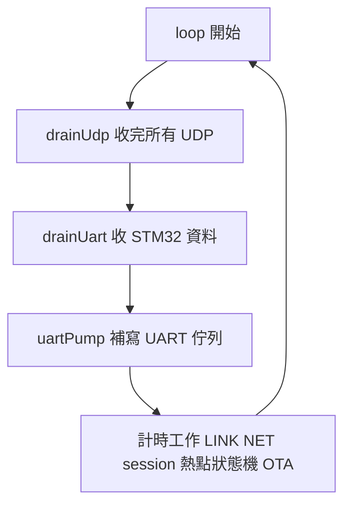

- `drainUdp()`：一次把已到的 datagram 都處理完（每圈最多 32 個，`UDP_MAX_PKTS_LOOP`，防洪水）；給 STM32 的幀呼叫 `uartSend()` 直接寫進 UART。
- `TxRing`（[`b570_uarttx.h`](../ESP01/B570_Bridge/b570_uarttx.h)）：硬體 FIFO 有空間就直接寫（平常一定是這條路），滿了才排進 1024 bytes 的環形佇列，每圈 `pump()` 補寫；**整幀進或整幀丟、絕不忙等**。寫 FIFO 時保留 1 格，因為 FIFO 真的滿時底層 `uart_write` 會忙等。
- `loop()` 裡所有計時都是 `millis()` 比較，沒有 `delay()`（只有 `setup()` 的開機選頻 `pickChannelBlocking()` 用 `delay(5)` 等掃描結果，那時不可能有人連線）；其他會阻塞的操作（模式切換）也只在沒人連線時做。
- **絕不 print**：ESP-01 的 `Serial` 就是接 STM32 的那條線，任何除錯文字都會混進資料流。程式還呼叫 `Serial.setDebugOutput(false)` 關掉 SDK 自己的輸出。開機時 ROM 用 74880 鮑率吐出的訊息擋不掉，就交給 STM32 的解析器當雜訊處理。

---

## 2. 硬體設計與選型

### 2.1 主控 STM32F103C8T6

原廠主控板就是它，我們沒有換。先檢查「夠不夠用」：

| 資源 | 規格 | 本專案使用 | 說明 |
|---|---|---|---|
| CPU | Cortex-M3，8 MHz 外部石英 × 9 = 72 MHz | 控制中斷每 10 ms 一次，實際耗時看遙測 `loop_us` | `SystemClock_Config()` |
| Flash | 64 KB | 程式 60.5 KB / 63 KB；最後 1 KB（`0x0800FC00`）存參數 | 連結腳本 `STM32F103C8TX_FLASH.ld` 把 FLASH 設成 63K |
| RAM | 20 KB | 6.2 KB | README 驗證紀錄（arm-none-eabi-gcc `-Os`） |

主要的 RAM 用量（都是靜態配置，沒有 `malloc`）：

| 緩衝區 | 大小 | 位置 |
|---|---|---|
| OLED 畫面緩衝 `OLED_GRAM[128][8]` | 1024 B | `BSPcode/oled.c` |
| UART 傳送環形佇列 `tx_ring` | 512 B | `rc_link.c` |
| 編排步驟 `seq[48]`（每步 8 B） | 384 B | `motion.c` |
| UART 接收 DMA `rx_dma` | 256 B | `rc_link.c` |
| 解析器緩衝 `parser.buf` | 256 B | `rc_link.c` |
| QR 模組 `qr_t`（29 列 × 4 B + 標頭）+ 功能遮罩 `fn_rows` | 約 240 B | `show.c`、`qr_mini.c` |
| 最小堆疊 / 堆積 | 1024 B / 512 B | 連結腳本 `_Min_Stack_Size`、`_Min_Heap_Size` |

用到的周邊：

| 周邊 | 用途 |
|---|---|
| TIM1 CH1 / CH4 | 右 / 左馬達 PWM（10 kHz） |
| TIM2、TIM4 | 左、右輪編碼器（編碼器模式） |
| TIM3 | 超音波回波捕捉（`USE_ULTRASONIC = 0` 時不用） |
| ADC1 IN6 | 電池電壓 |
| USART1（PA9/PA10，115200） | DMP 初始化時的除錯輸出 |
| USART2（PA2/PA3，230400）+ DMA1 Ch6 / Ch7 | ESP-01 |
| USART3（PB10/PB11，9600） | 原廠藍牙 APP（`APP_LEGACY_BT = 0` 時不用） |
| EXTI15_10（PA12） | MPU6050 資料就緒中斷 = 控制節拍（EXTI = 外部中斷：GPIO 腳位電位改變時觸發中斷；第 10–15 號腳共用 `EXTI15_10` 這一個中斷入口） |
| DWT 週期計數器 | 取代 SysTick 當 HAL 時基、量控制中斷耗時 |

### 2.2 姿態感測 MPU6050 與三種姿態演算法

MPU6050 是 3 軸陀螺儀 + 3 軸加速度計（[`WHEELTEC/MPU6050.c`](../WHEELTEC/MPU6050.c)）：

- 介面：I2C（PB8 = SCL、PB9 = SDA，軟體模擬 I2C，`BSPcode/iic.c`），位址 0x68。開機讀不到正確的 `WHO_AM_I`（0x68）就重新開機（`DMP_Init()`）。
- 量程：陀螺儀 ±2000 °/s（16.4 LSB = 1 °/s）、加速度 ±2 g。
- 取樣：200 Hz（`DEFAULT_MPU_HZ`），每筆資料就緒就從 INT 腳（PA12）送一個上升緣——**這就是整個控制系統的節拍來源**（3.1 節）。

**為什麼需要「姿態演算法」？** 陀螺儀量角速度，積分得到角度，但會慢慢漂移；加速度計可以從重力方向算出角度，但車子一加速、一震動就亂跳。兩者互補：短時間信陀螺儀、長時間信加速度計。三種融合方法都保留（參數 `ANGLE_ALGO`）：

| 編號 | 演算法 | 原理 | 優點 | 缺點 |
|---|---|---|---|---|
| 1 | DMP | MPU6050 內建的數位運動處理器算出四元數，MCU 讀 FIFO（`Read_DMP()`） | MCU 負擔小 | 黑盒子；Flash 寫入讓 CPU 停頓時 FIFO 會積壓舊資料（程式在存檔後用 `mpu_reset_fifo()` 清掉） |
| 2（預設） | 卡爾曼 | 狀態 = [角度, 陀螺偏移]，每 5 ms 預測 + 修正（`KF.c` 的 `KF_X()`，Ts = 0.005、Q = 1e-10、R = 1e-4；Q 是「預測的不確定度」，越小越相信陀螺儀積分的預測；R 是「量測的不確定度」，越小越相信加速度計） | 會估計並扣掉陀螺偏移 | 計算量較大（2 × 2 矩陣） |
| 3 | 互補濾波 | `angle = 0.02 × 加速度角 + 0.98 × (angle + 角速度 × 0.005)`（`filter.c`，K1 = 0.02） | 最簡單、好理解 | 不估計偏移 |

**互補濾波算一步看看**：目前角度 0°、陀螺儀 10 °/s、加速度計算出 1°：
`新角度 = 0.02 × 1 + 0.98 × (0 + 10 × 0.005) = 0.02 + 0.049 = 0.069°`。
它的時間常數 τ = dt × (1 − K1) / K1 = 0.005 × 0.98 / 0.02 ≈ 0.245 s：比 0.25 秒快的變化主要相信陀螺儀，比它慢的變化主要相信加速度計。

加速度角都用 `atan2(-ay, az)` 算，前傾為正（`control.c` 的 `Get_Angle()`）。切換演算法只在**存檔並重新開機後**才生效（`Params_Load()` 才把 `ANGLE_ALGO` 套到 `Way_Angle`），因為運轉中切換會沿用舊的濾波狀態，角度可能錯好幾秒。

### 2.3 馬達、驅動與編碼器

馬達、驅動板與編碼器都是 **WHEELTEC 原廠套件**，程式裡的機構參數（[`WHEELTEC/Inc/control.h`](../WHEELTEC/Inc/control.h)）：

| 參數 | 值 |
|---|---|
| 輪徑 `Diameter_67` | 67 mm（周長 210.49 mm） |
| 減速比 `Reduction_Ratio` | 30 |
| 編碼器線數 `Encoder_precision` | 13 |
| 倍頻 `EncoderMultiples` | 4（A、B 兩相的上升與下降緣都計數） |
| 編碼器讀取頻率 `Control_Frequency` | 200 Hz（每 5 ms 讀一次並清零） |

**驅動介面**：每顆馬達「兩支方向腳 + 一支 PWM」（晶片型號以原廠驅動板為準）。

| 馬達 | 方向腳 | PWM |
|---|---|---|
| 右 | AIN1 = PB14、AIN2 = PB15 | PWMA = PA8（TIM1 CH1） |
| 左 | BIN1 = PB13、BIN2 = PB12 | PWMB = PA11（TIM1 CH4） |

- PWM 頻率：TIM1 時脈 72 MHz、預除 0、週期 7199 → 72 MHz / 7200 = **10 kHz**。
- `PWM_LIMIT = 6900`，工作週期（duty cycle）上限約 96%（6900 / 7200）。
- `Set_Pwm()` 依正負號設方向腳，絕對值寫進比較暫存器；`Motor_Kill()` 把四支方向腳全拉低、PWM 設 0。

**編碼器換算**（`Get_Velocity_Form_Encoder()`）：

- 輪子轉一圈的計數 = 13 線 × 4 倍頻 × 30 減速比 = **1560**。
- 每個計數 = 210.49 mm / 1560 ≈ 0.135 mm。
- 5 ms 內 1 個計數 ≈ 0.135 / 0.005 ≈ **27 mm/s**。

範例：車速 500 mm/s，每輪每 5 ms 約 500 / 27 ≈ 18.5 個計數；兩輪合計約 37。

編碼器接在 TIM2（PA0 / PA1，左輪）和 TIM4（PB6 / PB7，右輪），用定時器的「編碼器模式」（TI12，硬體自動 4 倍頻；輸入濾波 10，只有 TIM4 的 CH2 沿用 CubeMX 設定為 0）計數；讀值取負號（`-Read_Encoder(2)`），讓前進為正。

### 2.4 無線模組 ESP-01

| 選項 | 無線 | 跟手機 | 優點 | 缺點 |
|---|---|---|---|---|
| **ESP-01（ESP8266，採用）** | 2.4 GHz Wi-Fi | Wi-Fi 直連 / 熱點 | 便宜、小、Arduino 生態系、支援 OTA 無線更新 | 沒有藍牙；只有 UART + 2 GPIO；RAM 約 80 KB |
| ESP32-C3 | Wi-Fi + BLE 5 | Wi-Fi 或 BLE | RAM 大（約 400 KB）、可加藍牙配對 | 要重新設計接線與韌體 |
| HC-05 類藍牙 SPP 模組 | 傳統藍牙 | Android 可以 | 透明 UART，接線簡單 | 要配對；不能 OTA；頻寬與延遲不如 Wi-Fi 直連 |
| BLE 模組 | BLE | 可以 | 省電 | 單包小、延遲受連線間隔影響；App 要寫 GATT |

選 ESP-01 的理由：最便宜、最小，UART 介面正好接 STM32 的 USART2；它要做的事（UDP ⇄ UART 轉送、session、Wi-Fi 設定）很單純，arduino-cli 編譯結果：全域 RAM 31.3 KB / 80 KB、韌體約 332 KB（OTA 上限約 502 KB），資源足夠。建議用 **ESP-01S**（板上已有開機需要的上拉電阻）。

Arduino IDE 設定（[README](../README.md)）：Generic ESP8266 Module、Flash 1MB（FS:none OTA:~502KB）、CPU **160 MHz**（較低延遲）、Flash Mode DOUT、esp8266 core 3.1.2。發射功率設 17 dBm（`TX_POWER_DBM`）。

### 2.5 電源設計

**ESP-01 是最挑電源的元件**：Wi-Fi 發射瞬間電流約 250 mA，如果穩壓器或線材供不上，電壓瞬間下陷，ESP 會重開機，甚至拖累同一條 3.3 V 上的 OLED（畫面閃爍）。

| 項目 | 建議（`B570_Bridge.ino` 檔頭、README） | 為什麼 |
|---|---|---|
| 3.3 V 穩壓器 | 能輸出 **≥ 300 mA** 給 ESP-01 | 峰值約 250 mA，要留餘裕 |
| 大電容 | 模組旁 100–470 µF 電解電容 | 發射的瞬間大電流先由電容供應，電壓不下陷 |
| 小電容 | 0.1 µF 陶瓷電容 | 濾掉高頻雜訊（電解電容對高頻反應慢） |
| EN / CH_PD | 接 3.3 V（10 kΩ 上拉） | 晶片致能 |
| GPIO0、GPIO2、RST | 開機時必須是高電位（ESP-01S 板上已有上拉） | GPIO0 低電位開機會進燒錄模式 |
| 共地 | ESP 與 STM32 的 GND 一定要接在一起 | UART 訊號是以 GND 為基準 |
| 症狀處理 | OLED 在 App 連線時閃爍、ESP 反覆重開 → 改用獨立 3.3 V 穩壓（例如 AMS1117 + 470 µF） | 與主控板的 3.3 V 分開 |

**電池電壓量測**（`BSPcode/bsp_adc.c` 的 `Get_battery_volt()`）：電池經分壓接到 PA6（ADC1 通道 6），程式公式：

```c
Volt = ADC值 × 3.3 × 11 × 100 / 4096;     /* 單位 0.01 V；×11 = 分壓比，4096 = 12 位元 ADC */
```

範例：ADC 讀到 1400 → 1400 × 3.3 × 11 × 100 / 4096 ≈ 1240 → **12.40 V**。每 1 個 ADC 計數約 8.9 mV。

- 取樣時間 239.5 個 ADC 週期（ADC 時脈 72 MHz / 6 = 12 MHz，一次轉換約 21 µs）：長取樣時間適合分壓電阻這種高阻抗訊號源。
- 每 10 ms 取樣一次，累積 100 次取平均 → 每秒更新一次 `Voltage`，抗雜訊。
- 程式以 3S 鋰電池計算電量：12.60 V = 滿（`BAT_FULL_CV`）、10.00 V = 空（`BAT_EMPTY_CV`）。電池規格以 WHEELTEC 原廠套件為準。

**低電壓保護**：參數 `LOWBAT_V`（預設 10.0 V，範圍 9.0–12.0）。運轉中低於門檻 → 停機、送 `EVENT LOW_BATTERY`；停機時電壓不足 → 無法啟動（`can_start()`）。為什麼要保護？鋰電池過度放電會損傷電池；而且電壓太低時馬達出力不足，平衡車會控制不住。

### 2.6 接線總表

| 功能 | STM32 腳位 | 接到 | 備註 |
|---|---|---|---|
| ESP-01 UART | PA2（USART2_TX） | ESP-01 RX（GPIO3） | 230400 8N1 |
| ESP-01 UART | PA3（USART2_RX） | ESP-01 TX（GPIO1） | 內部上拉；**燒錄 ESP 時先拔開** |
| 3.3 V / GND | — | ESP-01 VCC / GND | ≥ 300 mA、電容、共地 |
| MPU6050 I2C | PB8 = SCL、PB9 = SDA | MPU6050 | 軟體 I2C |
| MPU6050 中斷 | PA12（EXTI，上升緣，上拉） | MPU6050 INT | 200 Hz 控制節拍 |
| 右馬達 | PA8（TIM1 CH1 = PWMA）、PB14 AIN1、PB15 AIN2 | 驅動板 | |
| 左馬達 | PA11（TIM1 CH4 = PWMB）、PB13 BIN1、PB12 BIN2 | 驅動板 | |
| 左輪編碼器 | PA0 / PA1（TIM2） | 編碼器 A / B | |
| 右輪編碼器 | PB6 / PB7（TIM4） | 編碼器 A / B | |
| 電池電壓 | PA6（ADC1_IN6） | 分壓電路 | ×11 |
| OLED | PB5 = 時脈、PB4 = 資料、PA15 = DC、PB3 = RES | OLED | 軟體序列傳輸 |
| 按鍵 | PA5（輸入、上拉） | 使用者按鍵 | 按下 = 低電位 |
| LED | PA4 | 狀態燈 | |
| 除錯 UART | PA9 / PA10（USART1） | — | 115200 |
| 原廠藍牙（選用） | PB10 / PB11（USART3） | 藍牙模組 | `APP_LEGACY_BT` |
| 超音波（選用） | PB0 捕捉、PB1 觸發 | 超音波模組 | `USE_ULTRASONIC` |

注意：PA15、PB3、PB4 原本是 JTAG 腳位，程式用 `__HAL_AFIO_REMAP_SWJ_NOJTAG()` 關掉 JTAG、保留 SWD，所以 ST-Link 燒錄照常可用。

### 2.7 OLED 與按鍵

**OLED**（`BSPcode/oled.c`、[`WHEELTEC/show.c`](../WHEELTEC/show.c)）：

- 128 × 64 單色，用 GPIO 模擬的序列介面一個位元一個位元送出；初始化指令（例如 `0x8D 0x14` 開啟電荷泵）屬於 SSD1306 系列的指令集，實際控制器以原廠套件為準。
- 程式先畫在 1024 bytes 的 `OLED_GRAM`，主迴圈每 50 ms 呼叫 `UI_Task()` 整頁送出。
- 三個頁面：儀表板、配對 QR（熱點模式時改成熱點資訊）、參數資訊。App 連上自動切到儀表板，斷線自動切回配對頁。

**為什麼把 QR 放在 OLED 而不是印貼紙？** 帳密改了 QR 就自動更新；車子在熱點模式時還能顯示熱點名稱與 IP；不需要額外的零件。

**按鍵**（PA5，`BSPcode/key.c` 的 `Key_Scan()`）：每 10 ms 在控制中斷裡掃描一次，用狀態機辨識三種動作：

| 動作 | 判斷 | 功能 |
|---|---|---|
| 單擊 | 按住 ≥ 20 ms（去彈跳）後放開，300 ms 內沒有再按 | 啟動 / 停止 |
| 雙擊 | 放開後 300 ms 內再按一次 | 切換 OLED 頁面 |
| 長按 | 按住 2 s | 停止時：零點校正並存入 Flash；運轉中：停止 |

**LED**（PA4，`control.c` 呼叫 `Led_Flash()`）：

| 狀態 | LED |
|---|---|
| 停止（不論 App 是否連線） | 慢閃，每 1 s 切換一次 |
| 運轉中、App 沒連線 | 快閃，每 250 ms 切換一次 |
| 運轉中、App 已連線 | 恆亮 |

---

## 3. 軟體設計

### 3.1 STM32 韌體架構

#### 誰在什麼時候執行：中斷與主迴圈分工

| 執行環境 | 觸發 | 頻率 | 做什麼 | NVIC 優先權（數字小 = 高） |
|---|---|---|---|---|
| USART2 / DMA1 Ch6、Ch7 中斷 | UART IDLE、DMA 半滿 / 全滿、傳送完成 | 有資料時 | 解析幀、回覆、緊急停止立即斷電 | 0（最高） |
| EXTI15_10（MPU6050 INT） | PA12 上升緣 | 每 5 ms | 姿態、編碼器；每 10 ms 跑一次完整控制 | 2 |
| 主迴圈 | — | 50 ms 節拍 | OLED、Flash 存檔、接收看門狗、IMU 看門狗 | 最低（不是中斷） |

（NVIC = 巢狀向量中斷控制器，Cortex-M 內建、負責排定各中斷優先權的硬體；「巢狀」是指高優先權的中斷可以打斷正在執行的低優先權中斷。優先權分組 `NVIC_PRIORITYGROUP_2`；USART3、TIM3 是 1。）

**為什麼控制節拍來自 MPU6050 的中斷，而不是定時器？** 因為這樣「感測器剛有新資料」和「控制計算」嚴格同步：每次控制用的都是最新鮮的姿態，不會出現「定時器剛好在感測器更新前一刻觸發」這種相位飄移。

**為什麼 UART 中斷優先權比控制高？** 緊急停止要能「插隊」：就算控制中斷正在跑，UART 中斷也能打斷它，立刻呼叫 `Motor_Kill()`。（唯一的小縫隙：如果剛好打斷的是控制中斷正在 `Set_Pwm()` 寫 PWM 的那幾行，控制中斷返回後會把那一筆寫完，最晚在下一個 10 ms 週期被 `Turn_Off()` 關掉，見 1.6 節。）

#### 一個 10 ms 控制週期裡發生什麼

`HAL_GPIO_EXTI_Callback()`（[`WHEELTEC/control.c`](../WHEELTEC/control.c)）每 5 ms 被呼叫一次，用 `Flag_Target` 輪流：

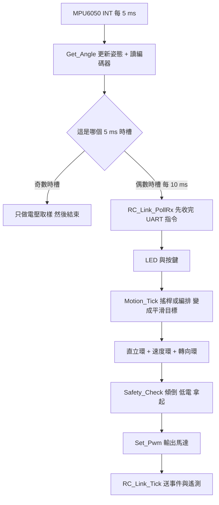

姿態每 5 ms 更新（濾波器在 200 Hz 下效果較好），控制每 10 ms 一次。

#### 跨中斷的資料要小心

UART 中斷（優先權 0）可以在控制中斷（優先權 2）**執行到一半**時插進來。如果 UART 中斷直接改控制用的狀態，控制中斷可能讀到「改到一半」的值。`motion.c` 依照「這件事要多快生效、會不會改到一半」分成三種做法：

| 做法 | 用在哪裡 | 為什麼 |
|---|---|---|
| 設「**請求旗標**」，交給下一個 `Motion_Tick()` 在控制中斷裡套用 | 啟動（`req_start`）、開始播放編排（`req_play`） | 啟動要重設目標值、送事件，牽涉好幾個變數，集中在控制週期開頭一次做完最安全；晚 10 ms 生效沒有關係 |
| 在 UART 中斷內**立即**執行 | 停止（`request_stop()`：`Motor_Kill()` 斷電 + 設 `Flag_Stop` 與 `req_stop`）、中止編排（`seq_abort()`） | 停下來越快越好。這兩個函式都用 `__disable_irq()` 包住要一起改的變數，同步生效；停止的原因與事件再由 `Motion_Tick()` 補上 |
| UART 中斷**直接寫入單一變數** | 搖桿值（`app_speed` / `app_turn`）、編排步驟 `seq[]`（`Motion_SeqLoad()`）、參數（`PARAM_SET`、`ZERO_CAL` 經 `Params_Set()` 改 `Balance_Kp`、`Max_Speed`…） | Cortex-M3 對齊的 16 / 32 位元寫入是原子的（一個指令完成，不會被打斷在中間），控制中斷下一次讀到的就是新值；`seq[]` 只在沒有播放時才允許寫入（播放中回 BUSY） |

需要把好幾個變數一起改的地方，用 `__disable_irq()` 關中斷，並保存 / 還原 `PRIMASK`（中斷遮罩暫存器），這樣即使函式被巢狀呼叫，也不會在內層就把中斷提早打開。

主迴圈的 IMU 看門狗：主迴圈靠控制中斷提供 50 ms 節拍；如果等了 100 ms（`DWT` 計數 7,200,000 個週期）節拍都沒來，連續 2 次就判定 MPU6050 中斷停了（IMU 斷線或當機）→ `Motion_ImuFault()` 切斷馬達、停機原因 8。

#### 模組關係

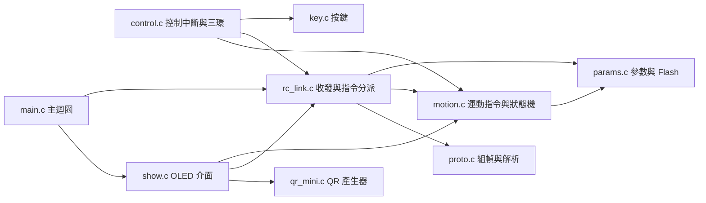

| 檔案 | 責任 |
|---|---|
| `WHEELTEC/proto.c` | CRC、組幀、串流解析（與 Python 參考實作行為一致，可在電腦上編譯測試） |
| `WHEELTEC/rc_link.c` | USART2 DMA 收發、指令分派、SEQ 去重、遙測 / 事件上傳、Wi-Fi 帳密與 NET 狀態 |
| `WHEELTEC/motion.c` | 搖桿 / 編排 → 平滑目標；馬達啟停狀態機；失聯保護；事件佇列 |
| `WHEELTEC/params.c` | 17 個參數的預設 / 範圍 / 夾限、Flash 存取 |
| `WHEELTEC/control.c` | 控制中斷、原廠三環、安全檢查、姿態讀取 |
| `WHEELTEC/show.c` | OLED 三頁介面 |
| `WHEELTEC/qr_mini.c` | 精簡 QR Code 產生器 |
| `WHEELTEC/Inc/app_config.h` | 版本號、功能開關（`USE_ULTRASONIC`、`APP_LEGACY_BT`、`MOTION_INVERT_*`） |

#### 馬達狀態機與安全檢查

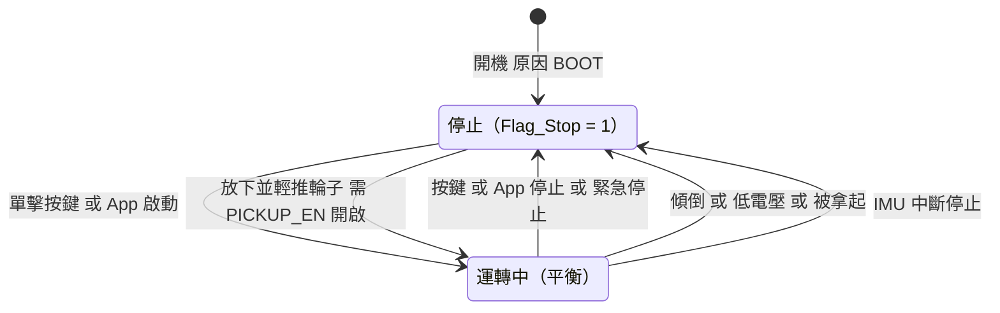

- 啟動條件（`can_start()`）：電壓 ≥ `LOWBAT_V`、傾角在 ±`FALL_ANGLE` 以內、不是 IMU 故障。
- 運轉中每 10 ms `Safety_Check()`：`|傾角 − 零點| > FALL_ANGLE`（預設 40°）→ 傾倒停機；電壓低於門檻 → 低電壓停機；`PICKUP_EN` 開啟時用原廠演算法偵測「被拿起」（輪子空轉、Z 軸加速度大、車身接近直立）。
- 因為拿起、傾倒、剛開機而停的，偵測到「放下並往前輕推輪子」（原廠 `Put_Down()`）會自動啟動（只在 `PICKUP_EN` = 1 時；關掉拿起偵測也會一併關掉這個自動啟動）。
- 使用者按的停止會**覆蓋**自動停機原因，避免「我按了停止，放下時它又自己跑起來」。

#### 參數存在 Flash 最後一頁

| 位移 | 內容 |
|---|---|
| 0 | `u32 magic` = 0x30373542（ASCII「B570」） |
| 4 | `u16 version` = 2 |
| 6 | `u16 count` = 17 |
| 8 | `float v[17]` |
| 76 | `u16 crc`（用同一個 CRC-16/CCITT-FALSE） |

- 位址 `0x0800FC00`（`PARAMS_FLASH_ADDR`），連結腳本把程式區縮成 63 KB，這 1 KB 不會被程式覆蓋。
- 開機 `Params_Load()`：先全部套預設，magic、版本、CRC 都對才載入；每個值再夾限一次。舊版（version 1，fw 2.0）的存檔會自動升級：還是舊預設加減速（1200 / 6000）的，改成新預設（2000 / 12000），使用者自己調過的值保留。
- `Params_Save()` 只能在**馬達停止**時執行：擦除一頁 Flash 時 CPU 會停頓 20–40 ms，平衡車在這段時間無法控制。寫完逐 byte 比對驗證；之後設 `Ctrl_ImuResync`，DMP 模式下清掉積壓的 FIFO。
- 存檔在**主迴圈**執行（`RC_Link_Task()`），UART 中斷只登記請求，因為擦寫 Flash 太慢，不能卡在中斷裡。
- `Params_Dirty`：RAM 跟 Flash 不同時為 1，遙測 flags bit6 與 OLED 資訊頁的 `*` 會提示「有未存檔修改」。

#### QR Code 在 OLED 上即時產生

[`WHEELTEC/qr_mini.c`](../WHEELTEC/qr_mini.c) 是約 270 行的精簡 QR 產生器（演算法依 ISO/IEC 18004，結構參考 Nayuki QR Code generator）：

- 只支援版本 1–3、Byte 模式、容錯 L / M——這些組合都只有**一個** Reed-Solomon 區塊，不需要交錯，程式可以很小。
- 優先用 M（容錯較高），放不下才用 L。
- Reed-Solomon 在 GF(2⁸)（多項式 0x11D）上計算錯誤更正碼；8 種遮罩（mask）都試一遍，用懲罰分數（N1–N4 規則）挑最好的。
- 不用動態記憶體；只在帳密版本改變時重新編碼（`build_qr()`），平常只是把 `qr_t` 畫出來。
- 版本 3 = 29 × 29 模組，每模組 2 × 2 像素 = 58 像素，在 64 × 64 區域內四周各留 3 像素。驗證：與 ISO 18004 參考實作逐模組比對 13 組完全一致，並模擬相機模糊、旋轉、雜訊確認可以解碼（README 驗證紀錄）。

### 3.2 控制演算法

#### 先建立直覺：手掌上立掃把

平衡車是一個「**倒單擺**」：就像把掃把立在手掌上，掃把往前倒，你的手就要往前移，把支點移回重心下方。車子往前傾，輪子就往前轉。

但只做這件事，車子雖然不倒，卻會一路往前跑。所以控制分三層：直立環負責「不倒」，速度環負責「不亂跑、照目標速度走」，轉向環負責「轉彎」。

#### PID 三個字母各做什麼

每一個「環」都是在算「**誤差**」（目標值 − 實際值），再用下面三種方式把誤差變成馬達出力：

| 項 | 白話 | 用掃把比喻 |
|---|---|---|
| P（比例，Proportional） | 誤差越大，出力越大 | 掃把歪越多，手移越多 |
| I（積分，Integral） | 把誤差一直累加起來；就算誤差很小，只要一直存在，累積值就會越來越大，把長時間的小偏差消掉 | 掃把一直往同一邊慢慢偏，手就要越來越用力修正 |
| D（微分，Derivative） | 看誤差「變化得多快」，提前踩煞車，避免衝過頭（阻尼） | 掃把倒得很快時，手要先用力追 |

所以「PD」就是只用 P 和 D、「PI」就是只用 P 和 I。

#### 串級：速度環其實是在改直立環的目標角度

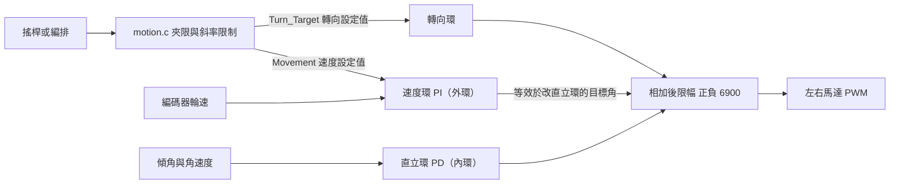

「串級控制（cascade control）」是指**外環的輸出當成內環的目標值**。圖上看起來三個輸出只是「相加」，為什麼還叫串級？下面列完公式後會用一行代數說明（看「相加為什麼等於串級」）。

| 環 | 控制什麼 | 型式 | 參數（`params.c` 預設） |
|---|---|---|---|
| 直立環 | 讓車身維持直立 | PD | `BAL_KP` 22500、`BAL_KD` 108 |
| 速度環 | 讓車速等於目標速度（不亂跑） | PI | `VEL_KP` 16000、`VEL_KI` 80 |
| 轉向環 | 左右輪差速轉彎 | P（+ 前進時的陀螺阻尼 D） | `TURN_KP` 4200、`TURN_KD` 0 |

係數都是「放大 100 倍」的尺度（程式裡會 `/ 100`），這是原廠的寫法。

#### 公式（直接來自 `control.c`）

**直立環**（`Balance()`）：

```
balance = Balance_Kp / 100 × (Angle − Middle_angle) + Balance_Kd / 100 × Gyro
```

`Middle_angle` 是機械零點（參數 `ZERO_ANGLE`），`Gyro` 是平衡軸角速度原始值。
範例：車身比零點前傾 2°、角速度 0：`balance = 225 × 2 = 450`（PWM 計數，約 450 / 7200 ≈ 6% 工作週期），正值 = 輪子往前追。若同時以 100 LSB（約 6.1 °/s）往前倒，再加 `1.08 × 100 = 108` → 558，倒得越快、追得越用力，這就是 D 項的「阻尼」作用。

**速度環**（`Velocity()`）：

```
Encoder_Least    = 0 − (encoder_left + encoder_right)
Encoder_bias     = 0.84 × Encoder_bias + 0.16 × Encoder_Least     // 一階低通濾波
Encoder_Integral = Encoder_Integral + Encoder_bias + Movement     // 限幅 ±10000，停機時清零
velocity         = −Encoder_bias × Velocity_Kp / 100 − Encoder_Integral × Velocity_Ki / 100
```

穩態時積分不再變化，代表 `Encoder_bias + Movement = 0`，也就是「兩輪 5 ms 計數和 = Movement」——車速剛好等於目標速度。

一個常讓初學者困惑的地方：**想讓平衡車減速，要先讓輪子「更快」往前**。因為輪子往前衝，車身才會往後仰，直立環再把輪子往後拉，整台車才慢下來。速度環的輸出正是透過「改變車身該傾斜的角度」來控制車速，所以它的符號看起來是「正回饋」。同理，**平衡車要先前傾才會加速**。

**轉向環**（`Turn()`）：

```
Turn_Target = tgt_turn × 0.001 × Max_Turn                         // 由 motion.c 換算
turn_pwm    = Turn_Target × Turn_Kp / 100 + gyro_z × Kd / 100       // Kd 只在 |目標速度| > 20 mm/s 時作用
Motor_Left  = balance + velocity + turn_pwm
Motor_Right = balance + velocity − turn_pwm                         // 兩者再各自限幅 ±6900
```

範例：搖桿全右、中速檔（轉向 × 0.75）→ `tgt_turn = 750 ‰` → `Turn_Target = 0.75 × 40 = 30` → `turn_pwm = 30 × 42 = 1260`：左輪加 1260、右輪減 1260，車子順時針轉。

#### 相加為什麼等於串級

把直立環和速度環的輸出加起來（先不看 D 項）：

```
balance + velocity = Balance_Kp / 100 × (Angle − Middle_angle) + velocity
                   = Balance_Kp / 100 × (Angle − (Middle_angle − Δθ))
其中 Δθ = velocity × 100 / Balance_Kp
```

也就是說，速度環的輸出**等於把直立環要維持的目標角度移動了 Δθ**。數字範例：速度環輸出 `velocity = 225`，`Δθ = 225 × 100 / 22500 = 1°`——效果跟「叫直立環改成維持一個差 1° 的角度」完全一樣。車身於是往某一邊傾斜，輪子為了不讓車倒而往那邊追，車速就改變了。

外環（速度環）決定內環（直立環）的目標角度，這就是串級；程式寫成直接相加，只是實作上的簡化（少一次乘除），數學上是同一件事。這也解釋了上面速度環提到的「想減速要先讓輪子往前衝」：要改變車速，必須先改變車身的傾角。轉向環則不一樣：它對左右輪一加一減，只改兩輪的差速，不影響前後平衡，是獨立並聯的一環。

#### 為什麼保留原廠參數與演算法

- 原廠係數是針對這台車的重量、重心、馬達、輪徑調過的；重新調參既花時間又有風險。
- 我們真正需要改的只是「**設定值從哪裡來**」：原本是藍牙 APP 的離散旗標（前 / 後 / 左 / 右），現在換成 App 傳來的連續速度與轉向。
- 所以 `Balance()`、`Velocity()`、`Turn()` 的結構與係數完全保留，只把設定值改成 `Motion_Movement()`、`Motion_TurnTarget()`。所有係數仍然開放在 App 即時整定（README 有建議的整定順序）。


#### 斜率限制（加速度限制）：平順、不暴衝

App 的搖桿值可能瞬間從 0 跳到 500 mm/s，直接丟給速度環，車子會猛然一抖。**斜率限制（slew rate limit）**：`Motion_Tick()` 每 10 ms 只讓目標值往設定值移動一小步（`slew()`）；對速度而言，就是限制加速度。速度和轉向各有一個獨立的上限：

```
速度每週期最大變化 = Accel_Limit × 0.01 s        （ACCEL 預設 2000 mm/s² → 每 10 ms 20 mm/s）
轉向每週期最大變化 = Turn_Accel_Limit × 0.01 s   （TURN_ACCEL 預設 12000 ‰/s → 每 10 ms 120 ‰）
```

所以 0 → 500 mm/s 需要 250 ms；轉向 0 → 1000 ‰ 約 83 ms。這段時間是**刻意加上的「反應」**，不是通訊延遲。想要起步更快就把 `ACCEL` 調大（上限 6000）。

#### 從搖桿到馬達：一個完整範例

使用者把 360° 搖桿**往正前方推一半**，中速檔，`MAX_SPEED` = 500 mm/s：

| 步驟 | 在哪裡 | 計算 | 結果 |
|---|---|---|---|
| 1. 死區 6% 並重新縮放 | App `analogStickMap()` | (0.5 − 0.06) / (1 − 0.06) | 0.468 |
| 2. expo 曲線（設定預設 0.35） | `curve()`：(1 − e) × a + e × a³ | 0.65 × 0.468 + 0.35 × 0.468³ | 0.340 |
| 3. 檔位 × 最高車速 | `DriveController` | 0.340 × 0.60 × 500 | **102 mm/s** |
| 4. 送出 CTRL | App 傳送執行緒 | speed = 102、turn = 0 | 12 bytes |
| 5. 夾限 | STM32 `Motion_Tick()` | `clampf(102, −500, 500)` | 102 |
| 6. 斜率限制 | `slew()`，每 10 ms 最多 20 | 20 → 40 → … → 102 | 6 個週期（60 ms）到達 |
| 7. 換算速度環設定值 | `Motion_Movement()` | 102 / 13.49 | 每週期 Movement ≈ 7.6 |

expo（指數曲線）的作用：搖桿小幅度時輸出更小、更細膩，推到底仍是 100%。`13.49` 是 `MMPS_PER_MOVEMENT`：兩輪 5 ms 計數和每 1 單位 = 13.49 mm/s（= 單輪 27 mm/s ÷ 2）。

#### 動作編排引擎：在車上執行

動作編排（例如「搖擺舞」「八字繞行」）**在 STM32 上執行**，而不是手機每 20 ms 送一個值。理由：時間由 10 ms 控制週期精準保證，不受手機排程與 Wi-Fi 抖動影響。

- 最多 48 步（`SEQ_MAX_STEPS`），每步 8 bytes：`i16 speed, i16 turn, u16 dur_ms, u8 mode, u8 period`。
- 四種模式：HOLD 定值、SINE_TURN（轉向 = turn × sin(2πt/P)）、SINE_SPEED（速度 = speed × sin(2πt/P)）、RAMP（從上一步結束值線性漸變）。正弦週期單位 20 ms（1–255 → 20 ms–5.1 s）。
- 正弦用拋物線近似（`sin_turns()`，誤差 < 0.1%），避免連結整套數學函式庫。
- 上傳可以分批：一幀 payload 最多 200 bytes，`SEQ_LOAD` 一批最多 24 步（3 + 24 × 8 = 195 bytes）。
- 播放中仍經過斜率限制；推搖桿超過 30 mm/s 或 50 ‰ 就判定為**手動接管**，中止編排。失聯、馬達停止也會中止。

範例：SINE_TURN、turn = 600、period = 50（1 s），在 t = 250 ms 時：600 × sin(2π × 0.25) = **600 ‰**；t = 750 ms 時 = −600 ‰，車子左右搖擺。


### 3.3 ESP-01 韌體架構

#### 程式組織：把「純邏輯」和「Arduino」分開

| 檔案 | 責任 | 依賴 Arduino？ |
|---|---|---|
| `B570_Bridge.ino` | setup / loop、Wi-Fi、UDP、UART、OTA 的接線 | 是 |
| `b570_proto.h` | CRC、組幀、解析器、TYPE 路由 | 否 |
| `b570_session.h` | Session 擁有權 | 否 |
| `b570_wificfg.h` | SSID / 密碼規則、EEPROM 紀錄、選頻 | 否 |
| `b570_sta.h` | 熱點模式的帳密規則與 payload 編碼 | 否 |
| `b570_netsm.h` | 熱點模式狀態機 | 否 |
| `b570_uarttx.h` | 不阻塞的 UART 傳送佇列 | 否 |
| `b570_preset.h` | 燒錄時內建熱點 | 否 |

`.ino` 只負責把硬體事件「餵」給這些純 C++ 模組，所有決策邏輯都在可以於電腦上測試的標頭檔裡（3.5 節）。這是很值得學的**可測試性設計**。

#### 不阻塞的 loop

`loop()` 每圈依序：收 UDP → 收 UART → 補寫 UART 佇列 → 檢查 session 逾時 → LINK（每 500 ms 或狀態改變）→ 熱點狀態機（每 20 ms，`NET_POLL_MS`）→ NET（每 2 s）→ 開機 1 s 後送 CRED → 延後重開機 → OTA（每 20 ms）。全部是 `millis()` 比較，沒有 `delay()`。

會阻塞的 Wi-Fi 操作（`WiFi.mode()` 約 100 ms、STA 掃描）只在「沒有 session、AP 上沒有手機」時進行；開機的選頻掃描（最多 1.5 s）只在 `setup()` 裡、還不可能有人連線時做。

#### EEPROM 紀錄 v2

ESP8266 沒有真正的 EEPROM，Arduino 的 `EEPROM` 函式庫是用一塊 Flash 模擬的（這裡用 256 bytes，`EEPROM_SIZE`）。

| 位移 | 內容 |
|---|---|
| 0 | `u32 magic` = 0xB5701A5A |
| 4 | `u8 version` = 2 |
| 5 / 6 | `u8 ssid_len` / `ssid[12]`（車子 AP 名稱） |
| 18 / 19 | `u8 pw_len` / `pw[16]`（AP 密碼） |
| 35 | `u8 channel`（0 = 自動） |
| 36 | `u8 sta_enabled`（熱點模式） |
| 37 / 38 | `u8 sta_ssid_len` / `sta_ssid[32]` |
| 70 / 71 | `u8 sta_pw_len` / `sta_pw[63]` |
| 134 | `u16 crc16(0..133)` |
| 248–253 | 內建熱點套用紀錄：`u32 "PSET"`、`u8 id`、`u8 ~id` |

- v1（韌體 1.0，38 bytes）的前 36 bytes 跟 v2 相同，讀到 v1 會沿用 AP 帳密、熱點模式關閉——**升級韌體不會換掉車子的 Wi-Fi 密碼**，使用者不用重新配對。
- AP 部分壞掉 = 整筆無效，重新產生出廠帳密；CRC 對但熱點欄位不合法，只清熱點設定。
- `EEPROM.commit()` 內容沒變就不寫 Flash，減少 Flash 磨損。
- `WiFi.persistent(false)`：不讓 SDK 自己把設定寫進它的 Flash 區，所有設定都由我們的紀錄管理。

#### OTA 無線更新

- 用 ArduinoOTA；主機名稱 = 車子 SSID 轉小寫（`_` 換成 `-`，例如 `b570-a1b2`），密碼 = 車子 Wi-Fi 密碼。
- 1 MB Flash 規劃成「程式 + OTA 暫存」，OTA 上限約 502 KB，目前韌體約 332 KB。
- 開始更新時（`onStart`）：先結束 session、送 `LINK 0` 給 STM32（STM32 會進入失聯保護）、把 UART 佇列送完，因為更新期間 `ArduinoOTA.handle()` 會阻塞。

### 3.4 Android App 架構

#### 技術選擇

| 項目 | 選擇 | 理由 |
|---|---|---|
| 語言 | Kotlin 2.0.21 | Android 官方首選、協程好寫 |
| UI | Jetpack Compose（BOM 2024.12.01，Material3） | 遙控器、儀表、曲線都是自訂繪圖，宣告式 UI 好維護 |
| 架構 | MVVM（`AppViewModel` → `CarRepository` → `CarLink`） | 畫面與連線分離，畫面旋轉 / 重建不斷線 |
| QR 掃描 | CameraX + ML Kit Barcode（內建模型，離線可用） | 不用網路、辨識快 |
| 最低版本 | **minSdk 29（Android 10）** | `WifiNetworkSpecifier` 從 API 29 才有，「不打斷上網」的核心依賴它 |
| 目標版本 | targetSdk 35 | |

#### 分層

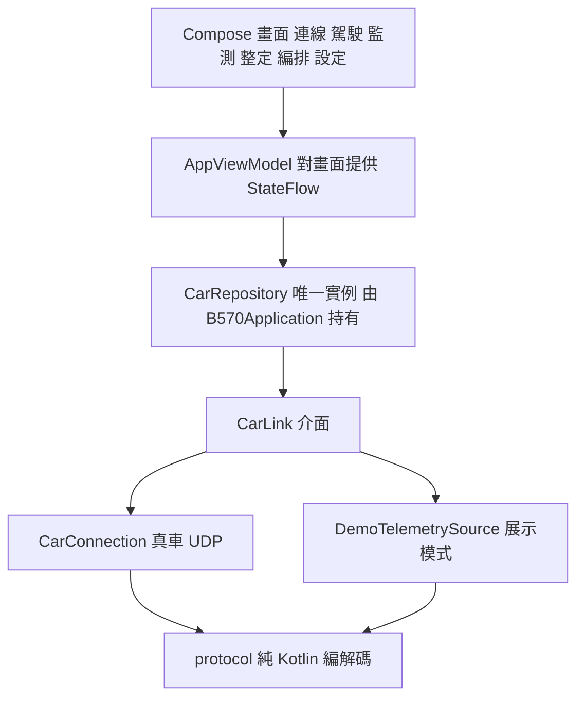

- `CarRepository` 放在 `Application` 裡，生命週期比任何畫面都長：畫面旋轉、Activity 重建都不會斷線。
- 展示模式（不需要車子）也走**同一條**解碼路徑：`DemoTelemetrySource` 產生真正的協定幀，連參數夾限、馬達運轉中不能存檔等規則都比照韌體。
- `protocol/` 是純 Kotlin、沒有 Android 依賴，可以直接在 JVM 上單元測試、重現 PROTOCOL.md 的測試向量。

#### 執行緒與協程

| 誰 | 在哪裡執行 | 做什麼 |
|---|---|---|
| 畫面、觸控 | 主執行緒 | 搖桿回呼**同步**寫入 `setControl()`（一個原子整數），不經協程、不 debounce |
| `B570-tx` | 專用執行緒，`THREAD_PRIORITY_URGENT_AUDIO` | 每 20 ms 絕對時間刻度：先送 CTRL，再送 PING / ESP_PING / WIFI_GET 與排隊的請求；所有 socket 寫入都在這裡 |
| `B570-rx` | 專用執行緒，同上優先權 | 收 datagram、解析、量測控制延遲（以收到那一刻為準） |
| 熱點找車、熱點看門狗 | 協程（`Dispatchers.IO`） | DISCOVER 廣播、介面監看 |
| 可靠請求 | 協程（suspend 函式） | `Mutex` 序列化、逾時重送 |

遙測約 50 Hz 進來，`AppViewModel` 另外提供節流版 `telemetrySlow`（≤ 10 Hz）給一般文字；曲線直接讀 60 秒的環形緩衝（`TelemetryHistory`，3000 筆），不觸發畫面重組。這些效能規則寫在 [ARCHITECTURE.md](../AndroidApp/ARCHITECTURE.md) §0。

#### 權限

| Android 版本 | 連線需要的執行期權限 | 說明 |
|---|---|---|
| 13 以上（API 33+） | `NEARBY_WIFI_DEVICES`（宣告 `neverForLocation`） | 「附近裝置」，不讀位置 |
| 10–12（API 29–32） | `ACCESS_FINE_LOCATION` + `ACCESS_COARSE_LOCATION` | 系統規定連 Wi-Fi 裝置要位置權限 |
| 全部 | `CAMERA` | 掃 QR |

熱點模式只在手機網路上廣播、不用 `WifiNetworkSpecifier`，所以 App 判斷「這次會先在熱點上找」時就不檢查 Wi-Fi 與這些權限。

#### QR 掃描

CameraX 的 `ImageAnalysis`（1280 × 720、`STRATEGY_KEEP_ONLY_LATEST`：處理不及就丟舊畫面，永遠分析最新的一張）→ ML Kit 只找 `FORMAT_QR_CODE` → `WifiCredentials.parseCarQr()` 解析並套用 1.3 節的 SSID / 密碼規則（不是 B570 的 QR 會顯示原因）。

#### 安全：多視窗、背景、畫面被蓋住

手機上什麼事都可能發生：通知欄被拉下、電話打來、分割畫面、App 被切到背景。原則是「**有任何疑慮，控制量先歸零**」：

- `MainActivity.onStop()`（退到背景）與 `onWindowFocusChanged(false)`（失去焦點）→ `vm.stopControl()`。
- `configChanges` 包含旋轉、分割畫面調整大小等，**不重建 Activity**，進行中的連線與手勢不中斷。
- 駕駛畫面被 QR 掃描覆蓋、切到別的分頁、打開滑入式選單時，搖桿停用並送 (0, 0)；恢復後要**重新按下**才會再送。
- 退到背景後連線不會主動中斷，傳送執行緒照樣送 `(0, 0)` 心跳（只要系統沒有暫停 App），車子原地平衡；如果整個 App 被系統殺掉或暫停，就靠 STM32 的 400 ms 失聯保護。

完整的「安全不變式」與對應的自動化測試，見 [ARCHITECTURE.md](../AndroidApp/ARCHITECTURE.md) §11.6。

### 3.5 測試策略

嵌入式系統最難測的是「要接上真硬體才能跑」。我們的策略是：**把邏輯跟硬體拆開，邏輯全部在電腦上測**；真正需要實車的項目（馬達方向、供電、各廠牌手機）另外列清單。

| 測試 | 怎麼跑 | 測什麼 | 為什麼這樣設計 |
|---|---|---|---|
| STM32 韌體邏輯 | `bash tools/fw_host_test/run.sh` | 把**真的** `proto.c`、`rc_link.c`、`motion.c`、`params.c` 跟假 HAL（假 UART、假 DMA、假 Flash，`tools/fw_host_test/stub/`）一起用 gcc 編譯 | 測的就是會燒進晶片的那份程式碼，不是另寫一份模型 |
| ESP-01 | `bash tools/esp_host_test/run_tests.sh` | 純 C++ 標頭檔在電腦上編譯，跑數千項檢查 | 3.3 節的「純邏輯分離」讓這件事變得可能 |
| 差分比對 | 由 `tools/esp_host_test/run_tests.sh` 自動呼叫 `tools/esp_host_test/gen_fuzz.py`、`gen_sta.py` 產生資料，再交給 C++ 測試 | 用 `tools/b570_proto.py` 產生隨機資料串與期望結果，C++ 解析器必須逐位元組一致 | 兩份獨立實作互相檢查，抓出規格理解的落差 |
| 狀態機參考模型 | 同上（`tools/esp_host_test/test_main.cpp` 的 `testNetSm()`） | 熱點狀態機在隨機情境下與一份簡化的參考模型比對每一步的動作 | 時間相關的邏輯最容易出錯，用另一種寫法交叉驗證 |
| UART 模擬 | 同上（`testUplinkLatency()`） | 以 43.4 µs / byte、128 bytes FIFO 模擬 ESP → STM32 的實際流量 | 量出 1.8 節的延遲數字 |
| Android | 在 `AndroidApp/` 執行 `./gradlew test` | 340 項 JVM 單元測試（協定向量、解析器、QR、`ControlPacer`、控制延遲…）；Robolectric 在 JVM 上跑真的 Compose 駕駛畫面測多點觸控與歸零（`DriveMultiTouchTest`） | 不需要模擬器或手機 |
| 協定測試向量 | `python tools/b570_proto.py vectors` | 印出全部向量，並自我檢查 CRC、解析器（雜訊 + 黏在一起 + 拆開）與控制延遲公式 | 三端（STM32、ESP、App）的測試都重現同一組向量，互相對照 |

韌體邏輯測試的項目包括：ESP 帳密與 LINK、參數夾限與整數四捨五入、存檔 / 重新載入 / 毀損復原、馬達啟動條件、斜率限制、失聯保護、編排分批 / 播放 / 接管、正弦 / 漸變、緊急停止、雜訊復原、SEQ 回覆與重送去重、IDLE 中斷失效時的輪詢、舊版參數升級、遲到的 DMA 半滿回呼……（`tools/fw_host_test/test_fw.c`）。

另外每一輪大改版都做過「對抗式審查」：從幾個面向獨立找問題，每個問題再由兩位反駁者驗證，確認的問題全部修正並補上測試（[README](../README.md) 驗證紀錄）。

> 給你的建議：自己改程式時，先在電腦上跑 `bash tools/fw_host_test/run.sh`、`bash tools/esp_host_test/run_tests.sh`、`python tools/b570_proto.py vectors` 這三組測試（改了 App 再加跑 `./gradlew test`），全部通過再燒錄。新功能也照這個模式：先把邏輯寫成「時間和輸入由外部餵入」的純函式，再接上硬體。

---

## 4. 選型與設計決策總表

### 4.1 決策總表

| 決策 | 選擇 | 替代方案 | 理由 |
|---|---|---|---|
| 無線技術 | Wi-Fi | 藍牙、BLE、nRF24、4G | ESP-01 只有 Wi-Fi；手機原生；延遲低 |
| 傳輸協定 | UDP | TCP、WebSocket、MQTT | 遙控指令是狀態，掉包不必重傳；無隊頭阻塞、無連線建立 |
| 可靠性 | 應用層：只對請求做逾時重送 + SEQ 去重 | 全部可靠傳輸 | 只花在需要的地方；重送不會讓指令重複執行 |
| 幀格式 | 二進位、SOF + LEN + TYPE + SEQ + CRC16 | JSON、文字指令 | 小（CTRL 只有 12 bytes）、好解析、UART 與 UDP 共用 |
| 檢查碼 | CRC-16/CCITT-FALSE | 加總、CRC-8、CRC-32 | 偵錯能力與成本平衡；標準演算法，各語言都好實作 |
| 位元組順序 | little-endian | big-endian | STM32、ESP8266 原生；C 可直接 `memcpy` |
| 路由 | TYPE 分區、ESP 原封轉送 | ESP 解析後重新編碼 | ESP 工作量最小；新增訊息不必改 ESP |
| 手機連線 | `WifiNetworkSpecifier`（本地網路） | 叫使用者到系統設定連、`bindProcessToNetwork` | 行動數據照常；只影響一個 socket |
| 第二種連線 | 熱點模式（ESP 當 STA） | 經雲端伺服器 | 手機 Wi-Fi 可關、延遲最低、不需要伺服器 |
| 配對 | OLED 動態 QR（標準 `WIFI:` 格式） | 印貼紙、手動輸入 | 改密碼自動更新；手機相機也認得 |
| 密碼 | 每台車隨機 8 碼、去掉易混淆字元 | 固定密碼 | 鄰近的車互不干擾；看得清楚 |
| 頻道 | 開機掃描，1 / 6 / 11 擇優 | 固定頻道 | 避開擁擠頻道 |
| 失聯處理 | 400 ms 目標平順歸零、原地平衡 | 直接斷電 | 斷電平衡車會倒 |
| 緊急停止 | UART 中斷內立即斷電 + App 重送到確認 | 等下一個控制週期 | 最短的停止路徑；不怕單一封包遺失 |
| UART 鮑率 | 230400 | 38400、115200、921600 | TELEM 2.1 ms 傳完，誤差 0.1%；再快對總延遲幫助很小 |
| UART 接收 | 環形 DMA + IDLE + 每 10 ms 輪詢 | 逐 byte 中斷 | CPU 負擔小；最壞延遲有上限（10 ms） |
| 控制節拍 | MPU6050 INT（200 Hz）驅動 | 定時器中斷 | 取樣與控制嚴格同步 |
| 控制演算法 | 保留原廠三環與係數 | 重寫（LQR 等） | 原廠已調好；只換設定值來源 |
| 平順化 | 速度與轉向的斜率限制（`ACCEL`、`TURN_ACCEL`） | 不限制 | 不暴衝；參數可調 |
| 動作編排 | 在車上執行 | 手機逐點送 | 時間精準、不受 Wi-Fi 抖動影響 |
| 參數儲存 | STM32 Flash 最後一頁 + CRC + 版本 | 外接 EEPROM | 不用加零件；可升級舊存檔 |
| 姿態演算法 | 三種可選，預設卡爾曼 | 只留一種 | 原廠就有三種，保留讓使用者實際比較；切換需存檔並重開機 |
| 主控 | 保留 STM32F103C8T6 | 換更強的 MCU | 資源足夠（Flash 60.5 / 63 KB、RAM 6.2 / 20 KB） |
| 無線模組 | ESP-01 | ESP32-C3、HC-05、BLE 模組 | 最便宜、最小、支援 OTA |
| App | Kotlin + Compose、MVVM、minSdk 29 | Flutter、網頁 App | `WifiNetworkSpecifier` 等原生 API 直接可用 |
| 上行防堆積 | `ControlPacer` + 小傳送緩衝 | 固定 50 Hz | 避免手機裡排隊造成數秒延遲 |
| 延遲量測 | 遙測回聲 `ctrl_seq` / `ctrl_age` | 只看 PING | 量到真正的「指令被套用」時間，能分段診斷 |
| 測試 | 真實程式碼 + 假 HAL、差分比對、參考模型 | 只在實車上測 | 快、可重複、能測到罕見情況 |

### 4.2 可以怎麼升級

| 方向 | 做法 | 會得到什麼 | 要注意 |
|---|---|---|---|
| 換 ESP32-C3 | 同樣 UART 接 STM32，韌體移植 `b570_*.h`（本來就不依賴 Arduino） | 可加 BLE 配對、更大 RAM 與頻寬；協定與 App 幾乎不用改 | 模組腳位與尺寸不同，要重新接線與供電；`.ino` 裡的 Wi-Fi、OTA、EEPROM 呼叫要改用 ESP32 版的 API；改完要重跑 ESP 主機端測試 |
| BLE 控制 | 在 ESP32-C3 上提供 GATT 服務，幀格式不變 | 不用開 Wi-Fi 也能控制 | 延遲受連線間隔影響，要實測 |
| 遠端控制 | 加一台轉送伺服器（手機 ⇄ 伺服器 ⇄ 車上的熱點手機或 4G 模組） | 不在同一個地方也能控制 | 延遲大且變動，失聯保護、加密與身分驗證都要重新設計 |
| STM32 無線更新 | 把 STM32 的 BOOT0 / NRST 接到 ESP 的 GPIO，由 ESP 讓 STM32 進入內建開機程式、透過 UART 燒錄 | 從 App 更新主控韌體 | ESP-01 只有 2 支 GPIO，而且開機時必須是高電位 |
| 協定加上驗證 | 在 payload 加訊息驗證碼（MAC，例如 HMAC；和網卡的 MAC 位址無關） | 防止同網段的其他裝置偽造指令 | 要管理金鑰；ESP 仍然只轉送，不必改 |
| 硬體看門狗 | 啟用 STM32 的獨立看門狗（IWDG） | 程式當機時自動重開 | 寫 Flash 停頓 20–40 ms，逾時要抓夠 |
| 更進階的控制 | 用 LQR 或模型預測控制取代 PID | 更好的響應 | 需要車子的物理模型；先用遙測資料辨識 |

---

## 附錄 A 常數速查表

| 常數 | 值 | 位置 |
|---|---|---|
| UDP 埠 / AP 位址 | 8888 / 192.168.4.1 | `B570_Bridge.ino`（`UDP_PORT`）、`CarConnection.kt` |
| UART 鮑率 | 230400 8N1 | `Core/Src/usart.c`、`B570_Bridge.ino`（`LINK_BAUD`） |
| 最長 payload / 幀 | 200 / 207 bytes | `proto.h`（`PROTO_MAX_PAYLOAD`） |
| 控制週期 | 10 ms（MPU6050 200 Hz 中斷每兩次一次） | `control.c` |
| STM32 RX DMA / TX 佇列 | 256 / 512 bytes | `rc_link.c` |
| 去重時間窗 | 150 週期 = 1.5 s | `rc_link.c`（`is_retry()`） |
| ESP session 逾時 | 1500 ms | `b570_session.h` |
| LINK / NET 週期 | 500 ms / 2000 ms | `B570_Bridge.ino` |
| ESP 設定變更後重開 | 500 ms | `RESTART_DELAY_MS` |
| ESP UART RX 緩衝 / TX 佇列 | 1024 / 1024 bytes | `UART_RX_BUFFER`、`UART_TX_RING` |
| App 傳送刻度 | 20 ms | `PERIOD_NS` |
| CTRL 頻率 | 50 Hz（操作中）/ 10 Hz（靜止）/ ≤ 16 Hz（壅塞） | `ControlPacer.kt` |
| PING / ESP_PING / WIFI_GET | 500 ms / 2 s / 3 s | `CarConnection.kt` |
| 請求逾時與重送 | 400 ms，最多重送 3 次（共 4 次，最長 1.6 s） | `REQ_TIMEOUT_MS`、`REQ_RETRIES` |
| App 失聯判定 | 1 s 開始重送 HELLO、1.5 s LinkLost | `HELLO_RESEND_NS`、`LINK_LOST_NS` |
| 自動重連間隔 | 1.5 / 3 / 5 / 8 / 12 / 15 s（6 次，約 45 s） | `data/QuickConnect.kt` |
| `FAILSAFE_MS` | 400 ms（150–2000） | `params.c`（參數 11） |
| `TELEM_HZ` | 50 Hz（10–100） | 參數 12 |
| `ACCEL` / `TURN_ACCEL` | 2000 mm/s² / 12000 ‰/s | 參數 9、10 |
| `MAX_SPEED` / `MAX_TURN` | 500 mm/s / 40 | 參數 7、8 |
| `FALL_ANGLE` / `LOWBAT_V` | 40° / 10.0 V | 參數 16、15 |
| 參數 Flash 位址 | `0x0800FC00` | `params.h` |
| PWM 頻率 / 上限 | 10 kHz / 6900（週期 7200） | `tim.c`、`control.h` |
| 熱點加入上限 / 斷線改 AP | 12 s / 15 s | `b570_netsm.h` |
| 熱點重試閒置時間 | 6 s（快速期）、第一次 12 s、之後 30 s | `b570_netsm.h` |
| 版本 | STM32 fw 2.1.0、ESP-01 1.1.1、協定 v1 | `app_config.h`、`B570_Bridge.ino` |

規格與程式有出入時，以 [PROTOCOL.md](PROTOCOL.md) 為準並同步修正；這份文件的數字若與程式碼不同，請以程式碼為準並回報。
